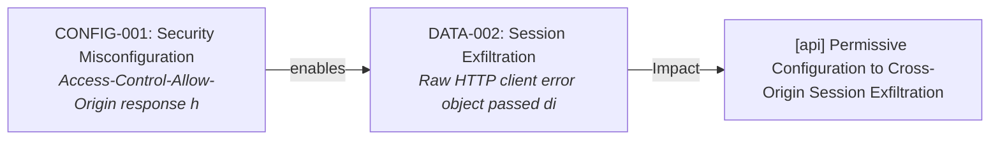
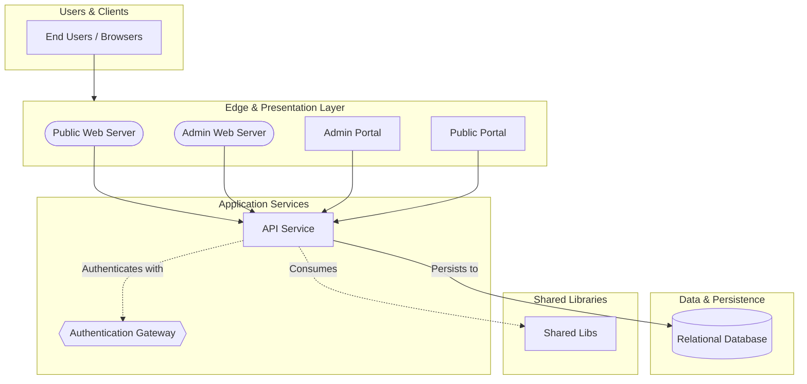

# Security Assessment: bcgov/nr-fom

Commit: `add5cf51f467720790da2333397d57473f70a998`

Generated by `scripts/compile-findings.py` + `scripts/render-report.py` (scripted findings; not Copilot-authored).

## Executive summary

51 open finding(s) (Critical 0, High 4, Medium 43, Low 4); 2 confirmed-fixed. Top findings: CICD-001 (High), CICD-010 (High), CICD-012 (High), CICD-014 (High), CICD-002 (Medium). Coverage gaps: GitHub's own alert list was not read (dependabot: HTTP 403 or unavailable). Public scanner proxy used instead.; GitHub's own alert list was not read (code-scanning: HTTP 403 or unavailable). Public scanner proxy used instead.; GitHub's own alert list was not read (secret-scanning: HTTP 403 or unavailable). Public scanner proxy used instead.. VEX analysis: 2/6 dependency CVEs reachable in source. Correlated 1 exploit attack chain(s). Score is written separately by score.py.

## Scope table

| Chapter | Status | Findings |
|---|---|---|
| architecture | analyzed | 0 |
| cicd | analyzed | 14 |
| zero-trust | analyzed | 8 |
| authn | analyzed | 1 |
| authz | analyzed | 0 |
| injection | analyzed | 10 |
| configuration | analyzed | 1 |
| cryptography | analyzed | 2 |
| secrets | analyzed | 0 |
| logging-data | analyzed | 11 |
| code-scanning | analyzed | 20 |
| secret-scanning | analyzed | 0 |
| dependabot | analyzed | 6 |
| dependencies | analyzed | 6 |
| containers-iac | analyzed | 8 |
| testing | analyzed | 0 |
| stack | analyzed | 0 |

## Severity totals

| Severity | Count |
|---|---|
| Critical | 0 |
| High | 4 |
| Medium | 43 |
| Low | 4 |

| Domain | Findings |
|---|---|
| CICD | 14 |
| CONFIG | 1 |
| CRYPTO | 1 |
| DATA | 11 |
| DEPS | 6 |
| INFRA | 8 |
| INJ | 10 |

## OWASP Top 10 (2021)

| Category | Findings |
|---|---|
| A01 Broken Access Control | CRYPTO-002 |
| A02 Cryptographic Failures | none |
| A03 Injection | CICD-001 |
| A04 Insecure Design | none |
| A05 Security Misconfiguration | none |
| A06 Vulnerable and Outdated Components | INJ-005, DEPS-001 |
| A07 Identification and Authentication Failures | none |
| A08 Software and Data Integrity Failures | DEPS-002 |
| A09 Security Logging and Monitoring Failures | DATA-001, DATA-002, DATA-003, DATA-004, DATA-005, DATA-006, DATA-007, DATA-008, DATA-009, DATA-010, DATA-011 |
| A10 Server-Side Request Forgery | none |

## Component risk ranking

1. `root` — Risk Score: 48 (20 finding(s): CICD-001, CICD-010, CICD-012, CICD-014, CICD-002)
2. API Service (`api`) — Risk Score: 26 (13 finding(s): CONFIG-001, CRYPTO-002, DATA-002, DATA-003, DATA-005)
3. Public Portal (`public`) — Risk Score: 14 (7 finding(s): DATA-010, DATA-011, INFRA-008, INJ-007, INJ-008)
4. Admin Portal (`admin`) — Risk Score: 12 (6 finding(s): DATA-001, INFRA-001, INJ-001, INJ-002, INJ-003)
5. Relational Database (`database`) — Risk Score: 6 (3 finding(s): INFRA-005, INFRA-006, INFRA-007)
6. Authentication Gateway (`auth-gateway`) — Risk Score: 2 (1 finding(s): DATA-004)
7. Shared Libs (`libs`) — Risk Score: 2 (1 finding(s): INJ-006)

## Attack chains (exploit correlation)

Multi-stage exploit paths synthesized across individual scanner and code findings. Remediating earlier stages breaks the attack chain.

### CHAIN-001: [api] Permissive Configuration to Cross-Origin Session Exfiltration

- **Severity:** High
- **Findings involved:** CONFIG-001, DATA-002
- **Narrative:** In component 'api', permissive CORS or cookie misconfigurations in CONFIG-001 allow malicious third-party web origins to read sensitive session data and authentication endpoints referenced in DATA-002.
- **Coordinated Remediation:** Restrict CORS allowed origins and set Secure and SameSite flags on session cookies.

## Tools run

- **semgrep** 1.184.0 — ok; 34 result(s). scanned 659 path(s)
- **gitleaks** gitleaks — ok; 0 result(s). clean scan
- **osv-scanner** osv-scanner — ok; 6 result(s). 6 advisory hit(s)
- **trivy** 0.76.1 — ok; 0 result(s). 0 vuln(s), 0 misconfig(s)
- **dependabot** unknown — failed; 0 result(s). WARN: dependabot unavailable: gh: Resource not accessible by integration (HTTP 403)
- **code-scanning** unknown — failed; 0 result(s). WARN: code-scanning unavailable: gh: Resource not accessible by integration (HTTP 403)
- **secret-scanning** unknown — failed; 0 result(s). WARN: secret-scanning-raw unavailable: gh: Resource not accessible by integration (HTTP 403)

## architecture

Status: analyzed

Public clone layout reviewed via README.md, package.json, bcgovpubcode.yml; monorepo/components inferred from manifests.

### Architecture overview

Discovered components:
- **Public Web Server** (`public-web-server`, type: `ingress`): paths ['public/Caddyfile']
- **Admin Web Server** (`admin-web-server`, type: `ingress`): paths ['admin/Caddyfile']
- **Admin Portal** (`admin`, type: `frontend`): paths ['admin']
- **Public Portal** (`public`, type: `frontend`): paths ['public']
- **API Service** (`api`, type: `api`): paths ['api']
- **Authentication Gateway** (`auth-gateway`, type: `auth-gateway`): paths ['api/src/core/security']
- **Relational Database** (`database`, type: `database`): paths ['api/src/migrations', 'db', 'docker-compose.yml']
- **Shared Libs** (`libs`, type: `library`): paths ['libs']

Chapter write-up: scripted assessment records tool context, citation targets, and per-finding impact when findings exist; clean chapters still document what ran.

- README.md:1
- package.json:1
- bcgovpubcode.yml:1

## cicd

Status: analyzed

Reviewed 8 GitHub workflow file(s) under .github/workflows; 14 supply-chain/workflow finding(s) from scanners.

Chapter write-up: scripted assessment records tool context, citation targets, and per-finding impact when findings exist; clean chapters still document what ran.

- **CICD-001** (High): Using variable interpolation `${{...}}` with `github` context data in a `run:` step could allow an attacker to inject their own code into the runner. This would — impact: Using variable interpolation `${{...}}` with `github` context data in a `run:` step could allow an attacker to inject their own code into the runner. This would
- **CICD-010** (High): This workflow uses `secrets: inherit` to pass all of the calling workflow's secrets to a reusable workflow. This violates the principle of least privilege becau — impact: This workflow uses `secrets: inherit` to pass all of the calling workflow's secrets to a reusable workflow. This violates the principle of least privilege becau
- **CICD-012** (High): This workflow uses `secrets: inherit` to pass all of the calling workflow's secrets to a reusable workflow. This violates the principle of least privilege becau — impact: This workflow uses `secrets: inherit` to pass all of the calling workflow's secrets to a reusable workflow. This violates the principle of least privilege becau
- **CICD-014** (High): This workflow uses `secrets: inherit` to pass all of the calling workflow's secrets to a reusable workflow. This violates the principle of least privilege becau — impact: This workflow uses `secrets: inherit` to pass all of the calling workflow's secrets to a reusable workflow. This violates the principle of least privilege becau
- **CICD-002** (Medium): GitHub Actions step uses a mutable tag or branch reference. Tags and branch names can be silently repointed by the action owner, enabling supply-chain attacks — — impact: GitHub Actions step uses a mutable tag or branch reference. Tags and branch names can be silently repointed by the action owner, enabling supply-chain attacks —
- **CICD-003** (Medium): GitHub Actions step uses a mutable tag or branch reference. Tags and branch names can be silently repointed by the action owner, enabling supply-chain attacks — — impact: GitHub Actions step uses a mutable tag or branch reference. Tags and branch names can be silently repointed by the action owner, enabling supply-chain attacks —
- **CICD-004** (Medium): GitHub Actions step uses a mutable tag or branch reference. Tags and branch names can be silently repointed by the action owner, enabling supply-chain attacks — — impact: GitHub Actions step uses a mutable tag or branch reference. Tags and branch names can be silently repointed by the action owner, enabling supply-chain attacks —
- **CICD-005** (Medium): GitHub Actions step uses a mutable tag or branch reference. Tags and branch names can be silently repointed by the action owner, enabling supply-chain attacks — — impact: GitHub Actions step uses a mutable tag or branch reference. Tags and branch names can be silently repointed by the action owner, enabling supply-chain attacks —
- **CICD-006** (Medium): GitHub Actions step uses a mutable tag or branch reference. Tags and branch names can be silently repointed by the action owner, enabling supply-chain attacks — — impact: GitHub Actions step uses a mutable tag or branch reference. Tags and branch names can be silently repointed by the action owner, enabling supply-chain attacks —
- **CICD-007** (Medium): GitHub Actions step uses a mutable tag or branch reference. Tags and branch names can be silently repointed by the action owner, enabling supply-chain attacks — — impact: GitHub Actions step uses a mutable tag or branch reference. Tags and branch names can be silently repointed by the action owner, enabling supply-chain attacks —
- **CICD-008** (Medium): GitHub Actions step uses a mutable tag or branch reference. Tags and branch names can be silently repointed by the action owner, enabling supply-chain attacks — — impact: GitHub Actions step uses a mutable tag or branch reference. Tags and branch names can be silently repointed by the action owner, enabling supply-chain attacks —
- **CICD-009** (Medium): GitHub Actions step uses a mutable tag or branch reference. Tags and branch names can be silently repointed by the action owner, enabling supply-chain attacks — — impact: GitHub Actions step uses a mutable tag or branch reference. Tags and branch names can be silently repointed by the action owner, enabling supply-chain attacks —
- **CICD-011** (Medium): GitHub Actions step uses a mutable tag or branch reference. Tags and branch names can be silently repointed by the action owner, enabling supply-chain attacks — — impact: GitHub Actions step uses a mutable tag or branch reference. Tags and branch names can be silently repointed by the action owner, enabling supply-chain attacks —
- **CICD-013** (Medium): GitHub Actions step uses a mutable tag or branch reference. Tags and branch names can be silently repointed by the action owner, enabling supply-chain attacks — — impact: GitHub Actions step uses a mutable tag or branch reference. Tags and branch names can be silently repointed by the action owner, enabling supply-chain attacks —

## zero-trust

Status: analyzed

Mapped 8 Critical/High/Medium finding(s) to Verify Explicitly / Least Privilege / Assume Breach themes from scanner output.

Chapter write-up: scripted assessment records tool context, citation targets, and per-finding impact when findings exist; clean chapters still document what ran.

- **CICD-001** (High): Using variable interpolation `${{...}}` with `github` context data in a `run:` step could allow an attacker to inject their own code into the runner. This would — impact: Using variable interpolation `${{...}}` with `github` context data in a `run:` step could allow an attacker to inject their own code into the runner. This would
- **CICD-010** (High): This workflow uses `secrets: inherit` to pass all of the calling workflow's secrets to a reusable workflow. This violates the principle of least privilege becau — impact: This workflow uses `secrets: inherit` to pass all of the calling workflow's secrets to a reusable workflow. This violates the principle of least privilege becau
- **CICD-012** (High): This workflow uses `secrets: inherit` to pass all of the calling workflow's secrets to a reusable workflow. This violates the principle of least privilege becau — impact: This workflow uses `secrets: inherit` to pass all of the calling workflow's secrets to a reusable workflow. This violates the principle of least privilege becau
- **CICD-014** (High): This workflow uses `secrets: inherit` to pass all of the calling workflow's secrets to a reusable workflow. This violates the principle of least privilege becau — impact: This workflow uses `secrets: inherit` to pass all of the calling workflow's secrets to a reusable workflow. This violates the principle of least privilege becau
- **CICD-002** (Medium): GitHub Actions step uses a mutable tag or branch reference. Tags and branch names can be silently repointed by the action owner, enabling supply-chain attacks — — impact: GitHub Actions step uses a mutable tag or branch reference. Tags and branch names can be silently repointed by the action owner, enabling supply-chain attacks —
- **CICD-003** (Medium): GitHub Actions step uses a mutable tag or branch reference. Tags and branch names can be silently repointed by the action owner, enabling supply-chain attacks — — impact: GitHub Actions step uses a mutable tag or branch reference. Tags and branch names can be silently repointed by the action owner, enabling supply-chain attacks —
- **CICD-004** (Medium): GitHub Actions step uses a mutable tag or branch reference. Tags and branch names can be silently repointed by the action owner, enabling supply-chain attacks — — impact: GitHub Actions step uses a mutable tag or branch reference. Tags and branch names can be silently repointed by the action owner, enabling supply-chain attacks —
- **CICD-005** (Medium): GitHub Actions step uses a mutable tag or branch reference. Tags and branch names can be silently repointed by the action owner, enabling supply-chain attacks — — impact: GitHub Actions step uses a mutable tag or branch reference. Tags and branch names can be silently repointed by the action owner, enabling supply-chain attacks —

## authn

Status: analyzed

Authentication file checks and scanner hits: 0 open, 1 confirmed-fixed (AUTH seeds when target is nr-fom).

Chapter write-up: scripted assessment records tool context, citation targets, and per-finding impact when findings exist; clean chapters still document what ran.

- **AUTH-001** (confirmed-fixed)

## authz

Status: analyzed

Automated authz rules, not a full RBAC audit: found 8 NestJS/Express/Django authorization/guard hit(s) under the clone.

Chapter write-up: scripted assessment records tool context, citation targets, and per-finding impact when findings exist; clean chapters still document what ran.

- api/src/app/modules/analytics-dashboard/analytics-dashboard.controller.ts:34
- api/src/app/modules/attachment/attachment.controller.ts:42
- api/src/app/modules/forest-client/forest-client.controller.ts:10
- api/src/app/modules/interaction/interaction.controller.ts:91
- api/src/app/modules/project/project.controller.ts:27

## injection

Status: analyzed

Semgrep 1.184.0 ran with 34 result(s). scanned 659 path(s). 10 injection-domain finding(s) promoted.

Chapter write-up: scripted assessment records tool context, citation targets, and per-finding impact when findings exist; clean chapters still document what ran.

- **INJ-001** (Medium): This link points to a plaintext HTTP URL. Prefer an encrypted HTTPS URL if possible. — impact: This link points to a plaintext HTTP URL. Prefer an encrypted HTTPS URL if possible. CWE: CWE-319
- **INJ-002** (Medium): This link points to a plaintext HTTP URL. Prefer an encrypted HTTPS URL if possible. — impact: This link points to a plaintext HTTP URL. Prefer an encrypted HTTPS URL if possible. CWE: CWE-319
- **INJ-003** (Medium): This link points to a plaintext HTTP URL. Prefer an encrypted HTTPS URL if possible. — impact: This link points to a plaintext HTTP URL. Prefer an encrypted HTTPS URL if possible. CWE: CWE-319
- **INJ-004** (Medium): This link points to a plaintext HTTP URL. Prefer an encrypted HTTPS URL if possible. — impact: This link points to a plaintext HTTP URL. Prefer an encrypted HTTPS URL if possible. CWE: CWE-319
- **INJ-005** (Medium): RegExp() called with a `envName` function argument, this might allow an attacker to cause a Regular Expression Denial-of-Service (ReDoS) within your application — impact: RegExp() called with a `envName` function argument, this might allow an attacker to cause a Regular Expression Denial-of-Service (ReDoS) within your application
- **INJ-006** (Medium): Depending on the context, user control data in `Object.assign` can cause web response to include data that it should not have or can lead to a mass assignment v — impact: Depending on the context, user control data in `Object.assign` can cause web response to include data that it should not have or can lead to a mass assignment v
- **INJ-007** (Medium): This link points to a plaintext HTTP URL. Prefer an encrypted HTTPS URL if possible. — impact: This link points to a plaintext HTTP URL. Prefer an encrypted HTTPS URL if possible. CWE: CWE-319
- **INJ-008** (Medium): This link points to a plaintext HTTP URL. Prefer an encrypted HTTPS URL if possible. — impact: This link points to a plaintext HTTP URL. Prefer an encrypted HTTPS URL if possible. CWE: CWE-319
- **INJ-009** (Medium): This link points to a plaintext HTTP URL. Prefer an encrypted HTTPS URL if possible. — impact: This link points to a plaintext HTTP URL. Prefer an encrypted HTTPS URL if possible. CWE: CWE-319
- **INJ-010** (Medium): This link points to a plaintext HTTP URL. Prefer an encrypted HTTPS URL if possible. — impact: This link points to a plaintext HTTP URL. Prefer an encrypted HTTPS URL if possible. CWE: CWE-319

## configuration

Status: analyzed

Configuration findings from scanners: 1. Public manifests reviewed for CORS/debug/TLS defaults where cited.

Chapter write-up: scripted assessment records tool context, citation targets, and per-finding impact when findings exist; clean chapters still document what ran.

- **CONFIG-001** (Medium): Access-Control-Allow-Origin response header is set to "*". This will disable CORS Same Origin Policy restrictions. — impact: Access-Control-Allow-Origin response header is set to "*". This will disable CORS Same Origin Policy restrictions. CWE: CWE-183

## cryptography

Status: analyzed

Cryptography file checks and scanner hits: 1 open, 1 confirmed-fixed.

Chapter write-up: scripted assessment records tool context, citation targets, and per-finding impact when findings exist; clean chapters still document what ran.

- **CRYPTO-002** (Medium): Detected possible user input going into a `path.join` or `path.resolve` function. This could possibly lead to a path traversal vulnerability,  where the attacke — impact: Detected possible user input going into a `path.join` or `path.resolve` function. This could possibly lead to a path traversal vulnerability,  where the attacke
- **CRYPTO-001** (confirmed-fixed)

## secrets

Status: analyzed

gitleaks gitleaks ran with 0 result(s). clean scan. 0 secret finding(s) promoted.

Chapter write-up: scripted assessment records tool context, citation targets, and per-finding impact when findings exist; clean chapters still document what ran.

- README.md:1

## logging-data

Status: analyzed

Logging/PII semantic and scanner hits: 11. Review checked client error logging and credential leaks.

Chapter write-up: scripted assessment records tool context, citation targets, and per-finding impact when findings exist; clean chapters still document what ran.

- **DATA-001** (Medium): Raw HTTP client error object passed directly to logger — impact: Serializing raw HTTP client error objects directly to logs exposes full request configurations, which frequently contain Authorization headers and Bearer tokens
- **DATA-002** (Medium): Raw HTTP client error object passed directly to logger — impact: Serializing raw HTTP client error objects directly to logs exposes full request configurations, which frequently contain Authorization headers and Bearer tokens
- **DATA-003** (Medium): Raw HTTP client error object passed directly to logger — impact: Serializing raw HTTP client error objects directly to logs exposes full request configurations, which frequently contain Authorization headers and Bearer tokens
- **DATA-004** (Medium): Raw HTTP client error object passed directly to logger — impact: Serializing raw HTTP client error objects directly to logs exposes full request configurations, which frequently contain Authorization headers and Bearer tokens
- **DATA-005** (Medium): Raw HTTP client error object passed directly to logger — impact: Serializing raw HTTP client error objects directly to logs exposes full request configurations, which frequently contain Authorization headers and Bearer tokens
- **DATA-006** (Medium): Raw HTTP client error object passed directly to logger — impact: Serializing raw HTTP client error objects directly to logs exposes full request configurations, which frequently contain Authorization headers and Bearer tokens
- **DATA-007** (Medium): Raw HTTP client error object passed directly to logger — impact: Serializing raw HTTP client error objects directly to logs exposes full request configurations, which frequently contain Authorization headers and Bearer tokens
- **DATA-008** (Medium): Raw HTTP client error object passed directly to logger — impact: Serializing raw HTTP client error objects directly to logs exposes full request configurations, which frequently contain Authorization headers and Bearer tokens
- **DATA-009** (Medium): Raw HTTP client error object passed directly to logger — impact: Serializing raw HTTP client error objects directly to logs exposes full request configurations, which frequently contain Authorization headers and Bearer tokens
- **DATA-010** (Medium): Raw HTTP client error object passed directly to logger — impact: Serializing raw HTTP client error objects directly to logs exposes full request configurations, which frequently contain Authorization headers and Bearer tokens
- **DATA-011** (Medium): Raw HTTP client error object passed directly to logger — impact: Serializing raw HTTP client error objects directly to logs exposes full request configurations, which frequently contain Authorization headers and Bearer tokens

## code-scanning

Status: analyzed

Semgrep 1.184.0 ran with 34 result(s). scanned 659 path(s). Public proxy for GitHub code-scanning until #96. GitHub's own alert list was not read (403/unavailable).

Chapter write-up: scripted assessment records tool context, citation targets, and per-finding impact when findings exist; clean chapters still document what ran.

- **CICD-001** (High): Using variable interpolation `${{...}}` with `github` context data in a `run:` step could allow an attacker to inject their own code into the runner. This would — impact: Using variable interpolation `${{...}}` with `github` context data in a `run:` step could allow an attacker to inject their own code into the runner. This would
- **CICD-010** (High): This workflow uses `secrets: inherit` to pass all of the calling workflow's secrets to a reusable workflow. This violates the principle of least privilege becau — impact: This workflow uses `secrets: inherit` to pass all of the calling workflow's secrets to a reusable workflow. This violates the principle of least privilege becau
- **CICD-012** (High): This workflow uses `secrets: inherit` to pass all of the calling workflow's secrets to a reusable workflow. This violates the principle of least privilege becau — impact: This workflow uses `secrets: inherit` to pass all of the calling workflow's secrets to a reusable workflow. This violates the principle of least privilege becau
- **CICD-014** (High): This workflow uses `secrets: inherit` to pass all of the calling workflow's secrets to a reusable workflow. This violates the principle of least privilege becau — impact: This workflow uses `secrets: inherit` to pass all of the calling workflow's secrets to a reusable workflow. This violates the principle of least privilege becau
- **CICD-002** (Medium): GitHub Actions step uses a mutable tag or branch reference. Tags and branch names can be silently repointed by the action owner, enabling supply-chain attacks — — impact: GitHub Actions step uses a mutable tag or branch reference. Tags and branch names can be silently repointed by the action owner, enabling supply-chain attacks —
- **CICD-003** (Medium): GitHub Actions step uses a mutable tag or branch reference. Tags and branch names can be silently repointed by the action owner, enabling supply-chain attacks — — impact: GitHub Actions step uses a mutable tag or branch reference. Tags and branch names can be silently repointed by the action owner, enabling supply-chain attacks —
- **CICD-004** (Medium): GitHub Actions step uses a mutable tag or branch reference. Tags and branch names can be silently repointed by the action owner, enabling supply-chain attacks — — impact: GitHub Actions step uses a mutable tag or branch reference. Tags and branch names can be silently repointed by the action owner, enabling supply-chain attacks —
- **CICD-005** (Medium): GitHub Actions step uses a mutable tag or branch reference. Tags and branch names can be silently repointed by the action owner, enabling supply-chain attacks — — impact: GitHub Actions step uses a mutable tag or branch reference. Tags and branch names can be silently repointed by the action owner, enabling supply-chain attacks —
- **CICD-006** (Medium): GitHub Actions step uses a mutable tag or branch reference. Tags and branch names can be silently repointed by the action owner, enabling supply-chain attacks — — impact: GitHub Actions step uses a mutable tag or branch reference. Tags and branch names can be silently repointed by the action owner, enabling supply-chain attacks —
- **CICD-007** (Medium): GitHub Actions step uses a mutable tag or branch reference. Tags and branch names can be silently repointed by the action owner, enabling supply-chain attacks — — impact: GitHub Actions step uses a mutable tag or branch reference. Tags and branch names can be silently repointed by the action owner, enabling supply-chain attacks —
- **CICD-008** (Medium): GitHub Actions step uses a mutable tag or branch reference. Tags and branch names can be silently repointed by the action owner, enabling supply-chain attacks — — impact: GitHub Actions step uses a mutable tag or branch reference. Tags and branch names can be silently repointed by the action owner, enabling supply-chain attacks —
- **CICD-009** (Medium): GitHub Actions step uses a mutable tag or branch reference. Tags and branch names can be silently repointed by the action owner, enabling supply-chain attacks — — impact: GitHub Actions step uses a mutable tag or branch reference. Tags and branch names can be silently repointed by the action owner, enabling supply-chain attacks —
- **CICD-011** (Medium): GitHub Actions step uses a mutable tag or branch reference. Tags and branch names can be silently repointed by the action owner, enabling supply-chain attacks — — impact: GitHub Actions step uses a mutable tag or branch reference. Tags and branch names can be silently repointed by the action owner, enabling supply-chain attacks —
- **CICD-013** (Medium): GitHub Actions step uses a mutable tag or branch reference. Tags and branch names can be silently repointed by the action owner, enabling supply-chain attacks — — impact: GitHub Actions step uses a mutable tag or branch reference. Tags and branch names can be silently repointed by the action owner, enabling supply-chain attacks —
- **CONFIG-001** (Medium): Access-Control-Allow-Origin response header is set to "*". This will disable CORS Same Origin Policy restrictions. — impact: Access-Control-Allow-Origin response header is set to "*". This will disable CORS Same Origin Policy restrictions. CWE: CWE-183
- **CRYPTO-002** (Medium): Detected possible user input going into a `path.join` or `path.resolve` function. This could possibly lead to a path traversal vulnerability,  where the attacke — impact: Detected possible user input going into a `path.join` or `path.resolve` function. This could possibly lead to a path traversal vulnerability,  where the attacke
- **INFRA-001** (Medium): In Kubernetes, each pod runs in its own isolated environment with its own set of security policies. However, certain container images may contain `setuid` or `s — impact: In Kubernetes, each pod runs in its own isolated environment with its own set of security policies. However, certain container images may contain `setuid` or `s
- **INFRA-002** (Medium): In Kubernetes, each pod runs in its own isolated environment with its own set of security policies. However, certain container images may contain `setuid` or `s — impact: In Kubernetes, each pod runs in its own isolated environment with its own set of security policies. However, certain container images may contain `setuid` or `s
- **INFRA-003** (Medium): In Kubernetes, each pod runs in its own isolated environment with its own set of security policies. However, certain container images may contain `setuid` or `s — impact: In Kubernetes, each pod runs in its own isolated environment with its own set of security policies. However, certain container images may contain `setuid` or `s
- **INFRA-004** (Medium): In Kubernetes, each pod runs in its own isolated environment with its own set of security policies. However, certain container images may contain `setuid` or `s — impact: In Kubernetes, each pod runs in its own isolated environment with its own set of security policies. However, certain container images may contain `setuid` or `s

## secret-scanning

Status: analyzed

gitleaks gitleaks ran with 0 result(s). clean scan. Public proxy for GitHub secret-scanning until #96. GitHub's own alert list was not read (403/unavailable).

Chapter write-up: scripted assessment records tool context, citation targets, and per-finding impact when findings exist; clean chapters still document what ran.

- README.md:1

## dependabot

Status: analyzed

osv-scanner osv-scanner ran with 6 result(s). 6 advisory hit(s). Trivy 0.76.1 ran with 0 result(s). 0 vuln(s), 0 misconfig(s). Public proxy for Dependabot until #96. GitHub's own alert list was not read (403/unavailable).

### VEX Reachability Analysis

- Reachable dependency vulnerabilities: 2 (packages: minimatch)
- Unreachable transitive vulnerabilities: 3 (packages: basic-ftp, deepmerge, glob)

Chapter write-up: scripted assessment records tool context, citation targets, and per-finding impact when findings exist; clean chapters still document what ran.

- **DEPS-005** (Medium): minimatch 10.2.6 affected by GHSA-g3hv-75wg-m249 — impact: minimatch has potential denial of service via globparts amplification CWE: CWE-405 Aliases: CVE-2026-118764.
- **DEPS-006** (Medium): minimatch 9.0.9 affected by GHSA-g3hv-75wg-m249 — impact: minimatch has potential denial of service via globparts amplification CWE: CWE-405 Aliases: CVE-2026-118764.
- **DEPS-001** (Low): basic-ftp 5.3.1 affected by GHSA-c475-qrg2-pj4r — impact: basic-ftp: Quadratic-time CPU denial of service in Client.list() Unix directory-listing parser (RE_LINE backtracking) CWE: CWE-1333 Aliases: CVE-2026-102990.
- **DEPS-002** (Low): deepmerge 4.3.1 affected by GHSA-gcqx-w48m-w2h4 — impact: deepmerge mergeObject() allows prototype poisoning of returned objects CWE: CWE-1321 Aliases: CVE-2026-93753.
- **DEPS-003** (Low): glob 10.5.0 affected by GHSA-3g3m-2fjr-6pw4 — impact: Glob: AbortSignal cancellation bypass allows post-timeout filesystem traversal CWE: CWE-400 Aliases: CVE-2026-118773.
- **DEPS-004** (Low): glob 13.0.6 affected by GHSA-3g3m-2fjr-6pw4 — impact: Glob: AbortSignal cancellation bypass allows post-timeout filesystem traversal CWE: CWE-400 Aliases: CVE-2026-118773.

## dependencies

Status: analyzed

osv-scanner osv-scanner ran with 6 result(s). 6 advisory hit(s). Trivy 0.76.1 ran with 0 result(s). 0 vuln(s), 0 misconfig(s). 6 dependency finding(s) promoted after dedupe.

### VEX Reachability Analysis

- Reachable dependency vulnerabilities: 2 (packages: minimatch)
- Unreachable transitive vulnerabilities: 3 (packages: basic-ftp, deepmerge, glob)

Chapter write-up: scripted assessment records tool context, citation targets, and per-finding impact when findings exist; clean chapters still document what ran.

- **DEPS-005** (Medium): minimatch 10.2.6 affected by GHSA-g3hv-75wg-m249 — impact: minimatch has potential denial of service via globparts amplification CWE: CWE-405 Aliases: CVE-2026-118764.
- **DEPS-006** (Medium): minimatch 9.0.9 affected by GHSA-g3hv-75wg-m249 — impact: minimatch has potential denial of service via globparts amplification CWE: CWE-405 Aliases: CVE-2026-118764.
- **DEPS-001** (Low): basic-ftp 5.3.1 affected by GHSA-c475-qrg2-pj4r — impact: basic-ftp: Quadratic-time CPU denial of service in Client.list() Unix directory-listing parser (RE_LINE backtracking) CWE: CWE-1333 Aliases: CVE-2026-102990.
- **DEPS-002** (Low): deepmerge 4.3.1 affected by GHSA-gcqx-w48m-w2h4 — impact: deepmerge mergeObject() allows prototype poisoning of returned objects CWE: CWE-1321 Aliases: CVE-2026-93753.
- **DEPS-003** (Low): glob 10.5.0 affected by GHSA-3g3m-2fjr-6pw4 — impact: Glob: AbortSignal cancellation bypass allows post-timeout filesystem traversal CWE: CWE-400 Aliases: CVE-2026-118773.
- **DEPS-004** (Low): glob 13.0.6 affected by GHSA-3g3m-2fjr-6pw4 — impact: Glob: AbortSignal cancellation bypass allows post-timeout filesystem traversal CWE: CWE-400 Aliases: CVE-2026-118773.

## containers-iac

Status: analyzed

Trivy 0.76.1 ran with 0 result(s). 0 vuln(s), 0 misconfig(s). 8 IaC/container finding(s).

Chapter write-up: scripted assessment records tool context, citation targets, and per-finding impact when findings exist; clean chapters still document what ran.

- **INFRA-001** (Medium): In Kubernetes, each pod runs in its own isolated environment with its own set of security policies. However, certain container images may contain `setuid` or `s — impact: In Kubernetes, each pod runs in its own isolated environment with its own set of security policies. However, certain container images may contain `setuid` or `s
- **INFRA-002** (Medium): In Kubernetes, each pod runs in its own isolated environment with its own set of security policies. However, certain container images may contain `setuid` or `s — impact: In Kubernetes, each pod runs in its own isolated environment with its own set of security policies. However, certain container images may contain `setuid` or `s
- **INFRA-003** (Medium): In Kubernetes, each pod runs in its own isolated environment with its own set of security policies. However, certain container images may contain `setuid` or `s — impact: In Kubernetes, each pod runs in its own isolated environment with its own set of security policies. However, certain container images may contain `setuid` or `s
- **INFRA-004** (Medium): In Kubernetes, each pod runs in its own isolated environment with its own set of security policies. However, certain container images may contain `setuid` or `s — impact: In Kubernetes, each pod runs in its own isolated environment with its own set of security policies. However, certain container images may contain `setuid` or `s
- **INFRA-005** (Medium): In Kubernetes, each pod runs in its own isolated environment with its own set of security policies. However, certain container images may contain `setuid` or `s — impact: In Kubernetes, each pod runs in its own isolated environment with its own set of security policies. However, certain container images may contain `setuid` or `s
- **INFRA-006** (Medium): In Kubernetes, each pod runs in its own isolated environment with its own set of security policies. However, certain container images may contain `setuid` or `s — impact: In Kubernetes, each pod runs in its own isolated environment with its own set of security policies. However, certain container images may contain `setuid` or `s
- **INFRA-007** (Medium): In Kubernetes, each pod runs in its own isolated environment with its own set of security policies. However, certain container images may contain `setuid` or `s — impact: In Kubernetes, each pod runs in its own isolated environment with its own set of security policies. However, certain container images may contain `setuid` or `s
- **INFRA-008** (Medium): In Kubernetes, each pod runs in its own isolated environment with its own set of security policies. However, certain container images may contain `setuid` or `s — impact: In Kubernetes, each pod runs in its own isolated environment with its own set of security policies. However, certain container images may contain `setuid` or `s

## testing

Status: analyzed

Found 50 test file(s) matching common unit/e2e patterns in the public clone.

Chapter write-up: scripted assessment records tool context, citation targets, and per-finding impact when findings exist; clean chapters still document what ran.

- e2e/admin-analytics.spec.ts:1
- e2e/admin-session-reload.spec.ts:1
- e2e/public-map.spec.ts:1

## stack

Status: analyzed

Stack from public manifests: engines={"node": ">=26.0.0 || ^24.15.0 || ^22.22.3"}; renovate=yes; 8 workflow file(s).

Chapter write-up: scripted assessment records tool context, citation targets, and per-finding impact when findings exist; clean chapters still document what ran.

- package.json:6
- renovate.json:1

## Findings

### CICD-001: Using variable interpolation `${{...}}` with `github` context data in a `run:` step could allow an attacker to inject their own code into the runner. This would

- **Severity:** High
- **Domain:** CICD
- **Source:** semgrep
- **Evidence:** .github/workflows/.deploy.yml:84 (`run: |`)
- **Impact:** Using variable interpolation `${{...}}` with `github` context data in a `run:` step could allow an attacker to inject their own code into the runner. This would allow them to steal secrets and code. `github` context data can have arbitrary  CWE: CWE-78 OWASP: A03 Injection
- **Recommendation:** Follow Semgrep rule guidance for yaml.github-actions.security.run-shell-injection.run-shell-injection: https://docs.github.com/en/actions/learn-github-actions/security-hardening-for-github-actions#understanding-the-risk-of-script-injections
- **CWE:** CWE-78
- **OWASP:** A03 Injection

### CICD-010: This workflow uses `secrets: inherit` to pass all of the calling workflow's secrets to a reusable workflow. This violates the principle of least privilege becau

- **Severity:** High
- **Domain:** CICD
- **Source:** semgrep
- **Evidence:** .github/workflows/merge.yml:55 (`[redacted: possible credential]`)
- **Impact:** This workflow uses `secrets: inherit` to pass all of the calling workflow's secrets to a reusable workflow. This violates the principle of least privilege because the called workflow receives access to every secret in the repository, not ju CWE: CWE-250
- **Recommendation:** Follow Semgrep rule guidance for yaml.github-actions.security.secrets-inherit.secrets-inherit: https://docs.github.com/en/actions/sharing-automations/reusing-workflows#passing-inputs-and-secrets-to-a-reusable-workflow
- **CWE:** CWE-250

### CICD-012: This workflow uses `secrets: inherit` to pass all of the calling workflow's secrets to a reusable workflow. This violates the principle of least privilege becau

- **Severity:** High
- **Domain:** CICD
- **Source:** semgrep
- **Evidence:** .github/workflows/pr-open.yml:67 (`[redacted: possible credential]`)
- **Impact:** This workflow uses `secrets: inherit` to pass all of the calling workflow's secrets to a reusable workflow. This violates the principle of least privilege because the called workflow receives access to every secret in the repository, not ju CWE: CWE-250
- **Recommendation:** Follow Semgrep rule guidance for yaml.github-actions.security.secrets-inherit.secrets-inherit: https://docs.github.com/en/actions/sharing-automations/reusing-workflows#passing-inputs-and-secrets-to-a-reusable-workflow
- **CWE:** CWE-250

### CICD-014: This workflow uses `secrets: inherit` to pass all of the calling workflow's secrets to a reusable workflow. This violates the principle of least privilege becau

- **Severity:** High
- **Domain:** CICD
- **Source:** semgrep
- **Evidence:** .github/workflows/release.yml:52 (`[redacted: possible credential]`)
- **Impact:** This workflow uses `secrets: inherit` to pass all of the calling workflow's secrets to a reusable workflow. This violates the principle of least privilege because the called workflow receives access to every secret in the repository, not ju CWE: CWE-250
- **Recommendation:** Follow Semgrep rule guidance for yaml.github-actions.security.secrets-inherit.secrets-inherit: https://docs.github.com/en/actions/sharing-automations/reusing-workflows#passing-inputs-and-secrets-to-a-reusable-workflow
- **CWE:** CWE-250

### CICD-002: GitHub Actions step uses a mutable tag or branch reference. Tags and branch names can be silently repointed by the action owner, enabling supply-chain attacks —

- **Severity:** Medium
- **Domain:** CICD
- **Source:** semgrep
- **Evidence:** .github/workflows/.deploy.yml:172 (`- uses: actions/checkout@v7`)
- **Impact:** GitHub Actions step uses a mutable tag or branch reference. Tags and branch names can be silently repointed by the action owner, enabling supply-chain attacks — as seen in the trivy-action and kics-github-action compromises. Pin the referen CWE: CWE-1357, CWE-353
- **Recommendation:** Follow Semgrep rule guidance for yaml.github-actions.security.github-actions-mutable-action-tag.github-actions-mutable-action-tag: https://docs.github.com/en/actions/security-guides/security-hardening-for-github-actions#using-third-party-actions
- **CWE:** CWE-1357, CWE-353

### CICD-003: GitHub Actions step uses a mutable tag or branch reference. Tags and branch names can be silently repointed by the action owner, enabling supply-chain attacks —

- **Severity:** Medium
- **Domain:** CICD
- **Source:** semgrep
- **Evidence:** .github/workflows/analysis.yml:105 (`- uses: actions/checkout@v7`)
- **Impact:** GitHub Actions step uses a mutable tag or branch reference. Tags and branch names can be silently repointed by the action owner, enabling supply-chain attacks — as seen in the trivy-action and kics-github-action compromises. Pin the referen CWE: CWE-1357, CWE-353
- **Recommendation:** Follow Semgrep rule guidance for yaml.github-actions.security.github-actions-mutable-action-tag.github-actions-mutable-action-tag: https://docs.github.com/en/actions/security-guides/security-hardening-for-github-actions#using-third-party-actions
- **CWE:** CWE-1357, CWE-353

### CICD-004: GitHub Actions step uses a mutable tag or branch reference. Tags and branch names can be silently repointed by the action owner, enabling supply-chain attacks —

- **Severity:** Medium
- **Domain:** CICD
- **Source:** semgrep
- **Evidence:** .github/workflows/analysis.yml:122 (`uses: github/codeql-action/upload-sarif@v4`)
- **Impact:** GitHub Actions step uses a mutable tag or branch reference. Tags and branch names can be silently repointed by the action owner, enabling supply-chain attacks — as seen in the trivy-action and kics-github-action compromises. Pin the referen CWE: CWE-1357, CWE-353
- **Recommendation:** Follow Semgrep rule guidance for yaml.github-actions.security.github-actions-mutable-action-tag.github-actions-mutable-action-tag: https://docs.github.com/en/actions/security-guides/security-hardening-for-github-actions#using-third-party-actions
- **CWE:** CWE-1357, CWE-353

### CICD-005: GitHub Actions step uses a mutable tag or branch reference. Tags and branch names can be silently repointed by the action owner, enabling supply-chain attacks —

- **Severity:** Medium
- **Domain:** CICD
- **Source:** semgrep
- **Evidence:** .github/workflows/analysis.yml:132 (`uses: github/codeql-action/upload-sarif@v4`)
- **Impact:** GitHub Actions step uses a mutable tag or branch reference. Tags and branch names can be silently repointed by the action owner, enabling supply-chain attacks — as seen in the trivy-action and kics-github-action compromises. Pin the referen CWE: CWE-1357, CWE-353
- **Recommendation:** Follow Semgrep rule guidance for yaml.github-actions.security.github-actions-mutable-action-tag.github-actions-mutable-action-tag: https://docs.github.com/en/actions/security-guides/security-hardening-for-github-actions#using-third-party-actions
- **CWE:** CWE-1357, CWE-353

### CICD-006: GitHub Actions step uses a mutable tag or branch reference. Tags and branch names can be silently repointed by the action owner, enabling supply-chain attacks —

- **Severity:** Medium
- **Domain:** CICD
- **Source:** semgrep
- **Evidence:** .github/workflows/analysis.yml:147 (`- uses: actions/checkout@v7`)
- **Impact:** GitHub Actions step uses a mutable tag or branch reference. Tags and branch names can be silently repointed by the action owner, enabling supply-chain attacks — as seen in the trivy-action and kics-github-action compromises. Pin the referen CWE: CWE-1357, CWE-353
- **Recommendation:** Follow Semgrep rule guidance for yaml.github-actions.security.github-actions-mutable-action-tag.github-actions-mutable-action-tag: https://docs.github.com/en/actions/security-guides/security-hardening-for-github-actions#using-third-party-actions
- **CWE:** CWE-1357, CWE-353

### CICD-007: GitHub Actions step uses a mutable tag or branch reference. Tags and branch names can be silently repointed by the action owner, enabling supply-chain attacks —

- **Severity:** Medium
- **Domain:** CICD
- **Source:** semgrep
- **Evidence:** .github/workflows/analysis.yml:181 (`- uses: actions/checkout@v7`)
- **Impact:** GitHub Actions step uses a mutable tag or branch reference. Tags and branch names can be silently repointed by the action owner, enabling supply-chain attacks — as seen in the trivy-action and kics-github-action compromises. Pin the referen CWE: CWE-1357, CWE-353
- **Recommendation:** Follow Semgrep rule guidance for yaml.github-actions.security.github-actions-mutable-action-tag.github-actions-mutable-action-tag: https://docs.github.com/en/actions/security-guides/security-hardening-for-github-actions#using-third-party-actions
- **CWE:** CWE-1357, CWE-353

### CICD-008: GitHub Actions step uses a mutable tag or branch reference. Tags and branch names can be silently repointed by the action owner, enabling supply-chain attacks —

- **Severity:** Medium
- **Domain:** CICD
- **Source:** semgrep
- **Evidence:** .github/workflows/load.yml:35 (`- uses: actions/checkout@v7`)
- **Impact:** GitHub Actions step uses a mutable tag or branch reference. Tags and branch names can be silently repointed by the action owner, enabling supply-chain attacks — as seen in the trivy-action and kics-github-action compromises. Pin the referen CWE: CWE-1357, CWE-353
- **Recommendation:** Follow Semgrep rule guidance for yaml.github-actions.security.github-actions-mutable-action-tag.github-actions-mutable-action-tag: https://docs.github.com/en/actions/security-guides/security-hardening-for-github-actions#using-third-party-actions
- **CWE:** CWE-1357, CWE-353

### CICD-009: GitHub Actions step uses a mutable tag or branch reference. Tags and branch names can be silently repointed by the action owner, enabling supply-chain attacks —

- **Severity:** Medium
- **Domain:** CICD
- **Source:** semgrep
- **Evidence:** .github/workflows/merge.yml:30 (`- uses: actions/checkout@v7`)
- **Impact:** GitHub Actions step uses a mutable tag or branch reference. Tags and branch names can be silently repointed by the action owner, enabling supply-chain attacks — as seen in the trivy-action and kics-github-action compromises. Pin the referen CWE: CWE-1357, CWE-353
- **Recommendation:** Follow Semgrep rule guidance for yaml.github-actions.security.github-actions-mutable-action-tag.github-actions-mutable-action-tag: https://docs.github.com/en/actions/security-guides/security-hardening-for-github-actions#using-third-party-actions
- **CWE:** CWE-1357, CWE-353

### CICD-011: GitHub Actions step uses a mutable tag or branch reference. Tags and branch names can be silently repointed by the action owner, enabling supply-chain attacks —

- **Severity:** Medium
- **Domain:** CICD
- **Source:** semgrep
- **Evidence:** .github/workflows/pr-open.yml:51 (`- uses: actions/checkout@v7`)
- **Impact:** GitHub Actions step uses a mutable tag or branch reference. Tags and branch names can be silently repointed by the action owner, enabling supply-chain attacks — as seen in the trivy-action and kics-github-action compromises. Pin the referen CWE: CWE-1357, CWE-353
- **Recommendation:** Follow Semgrep rule guidance for yaml.github-actions.security.github-actions-mutable-action-tag.github-actions-mutable-action-tag: https://docs.github.com/en/actions/security-guides/security-hardening-for-github-actions#using-third-party-actions
- **CWE:** CWE-1357, CWE-353

### CICD-013: GitHub Actions step uses a mutable tag or branch reference. Tags and branch names can be silently repointed by the action owner, enabling supply-chain attacks —

- **Severity:** Medium
- **Domain:** CICD
- **Source:** semgrep
- **Evidence:** .github/workflows/release.yml:26 (`- uses: actions/checkout@v7`)
- **Impact:** GitHub Actions step uses a mutable tag or branch reference. Tags and branch names can be silently repointed by the action owner, enabling supply-chain attacks — as seen in the trivy-action and kics-github-action compromises. Pin the referen CWE: CWE-1357, CWE-353
- **Recommendation:** Follow Semgrep rule guidance for yaml.github-actions.security.github-actions-mutable-action-tag.github-actions-mutable-action-tag: https://docs.github.com/en/actions/security-guides/security-hardening-for-github-actions#using-third-party-actions
- **CWE:** CWE-1357, CWE-353

### CONFIG-001: Access-Control-Allow-Origin response header is set to "*". This will disable CORS Same Origin Policy restrictions.

- **Severity:** Medium
- **Domain:** CONFIG
- **Source:** semgrep
- **Evidence:** api/src/main.ts:62 (`app.enableCors({`)
- **Impact:** Access-Control-Allow-Origin response header is set to "*". This will disable CORS Same Origin Policy restrictions. CWE: CWE-183
- **Recommendation:** Follow Semgrep rule guidance for typescript.nestjs.security.audit.nestjs-header-cors-any.nestjs-header-cors-any: https://owasp.org/Top10/A04_2021-Insecure_Design
- **CWE:** CWE-183

### CRYPTO-002: Detected possible user input going into a `path.join` or `path.resolve` function. This could possibly lead to a path traversal vulnerability,  where the attacke

- **Severity:** Medium
- **Domain:** CRYPTO
- **Source:** semgrep
- **Evidence:** api/src/core/dependency-isolation.spec.ts:8 (`[redacted: possible credential]`)
- **Impact:** Detected possible user input going into a `path.join` or `path.resolve` function. This could possibly lead to a path traversal vulnerability,  where the attacker can access arbitrary files stored in the file system. Instead, be sure to sani CWE: CWE-22 OWASP: A01 Broken Access Control
- **Recommendation:** Follow Semgrep rule guidance for javascript.lang.security.audit.path-traversal.path-join-resolve-traversal.path-join-resolve-traversal: https://owasp.org/www-community/attacks/Path_Traversal
- **CWE:** CWE-22
- **OWASP:** A01 Broken Access Control

### DATA-001: Raw HTTP client error object passed directly to logger

- **Severity:** Medium
- **Domain:** DATA
- **Source:** semantic-analyzer
- **Evidence:** admin/src/app/analytics-dashboard/analytics-dashboard-data.service.ts:61 (`console.error(`Failed to fetch ${context}`, err);`)
- **Impact:** Serializing raw HTTP client error objects directly to logs exposes full request configurations, which frequently contain Authorization headers and Bearer tokens.
- **Recommendation:** Log only `error.message` or `error.code` rather than serializing the entire HTTP error object.
- **CWE:** CWE-532
- **OWASP:** A09 Security Logging and Monitoring Failures

### DATA-002: Raw HTTP client error object passed directly to logger

- **Severity:** Medium
- **Domain:** DATA
- **Source:** semantic-analyzer
- **Evidence:** api/src/app/modules/attachment/attachment.service.ts:225 (`console.error("Unable to remove object: ", err);`)
- **Impact:** Serializing raw HTTP client error objects directly to logs exposes full request configurations, which frequently contain Authorization headers and Bearer tokens.
- **Recommendation:** Log only `error.message` or `error.code` rather than serializing the entire HTTP error object.
- **CWE:** CWE-532
- **OWASP:** A09 Security Logging and Monitoring Failures

### DATA-003: Raw HTTP client error object passed directly to logger

- **Severity:** Medium
- **Domain:** DATA
- **Source:** semantic-analyzer
- **Evidence:** api/src/app/modules/project/project.service.ts:728 (`this.logger.debug(`District lookup failed for ${districtId}: %o`, error);`)
- **Impact:** Serializing raw HTTP client error objects directly to logs exposes full request configurations, which frequently contain Authorization headers and Bearer tokens.
- **Recommendation:** Log only `error.message` or `error.code` rather than serializing the entire HTTP error object.
- **CWE:** CWE-532
- **OWASP:** A09 Security Logging and Monitoring Failures

### DATA-004: Raw HTTP client error object passed directly to logger

- **Severity:** Medium
- **Domain:** DATA
- **Source:** semantic-analyzer
- **Evidence:** api/src/core/security/auth.guard.ts:86 (`this.logger.warn("AuthGuard checks failed: %o", err);`)
- **Impact:** Serializing raw HTTP client error objects directly to logs exposes full request configurations, which frequently contain Authorization headers and Bearer tokens.
- **Recommendation:** Log only `error.message` or `error.code` rather than serializing the entire HTTP error object.
- **CWE:** CWE-532
- **OWASP:** A09 Security Logging and Monitoring Failures

### DATA-005: Raw HTTP client error object passed directly to logger

- **Severity:** Medium
- **Domain:** DATA
- **Source:** semantic-analyzer
- **Evidence:** api/src/main.ts:41 (`console.error('Error during database migration:', error);`)
- **Impact:** Serializing raw HTTP client error objects directly to logs exposes full request configurations, which frequently contain Authorization headers and Bearer tokens.
- **Recommendation:** Log only `error.message` or `error.code` rather than serializing the entire HTTP error object.
- **CWE:** CWE-532
- **OWASP:** A09 Security Logging and Monitoring Failures

### DATA-006: Raw HTTP client error object passed directly to logger

- **Severity:** Medium
- **Domain:** DATA
- **Source:** semantic-analyzer
- **Evidence:** api/src/main.ts:134 (`console.error('Error during post startup:', error);`)
- **Impact:** Serializing raw HTTP client error objects directly to logs exposes full request configurations, which frequently contain Authorization headers and Bearer tokens.
- **Recommendation:** Log only `error.message` or `error.code` rather than serializing the entire HTTP error object.
- **CWE:** CWE-532
- **OWASP:** A09 Security Logging and Monitoring Failures

### DATA-007: Raw HTTP client error object passed directly to logger

- **Severity:** Medium
- **Domain:** DATA
- **Source:** semantic-analyzer
- **Evidence:** api/src/main.ts:150 (`console.error('Error during application startup:', error);`)
- **Impact:** Serializing raw HTTP client error objects directly to logs exposes full request configurations, which frequently contain Authorization headers and Bearer tokens.
- **Recommendation:** Log only `error.message` or `error.code` rather than serializing the entire HTTP error object.
- **CWE:** CWE-532
- **OWASP:** A09 Security Logging and Monitoring Failures

### DATA-008: Raw HTTP client error object passed directly to logger

- **Severity:** Medium
- **Domain:** DATA
- **Source:** semantic-analyzer
- **Evidence:** api/src/main.ts:166 (`console.error('Error during batch execution:', error);`)
- **Impact:** Serializing raw HTTP client error objects directly to logs exposes full request configurations, which frequently contain Authorization headers and Bearer tokens.
- **Recommendation:** Log only `error.message` or `error.code` rather than serializing the entire HTTP error object.
- **CWE:** CWE-532
- **OWASP:** A09 Security Logging and Monitoring Failures

### DATA-009: Raw HTTP client error object passed directly to logger

- **Severity:** Medium
- **Domain:** DATA
- **Source:** semantic-analyzer
- **Evidence:** api/src/main.ts:179 (`console.error('Error during test data migration:', error);`)
- **Impact:** Serializing raw HTTP client error objects directly to logs exposes full request configurations, which frequently contain Authorization headers and Bearer tokens.
- **Recommendation:** Log only `error.message` or `error.code` rather than serializing the entire HTTP error object.
- **CWE:** CWE-532
- **OWASP:** A09 Security Logging and Monitoring Failures

### DATA-010: Raw HTTP client error object passed directly to logger

- **Severity:** Medium
- **Domain:** DATA
- **Source:** semantic-analyzer
- **Evidence:** public/src/app/applications/details-panel/details-panel.component.ts:133 (`console.error(err);`)
- **Impact:** Serializing raw HTTP client error objects directly to logs exposes full request configurations, which frequently contain Authorization headers and Bearer tokens.
- **Recommendation:** Log only `error.message` or `error.code` rather than serializing the entire HTTP error object.
- **CWE:** CWE-532
- **OWASP:** A09 Security Logging and Monitoring Failures

### DATA-011: Raw HTTP client error object passed directly to logger

- **Severity:** Medium
- **Domain:** DATA
- **Source:** semantic-analyzer
- **Evidence:** public/src/app/applications/details-panel/details-panel.component.ts:139 (`console.error(err);`)
- **Impact:** Serializing raw HTTP client error objects directly to logs exposes full request configurations, which frequently contain Authorization headers and Bearer tokens.
- **Recommendation:** Log only `error.message` or `error.code` rather than serializing the entire HTTP error object.
- **CWE:** CWE-532
- **OWASP:** A09 Security Logging and Monitoring Failures

### DEPS-005: minimatch 10.2.6 affected by GHSA-g3hv-75wg-m249

- **Severity:** Medium
- **Domain:** DEPS
- **Source:** osv-scanner
- **Reachability:** reachable (VEX status: `affected`)
- **VEX Justification:** Transitively reachable via imported package 'typescript-eslint'.
- **Evidence:** package-lock.json:2877 (`"node_modules/@eslint/config-array/node_modules/minimatch": {`)
- **Impact:** minimatch has potential denial of service via globparts amplification CWE: CWE-405 Aliases: CVE-2026-118764.
- **Recommendation:** Upgrade minimatch from 10.2.6 to a patched release per GHSA-g3hv-75wg-m249.
- **CWE:** CWE-405

### DEPS-006: minimatch 9.0.9 affected by GHSA-g3hv-75wg-m249

- **Severity:** Medium
- **Domain:** DEPS
- **Source:** osv-scanner
- **Reachability:** reachable (VEX status: `affected`)
- **VEX Justification:** Transitively reachable via imported package 'typescript-eslint'.
- **Evidence:** package-lock.json:2877 (`"node_modules/@eslint/config-array/node_modules/minimatch": {`)
- **Impact:** minimatch has potential denial of service via globparts amplification CWE: CWE-405 Aliases: CVE-2026-118764.
- **Recommendation:** Upgrade minimatch from 9.0.9 to a patched release per GHSA-g3hv-75wg-m249.
- **CWE:** CWE-405

### INFRA-001: In Kubernetes, each pod runs in its own isolated environment with its own set of security policies. However, certain container images may contain `setuid` or `s

- **Severity:** Medium
- **Domain:** INFRA
- **Source:** semgrep
- **Evidence:** admin/openshift.deploy.yml:94 (`securityContext:`)
- **Impact:** In Kubernetes, each pod runs in its own isolated environment with its own set of security policies. However, certain container images may contain `setuid` or `setgid` binaries that could allow an attacker to perform privilege escalation and CWE: CWE-732
- **Recommendation:** Follow Semgrep rule guidance for yaml.kubernetes.security.allow-privilege-escalation.allow-privilege-escalation: https://kubernetes.io/docs/concepts/policy/pod-security-policy/#privilege-escalation
- **CWE:** CWE-732

### INFRA-002: In Kubernetes, each pod runs in its own isolated environment with its own set of security policies. However, certain container images may contain `setuid` or `s

- **Severity:** Medium
- **Domain:** INFRA
- **Source:** semgrep
- **Evidence:** api/openshift.deploy.yml:164 (`securityContext:`)
- **Impact:** In Kubernetes, each pod runs in its own isolated environment with its own set of security policies. However, certain container images may contain `setuid` or `setgid` binaries that could allow an attacker to perform privilege escalation and CWE: CWE-732
- **Recommendation:** Follow Semgrep rule guidance for yaml.kubernetes.security.allow-privilege-escalation.allow-privilege-escalation: https://kubernetes.io/docs/concepts/policy/pod-security-policy/#privilege-escalation
- **CWE:** CWE-732

### INFRA-003: In Kubernetes, each pod runs in its own isolated environment with its own set of security policies. However, certain container images may contain `setuid` or `s

- **Severity:** Medium
- **Domain:** INFRA
- **Source:** semgrep
- **Evidence:** api/openshift.deploy.yml:339 (`securityContext:`)
- **Impact:** In Kubernetes, each pod runs in its own isolated environment with its own set of security policies. However, certain container images may contain `setuid` or `setgid` binaries that could allow an attacker to perform privilege escalation and CWE: CWE-732
- **Recommendation:** Follow Semgrep rule guidance for yaml.kubernetes.security.allow-privilege-escalation.allow-privilege-escalation: https://kubernetes.io/docs/concepts/policy/pod-security-policy/#privilege-escalation
- **CWE:** CWE-732

### INFRA-004: In Kubernetes, each pod runs in its own isolated environment with its own set of security policies. However, certain container images may contain `setuid` or `s

- **Severity:** Medium
- **Domain:** INFRA
- **Source:** semgrep
- **Evidence:** api/openshift.deploy.yml:414 (`securityContext:`)
- **Impact:** In Kubernetes, each pod runs in its own isolated environment with its own set of security policies. However, certain container images may contain `setuid` or `setgid` binaries that could allow an attacker to perform privilege escalation and CWE: CWE-732
- **Recommendation:** Follow Semgrep rule guidance for yaml.kubernetes.security.allow-privilege-escalation.allow-privilege-escalation: https://kubernetes.io/docs/concepts/policy/pod-security-policy/#privilege-escalation
- **CWE:** CWE-732

### INFRA-005: In Kubernetes, each pod runs in its own isolated environment with its own set of security policies. However, certain container images may contain `setuid` or `s

- **Severity:** Medium
- **Domain:** INFRA
- **Source:** semgrep
- **Evidence:** db/openshift.deploy.yml:160 (`securityContext:`)
- **Impact:** In Kubernetes, each pod runs in its own isolated environment with its own set of security policies. However, certain container images may contain `setuid` or `setgid` binaries that could allow an attacker to perform privilege escalation and CWE: CWE-732
- **Recommendation:** Follow Semgrep rule guidance for yaml.kubernetes.security.allow-privilege-escalation.allow-privilege-escalation: https://kubernetes.io/docs/concepts/policy/pod-security-policy/#privilege-escalation
- **CWE:** CWE-732

### INFRA-006: In Kubernetes, each pod runs in its own isolated environment with its own set of security policies. However, certain container images may contain `setuid` or `s

- **Severity:** Medium
- **Domain:** INFRA
- **Source:** semgrep
- **Evidence:** db/openshift.deploy.yml:276 (`securityContext:`)
- **Impact:** In Kubernetes, each pod runs in its own isolated environment with its own set of security policies. However, certain container images may contain `setuid` or `setgid` binaries that could allow an attacker to perform privilege escalation and CWE: CWE-732
- **Recommendation:** Follow Semgrep rule guidance for yaml.kubernetes.security.allow-privilege-escalation.allow-privilege-escalation: https://kubernetes.io/docs/concepts/policy/pod-security-policy/#privilege-escalation
- **CWE:** CWE-732

### INFRA-007: In Kubernetes, each pod runs in its own isolated environment with its own set of security policies. However, certain container images may contain `setuid` or `s

- **Severity:** Medium
- **Domain:** INFRA
- **Source:** semgrep
- **Evidence:** db/openshift.deploy.yml:364 (`securityContext:`)
- **Impact:** In Kubernetes, each pod runs in its own isolated environment with its own set of security policies. However, certain container images may contain `setuid` or `setgid` binaries that could allow an attacker to perform privilege escalation and CWE: CWE-732
- **Recommendation:** Follow Semgrep rule guidance for yaml.kubernetes.security.allow-privilege-escalation.allow-privilege-escalation: https://kubernetes.io/docs/concepts/policy/pod-security-policy/#privilege-escalation
- **CWE:** CWE-732

### INFRA-008: In Kubernetes, each pod runs in its own isolated environment with its own set of security policies. However, certain container images may contain `setuid` or `s

- **Severity:** Medium
- **Domain:** INFRA
- **Source:** semgrep
- **Evidence:** public/openshift.deploy.yml:91 (`securityContext:`)
- **Impact:** In Kubernetes, each pod runs in its own isolated environment with its own set of security policies. However, certain container images may contain `setuid` or `setgid` binaries that could allow an attacker to perform privilege escalation and CWE: CWE-732
- **Recommendation:** Follow Semgrep rule guidance for yaml.kubernetes.security.allow-privilege-escalation.allow-privilege-escalation: https://kubernetes.io/docs/concepts/policy/pod-security-policy/#privilege-escalation
- **CWE:** CWE-732

### INJ-001: This link points to a plaintext HTTP URL. Prefer an encrypted HTTPS URL if possible.

- **Severity:** Medium
- **Domain:** INJ
- **Source:** semgrep
- **Evidence:** admin/src/app/footer/footer.component.html:7 (`<li><a href="http://www2.gov.bc.ca/gov/content/home/copyright" target="_blank" r`)
- **Impact:** This link points to a plaintext HTTP URL. Prefer an encrypted HTTPS URL if possible. CWE: CWE-319
- **Recommendation:** Follow Semgrep rule guidance for html.security.plaintext-http-link.plaintext-http-link: https://cwe.mitre.org/data/definitions/319.html
- **CWE:** CWE-319

### INJ-002: This link points to a plaintext HTTP URL. Prefer an encrypted HTTPS URL if possible.

- **Severity:** Medium
- **Domain:** INJ
- **Source:** semgrep
- **Evidence:** admin/src/app/footer/footer.component.html:8 (`<li><a href="http://www2.gov.bc.ca/gov/content/home/disclaimer" target="_blank" `)
- **Impact:** This link points to a plaintext HTTP URL. Prefer an encrypted HTTPS URL if possible. CWE: CWE-319
- **Recommendation:** Follow Semgrep rule guidance for html.security.plaintext-http-link.plaintext-http-link: https://cwe.mitre.org/data/definitions/319.html
- **CWE:** CWE-319

### INJ-003: This link points to a plaintext HTTP URL. Prefer an encrypted HTTPS URL if possible.

- **Severity:** Medium
- **Domain:** INJ
- **Source:** semgrep
- **Evidence:** admin/src/app/footer/footer.component.html:9 (`<li><a href="http://www2.gov.bc.ca/gov/content/home/privacy" target="_blank" rel`)
- **Impact:** This link points to a plaintext HTTP URL. Prefer an encrypted HTTPS URL if possible. CWE: CWE-319
- **Recommendation:** Follow Semgrep rule guidance for html.security.plaintext-http-link.plaintext-http-link: https://cwe.mitre.org/data/definitions/319.html
- **CWE:** CWE-319

### INJ-004: This link points to a plaintext HTTP URL. Prefer an encrypted HTTPS URL if possible.

- **Severity:** Medium
- **Domain:** INJ
- **Source:** semgrep
- **Evidence:** admin/src/app/footer/footer.component.html:10 (`<li><a href="http://www2.gov.bc.ca/gov/content/home/accessibility" target="_blan`)
- **Impact:** This link points to a plaintext HTTP URL. Prefer an encrypted HTTPS URL if possible. CWE: CWE-319
- **Recommendation:** Follow Semgrep rule guidance for html.security.plaintext-http-link.plaintext-http-link: https://cwe.mitre.org/data/definitions/319.html
- **CWE:** CWE-319

### INJ-005: RegExp() called with a `envName` function argument, this might allow an attacker to cause a Regular Expression Denial-of-Service (ReDoS) within your application

- **Severity:** Medium
- **Domain:** INJ
- **Source:** semgrep
- **Evidence:** api/src/deploy-template.spec.ts:44 (`expect(body).toMatch(new RegExp(`\\n\\s+- name: ${envName}\\n`));`)
- **Impact:** RegExp() called with a `envName` function argument, this might allow an attacker to cause a Regular Expression Denial-of-Service (ReDoS) within your application as RegExP blocks the main thread. For this reason, it is recommended to use har CWE: CWE-1333 OWASP: A06 Vulnerable and Outdated Components
- **Recommendation:** Follow Semgrep rule guidance for javascript.lang.security.audit.detect-non-literal-regexp.detect-non-literal-regexp: https://owasp.org/www-community/attacks/Regular_expression_Denial_of_Service_-_ReDoS
- **CWE:** CWE-1333
- **OWASP:** A06 Vulnerable and Outdated Components

### INJ-006: Depending on the context, user control data in `Object.assign` can cause web response to include data that it should not have or can lead to a mass assignment v

- **Severity:** Medium
- **Domain:** INJ
- **Source:** semgrep
- **Evidence:** libs/utility/src/security/user.ts:22 (`Object.assign(user, JSON.parse(json)); // Use this syntax to start with a User o`)
- **Impact:** Depending on the context, user control data in `Object.assign` can cause web response to include data that it should not have or can lead to a mass assignment vulnerability. CWE: CWE-601
- **Recommendation:** Follow Semgrep rule guidance for javascript.lang.security.insecure-object-assign.insecure-object-assign: https://cheatsheetseries.owasp.org/cheatsheets/Mass_Assignment_Cheat_Sheet.html
- **CWE:** CWE-601

### INJ-007: This link points to a plaintext HTTP URL. Prefer an encrypted HTTPS URL if possible.

- **Severity:** Medium
- **Domain:** INJ
- **Source:** semgrep
- **Evidence:** public/src/app/footer/footer.component.html:8 (`<li><a href="http://www2.gov.bc.ca/gov/content/home/copyright" target="_blank" r`)
- **Impact:** This link points to a plaintext HTTP URL. Prefer an encrypted HTTPS URL if possible. CWE: CWE-319
- **Recommendation:** Follow Semgrep rule guidance for html.security.plaintext-http-link.plaintext-http-link: https://cwe.mitre.org/data/definitions/319.html
- **CWE:** CWE-319

### INJ-008: This link points to a plaintext HTTP URL. Prefer an encrypted HTTPS URL if possible.

- **Severity:** Medium
- **Domain:** INJ
- **Source:** semgrep
- **Evidence:** public/src/app/footer/footer.component.html:9 (`<li><a href="http://www2.gov.bc.ca/gov/content/home/disclaimer" target="_blank" `)
- **Impact:** This link points to a plaintext HTTP URL. Prefer an encrypted HTTPS URL if possible. CWE: CWE-319
- **Recommendation:** Follow Semgrep rule guidance for html.security.plaintext-http-link.plaintext-http-link: https://cwe.mitre.org/data/definitions/319.html
- **CWE:** CWE-319

### INJ-009: This link points to a plaintext HTTP URL. Prefer an encrypted HTTPS URL if possible.

- **Severity:** Medium
- **Domain:** INJ
- **Source:** semgrep
- **Evidence:** public/src/app/footer/footer.component.html:10 (`<li><a href="http://www2.gov.bc.ca/gov/content/home/privacy" target="_blank" rel`)
- **Impact:** This link points to a plaintext HTTP URL. Prefer an encrypted HTTPS URL if possible. CWE: CWE-319
- **Recommendation:** Follow Semgrep rule guidance for html.security.plaintext-http-link.plaintext-http-link: https://cwe.mitre.org/data/definitions/319.html
- **CWE:** CWE-319

### INJ-010: This link points to a plaintext HTTP URL. Prefer an encrypted HTTPS URL if possible.

- **Severity:** Medium
- **Domain:** INJ
- **Source:** semgrep
- **Evidence:** public/src/app/footer/footer.component.html:11 (`<li><a href="http://www2.gov.bc.ca/gov/content/home/accessibility" target="_blan`)
- **Impact:** This link points to a plaintext HTTP URL. Prefer an encrypted HTTPS URL if possible. CWE: CWE-319
- **Recommendation:** Follow Semgrep rule guidance for html.security.plaintext-http-link.plaintext-http-link: https://cwe.mitre.org/data/definitions/319.html
- **CWE:** CWE-319

### DEPS-001: basic-ftp 5.3.1 affected by GHSA-c475-qrg2-pj4r

- **Severity:** Low
- **Domain:** DEPS
- **Source:** osv-scanner
- **Reachability:** unreachable (VEX status: `not_affected`)
- **VEX Justification:** vulnerable_code_not_in_execute_path (unimported transitive dependency with no imported parent callers)
- **Evidence:** package-lock.json:8569 (`"node_modules/basic-ftp": {`)
- **Impact:** basic-ftp: Quadratic-time CPU denial of service in Client.list() Unix directory-listing parser (RE_LINE backtracking) CWE: CWE-1333 Aliases: CVE-2026-102990.
- **Recommendation:** Upgrade basic-ftp from 5.3.1 to a patched release per GHSA-c475-qrg2-pj4r.
- **CWE:** CWE-1333
- **OWASP:** A06 Vulnerable and Outdated Components

### DEPS-002: deepmerge 4.3.1 affected by GHSA-gcqx-w48m-w2h4

- **Severity:** Low
- **Domain:** DEPS
- **Source:** osv-scanner
- **Reachability:** unreachable (VEX status: `not_affected`)
- **VEX Justification:** vulnerable_code_not_in_execute_path (unimported transitive dependency with no imported parent callers)
- **Evidence:** package-lock.json:9603 (`"node_modules/deepmerge": {`)
- **Impact:** deepmerge mergeObject() allows prototype poisoning of returned objects CWE: CWE-1321 Aliases: CVE-2026-93753.
- **Recommendation:** Upgrade deepmerge from 4.3.1 to a patched release per GHSA-gcqx-w48m-w2h4.
- **CWE:** CWE-1321
- **OWASP:** A08 Software and Data Integrity Failures

### DEPS-003: glob 10.5.0 affected by GHSA-3g3m-2fjr-6pw4

- **Severity:** Low
- **Domain:** DEPS
- **Source:** osv-scanner
- **Reachability:** unreachable (VEX status: `not_affected`)
- **VEX Justification:** vulnerable_code_not_in_execute_path (unimported transitive dependency with no imported parent callers)
- **Evidence:** package-lock.json:11016 (`"node_modules/glob": {`)
- **Impact:** Glob: AbortSignal cancellation bypass allows post-timeout filesystem traversal CWE: CWE-400 Aliases: CVE-2026-118773.
- **Recommendation:** Upgrade glob from 10.5.0 to a patched release per GHSA-3g3m-2fjr-6pw4.
- **CWE:** CWE-400

### DEPS-004: glob 13.0.6 affected by GHSA-3g3m-2fjr-6pw4

- **Severity:** Low
- **Domain:** DEPS
- **Source:** osv-scanner
- **Reachability:** unreachable (VEX status: `not_affected`)
- **VEX Justification:** vulnerable_code_not_in_execute_path (unimported transitive dependency with no imported parent callers)
- **Evidence:** package-lock.json:11016 (`"node_modules/glob": {`)
- **Impact:** Glob: AbortSignal cancellation bypass allows post-timeout filesystem traversal CWE: CWE-400 Aliases: CVE-2026-118773.
- **Recommendation:** Upgrade glob from 13.0.6 to a patched release per GHSA-3g3m-2fjr-6pw4.
- **CWE:** CWE-400

## Confirmed fixed

| ID | Cite | Note |
|---|---|---|
| AUTH-001 | api/src/core/security/auth.service.ts:160 | JWT verify pinned to RS256 (algorithms array present). |
| CRYPTO-001 | api/src/app/modules/public-comment/public-comment.service.ts:42 | No default key; constructor fails closed when key unset. |

## Coverage gaps

- GitHub's own alert list was not read (dependabot: HTTP 403 or unavailable). Public scanner proxy used instead.
- GitHub's own alert list was not read (code-scanning: HTTP 403 or unavailable). Public scanner proxy used instead.
- GitHub's own alert list was not read (secret-scanning: HTTP 403 or unavailable). Public scanner proxy used instead.

## Questions

None.
