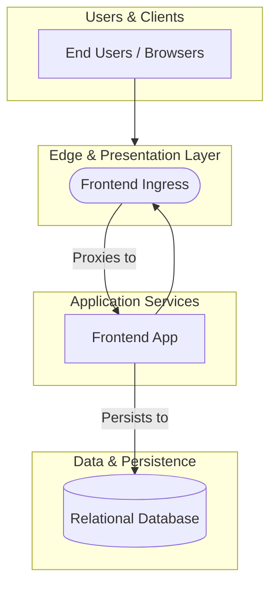

# Security Assessment: bcgov/nr-hydrometric-rating-curve

Commit: `a182f073533ff08b899db4903c4edab1a7d97fa8`

Generated by `scripts/compile-findings.py` + `scripts/render-report.py` (scripted findings; not Copilot-authored).

## Executive summary

36 open finding(s) (Critical 0, High 8, Medium 20, Low 8); 0 confirmed-fixed. Top findings: AUTHZ-001 (High), AUTHZ-002 (High), AUTHZ-003 (High), AUTHZ-004 (High), AUTHZ-005 (High). Coverage gaps: GitHub's own alert list was not read (dependabot: HTTP 403 or unavailable). Public scanner proxy used instead.; GitHub's own alert list was not read (code-scanning: HTTP 403 or unavailable). Public scanner proxy used instead.; GitHub's own alert list was not read (secret-scanning: HTTP 403 or unavailable). Public scanner proxy used instead.. Score is written separately by score.py.

## Scope table

| Chapter | Status | Findings |
|---|---|---|
| architecture | analyzed | 0 |
| cicd | analyzed | 13 |
| zero-trust | analyzed | 8 |
| authn | analyzed | 0 |
| authz | analyzed | 5 |
| injection | analyzed | 4 |
| configuration | analyzed | 0 |
| cryptography | analyzed | 0 |
| secrets | analyzed | 0 |
| logging-data | analyzed | 0 |
| code-scanning | analyzed | 17 |
| secret-scanning | analyzed | 0 |
| dependabot | analyzed | 0 |
| dependencies | analyzed | 0 |
| containers-iac | analyzed | 14 |
| testing | analyzed | 0 |
| stack | analyzed | 0 |

## Severity totals

| Severity | Count |
|---|---|
| Critical | 0 |
| High | 8 |
| Medium | 20 |
| Low | 8 |

| Domain | Findings |
|---|---|
| AUTHZ | 5 |
| CICD | 13 |
| INFRA | 14 |
| INJ | 4 |

## OWASP Top 10 (2021)

| Category | Findings |
|---|---|
| A01 Broken Access Control | AUTHZ-001, AUTHZ-002, AUTHZ-003, AUTHZ-004, AUTHZ-005, INJ-001 |
| A02 Cryptographic Failures | none |
| A03 Injection | CICD-001, INJ-002, INJ-003 |
| A04 Insecure Design | none |
| A05 Security Misconfiguration | INFRA-002, INFRA-009, INFRA-006, INFRA-007, INFRA-013, INFRA-014, INFRA-001, INFRA-003, INFRA-004, INFRA-005, INFRA-008, INFRA-010, INFRA-011, INFRA-012 |
| A06 Vulnerable and Outdated Components | none |
| A07 Identification and Authentication Failures | none |
| A08 Software and Data Integrity Failures | none |
| A09 Security Logging and Monitoring Failures | none |
| A10 Server-Side Request Forgery | none |

## Component risk ranking

1. `root` — Risk Score: 55 (27 finding(s): CICD-001, INFRA-002, INFRA-009, CICD-002, CICD-003)
2. Frontend App (`frontend-app`) — Risk Score: 33 (9 finding(s): AUTHZ-001, AUTHZ-002, AUTHZ-003, AUTHZ-004, AUTHZ-005)

## Tools run

- **semgrep** 1.184.0 — ok; 17 result(s). scanned 124 path(s)
- **gitleaks** gitleaks — ok; 0 result(s). clean scan
- **osv-scanner** osv-scanner — ok; 0 result(s). 0 advisory hit(s)
- **trivy** 0.76.1 — ok; 14 result(s). 0 vuln(s), 14 misconfig(s)
- **dependabot** unknown — failed; 0 result(s). WARN: dependabot unavailable: gh: Resource not accessible by integration (HTTP 403)
- **code-scanning** unknown — failed; 0 result(s). WARN: code-scanning unavailable: gh: Resource not accessible by integration (HTTP 403)
- **secret-scanning** unknown — failed; 0 result(s). WARN: secret-scanning-raw unavailable: gh: Resource not accessible by integration (HTTP 403)

## architecture

Status: analyzed

Public clone layout reviewed via README.md; monorepo/components inferred from manifests.

### Architecture overview

Discovered components:
- **Frontend Ingress** (`frontend-ingress`, type: `ingress`): paths ['frontend/nginx.conf.template']
- **Frontend App** (`frontend-app`, type: `api`): paths ['frontend', 'frontend/rctool']
- **Relational Database** (`database`, type: `database`): paths ['frontend/rctool/migrations']

Chapter write-up: scripted assessment records tool context, citation targets, and per-finding impact when findings exist; clean chapters still document what ran.

- README.md:1

## cicd

Status: analyzed

Reviewed 10 GitHub workflow file(s) under .github/workflows; 13 supply-chain/workflow finding(s) from scanners.

Chapter write-up: scripted assessment records tool context, citation targets, and per-finding impact when findings exist; clean chapters still document what ran.

- **CICD-001** (High): Using variable interpolation `${{...}}` with `github` context data in a `run:` step could allow an attacker to inject their own code into the runner. This would — impact: Using variable interpolation `${{...}}` with `github` context data in a `run:` step could allow an attacker to inject their own code into the runner. This would
- **CICD-002** (Medium): GitHub Actions step uses a mutable tag or branch reference. Tags and branch names can be silently repointed by the action owner, enabling supply-chain attacks — — impact: GitHub Actions step uses a mutable tag or branch reference. Tags and branch names can be silently repointed by the action owner, enabling supply-chain attacks —
- **CICD-003** (Medium): GitHub Actions step uses a mutable tag or branch reference. Tags and branch names can be silently repointed by the action owner, enabling supply-chain attacks — — impact: GitHub Actions step uses a mutable tag or branch reference. Tags and branch names can be silently repointed by the action owner, enabling supply-chain attacks —
- **CICD-004** (Medium): GitHub Actions step uses a mutable tag or branch reference. Tags and branch names can be silently repointed by the action owner, enabling supply-chain attacks — — impact: GitHub Actions step uses a mutable tag or branch reference. Tags and branch names can be silently repointed by the action owner, enabling supply-chain attacks —
- **CICD-005** (Medium): GitHub Actions step uses a mutable tag or branch reference. Tags and branch names can be silently repointed by the action owner, enabling supply-chain attacks — — impact: GitHub Actions step uses a mutable tag or branch reference. Tags and branch names can be silently repointed by the action owner, enabling supply-chain attacks —
- **CICD-006** (Medium): GitHub Actions step uses a mutable tag or branch reference. Tags and branch names can be silently repointed by the action owner, enabling supply-chain attacks — — impact: GitHub Actions step uses a mutable tag or branch reference. Tags and branch names can be silently repointed by the action owner, enabling supply-chain attacks —
- **CICD-007** (Medium): GitHub Actions step uses a mutable tag or branch reference. Tags and branch names can be silently repointed by the action owner, enabling supply-chain attacks — — impact: GitHub Actions step uses a mutable tag or branch reference. Tags and branch names can be silently repointed by the action owner, enabling supply-chain attacks —
- **CICD-008** (Medium): GitHub Actions step uses a mutable tag or branch reference. Tags and branch names can be silently repointed by the action owner, enabling supply-chain attacks — — impact: GitHub Actions step uses a mutable tag or branch reference. Tags and branch names can be silently repointed by the action owner, enabling supply-chain attacks —
- **CICD-009** (Medium): GitHub Actions step uses a mutable tag or branch reference. Tags and branch names can be silently repointed by the action owner, enabling supply-chain attacks — — impact: GitHub Actions step uses a mutable tag or branch reference. Tags and branch names can be silently repointed by the action owner, enabling supply-chain attacks —
- **CICD-010** (Medium): GitHub Actions step uses a mutable tag or branch reference. Tags and branch names can be silently repointed by the action owner, enabling supply-chain attacks — — impact: GitHub Actions step uses a mutable tag or branch reference. Tags and branch names can be silently repointed by the action owner, enabling supply-chain attacks —
- **CICD-011** (Medium): GitHub Actions step uses a mutable tag or branch reference. Tags and branch names can be silently repointed by the action owner, enabling supply-chain attacks — — impact: GitHub Actions step uses a mutable tag or branch reference. Tags and branch names can be silently repointed by the action owner, enabling supply-chain attacks —
- **CICD-012** (Medium): GitHub Actions step uses a mutable tag or branch reference. Tags and branch names can be silently repointed by the action owner, enabling supply-chain attacks — — impact: GitHub Actions step uses a mutable tag or branch reference. Tags and branch names can be silently repointed by the action owner, enabling supply-chain attacks —
- **CICD-013** (Medium): GitHub Actions step uses a mutable tag or branch reference. Tags and branch names can be silently repointed by the action owner, enabling supply-chain attacks — — impact: GitHub Actions step uses a mutable tag or branch reference. Tags and branch names can be silently repointed by the action owner, enabling supply-chain attacks —

## zero-trust

Status: analyzed

Mapped 8 Critical/High/Medium finding(s) to Verify Explicitly / Least Privilege / Assume Breach themes from scanner output.

Chapter write-up: scripted assessment records tool context, citation targets, and per-finding impact when findings exist; clean chapters still document what ran.

- **AUTHZ-001** (High): Unprotected mutating Django view function: rctool_import — impact: View executes database mutations without enforcing user authentication or permission checks, exposing endpoints to unauthenticated callers.
- **AUTHZ-002** (High): Unprotected mutating Django view function: rctool_develop_initialize — impact: View executes database mutations without enforcing user authentication or permission checks, exposing endpoints to unauthenticated callers.
- **AUTHZ-003** (High): Unprotected mutating Django view function: rctool_develop_autofit — impact: View executes database mutations without enforcing user authentication or permission checks, exposing endpoints to unauthenticated callers.
- **AUTHZ-004** (High): Unprotected mutating Django view function: rctool_export_initialize — impact: View executes database mutations without enforcing user authentication or permission checks, exposing endpoints to unauthenticated callers.
- **AUTHZ-005** (High): Unprotected mutating Django view function: rctool_export_output — impact: View executes database mutations without enforcing user authentication or permission checks, exposing endpoints to unauthenticated callers.
- **CICD-001** (High): Using variable interpolation `${{...}}` with `github` context data in a `run:` step could allow an attacker to inject their own code into the runner. This would — impact: Using variable interpolation `${{...}}` with `github` context data in a `run:` step could allow an attacker to inject their own code into the runner. This would
- **INFRA-002** (High): Root file system is not read-only — impact: Container 'nr-hydrometric-rating-curve-frontend' of Deployment 'nr-hydrometric-rating-curve-frontend' should set 'securityContext.readOnlyRootFilesystem' to tru
- **INFRA-009** (High): Root file system is not read-only — impact: Container 'nr-hydrometric-rating-curve-rctool' of Deployment 'nr-hydrometric-rating-curve-rctool' should set 'securityContext.readOnlyRootFilesystem' to true

## authn

Status: analyzed

Authentication file checks and scanner hits: 0 open, 0 confirmed-fixed (AUTH seeds when target is nr-fom).

Chapter write-up: scripted assessment records tool context, citation targets, and per-finding impact when findings exist; clean chapters still document what ran.

- README.md:1

## authz

Status: analyzed

Semantic authorization analysis reviewed controllers and endpoints; found 5 authorization/access control finding(s).

Chapter write-up: scripted assessment records tool context, citation targets, and per-finding impact when findings exist; clean chapters still document what ran.

- **AUTHZ-001** (High): Unprotected mutating Django view function: rctool_import — impact: View executes database mutations without enforcing user authentication or permission checks, exposing endpoints to unauthenticated callers.
- **AUTHZ-002** (High): Unprotected mutating Django view function: rctool_develop_initialize — impact: View executes database mutations without enforcing user authentication or permission checks, exposing endpoints to unauthenticated callers.
- **AUTHZ-003** (High): Unprotected mutating Django view function: rctool_develop_autofit — impact: View executes database mutations without enforcing user authentication or permission checks, exposing endpoints to unauthenticated callers.
- **AUTHZ-004** (High): Unprotected mutating Django view function: rctool_export_initialize — impact: View executes database mutations without enforcing user authentication or permission checks, exposing endpoints to unauthenticated callers.
- **AUTHZ-005** (High): Unprotected mutating Django view function: rctool_export_output — impact: View executes database mutations without enforcing user authentication or permission checks, exposing endpoints to unauthenticated callers.

## injection

Status: analyzed

Semgrep 1.184.0 ran with 17 result(s). scanned 124 path(s). 4 injection-domain finding(s) promoted.

Chapter write-up: scripted assessment records tool context, citation targets, and per-finding impact when findings exist; clean chapters still document what ran.

- **INJ-001** (Medium): Manually-created forms in django templates should specify a csrf_token to prevent CSRF attacks. — impact: Manually-created forms in django templates should specify a csrf_token to prevent CSRF attacks. CWE: CWE-352 OWASP: A01 Broken Access Control
- **INJ-002** (Medium): Detected direct use of jinja2. If not done properly, this may bypass HTML escaping which opens up the application to cross-site scripting (XSS) vulnerabilities. — impact: Detected direct use of jinja2. If not done properly, this may bypass HTML escaping which opens up the application to cross-site scripting (XSS) vulnerabilities.
- **INJ-003** (Medium): Detected direct use of jinja2. If not done properly, this may bypass HTML escaping which opens up the application to cross-site scripting (XSS) vulnerabilities. — impact: Detected direct use of jinja2. If not done properly, this may bypass HTML escaping which opens up the application to cross-site scripting (XSS) vulnerabilities.
- **INJ-004** (Medium): Possibility of prototype polluting function detected. By adding or modifying attributes of an object prototype, it is possible to create attributes that exist o — impact: Possibility of prototype polluting function detected. By adding or modifying attributes of an object prototype, it is possible to create attributes that exist o

## configuration

Status: analyzed

Configuration findings from scanners: 0. Public manifests reviewed for CORS/debug/TLS defaults where cited.

Chapter write-up: scripted assessment records tool context, citation targets, and per-finding impact when findings exist; clean chapters still document what ran.

- README.md:1

## cryptography

Status: analyzed

Cryptography file checks and scanner hits: 0 open, 0 confirmed-fixed.

Chapter write-up: scripted assessment records tool context, citation targets, and per-finding impact when findings exist; clean chapters still document what ran.

- README.md:1

## secrets

Status: analyzed

gitleaks gitleaks ran with 0 result(s). clean scan. 0 secret finding(s) promoted.

Chapter write-up: scripted assessment records tool context, citation targets, and per-finding impact when findings exist; clean chapters still document what ran.

- README.md:1

## logging-data

Status: analyzed

Logging/PII semantic and scanner hits: 0. Review checked client error logging and credential leaks.

Chapter write-up: scripted assessment records tool context, citation targets, and per-finding impact when findings exist; clean chapters still document what ran.

- README.md:1

## code-scanning

Status: analyzed

Semgrep 1.184.0 ran with 17 result(s). scanned 124 path(s). Public proxy for GitHub code-scanning until #96. GitHub's own alert list was not read (403/unavailable).

Chapter write-up: scripted assessment records tool context, citation targets, and per-finding impact when findings exist; clean chapters still document what ran.

- **CICD-001** (High): Using variable interpolation `${{...}}` with `github` context data in a `run:` step could allow an attacker to inject their own code into the runner. This would — impact: Using variable interpolation `${{...}}` with `github` context data in a `run:` step could allow an attacker to inject their own code into the runner. This would
- **CICD-002** (Medium): GitHub Actions step uses a mutable tag or branch reference. Tags and branch names can be silently repointed by the action owner, enabling supply-chain attacks — — impact: GitHub Actions step uses a mutable tag or branch reference. Tags and branch names can be silently repointed by the action owner, enabling supply-chain attacks —
- **CICD-003** (Medium): GitHub Actions step uses a mutable tag or branch reference. Tags and branch names can be silently repointed by the action owner, enabling supply-chain attacks — — impact: GitHub Actions step uses a mutable tag or branch reference. Tags and branch names can be silently repointed by the action owner, enabling supply-chain attacks —
- **CICD-004** (Medium): GitHub Actions step uses a mutable tag or branch reference. Tags and branch names can be silently repointed by the action owner, enabling supply-chain attacks — — impact: GitHub Actions step uses a mutable tag or branch reference. Tags and branch names can be silently repointed by the action owner, enabling supply-chain attacks —
- **CICD-005** (Medium): GitHub Actions step uses a mutable tag or branch reference. Tags and branch names can be silently repointed by the action owner, enabling supply-chain attacks — — impact: GitHub Actions step uses a mutable tag or branch reference. Tags and branch names can be silently repointed by the action owner, enabling supply-chain attacks —
- **CICD-006** (Medium): GitHub Actions step uses a mutable tag or branch reference. Tags and branch names can be silently repointed by the action owner, enabling supply-chain attacks — — impact: GitHub Actions step uses a mutable tag or branch reference. Tags and branch names can be silently repointed by the action owner, enabling supply-chain attacks —
- **CICD-007** (Medium): GitHub Actions step uses a mutable tag or branch reference. Tags and branch names can be silently repointed by the action owner, enabling supply-chain attacks — — impact: GitHub Actions step uses a mutable tag or branch reference. Tags and branch names can be silently repointed by the action owner, enabling supply-chain attacks —
- **CICD-008** (Medium): GitHub Actions step uses a mutable tag or branch reference. Tags and branch names can be silently repointed by the action owner, enabling supply-chain attacks — — impact: GitHub Actions step uses a mutable tag or branch reference. Tags and branch names can be silently repointed by the action owner, enabling supply-chain attacks —
- **CICD-009** (Medium): GitHub Actions step uses a mutable tag or branch reference. Tags and branch names can be silently repointed by the action owner, enabling supply-chain attacks — — impact: GitHub Actions step uses a mutable tag or branch reference. Tags and branch names can be silently repointed by the action owner, enabling supply-chain attacks —
- **CICD-010** (Medium): GitHub Actions step uses a mutable tag or branch reference. Tags and branch names can be silently repointed by the action owner, enabling supply-chain attacks — — impact: GitHub Actions step uses a mutable tag or branch reference. Tags and branch names can be silently repointed by the action owner, enabling supply-chain attacks —
- **CICD-011** (Medium): GitHub Actions step uses a mutable tag or branch reference. Tags and branch names can be silently repointed by the action owner, enabling supply-chain attacks — — impact: GitHub Actions step uses a mutable tag or branch reference. Tags and branch names can be silently repointed by the action owner, enabling supply-chain attacks —
- **CICD-012** (Medium): GitHub Actions step uses a mutable tag or branch reference. Tags and branch names can be silently repointed by the action owner, enabling supply-chain attacks — — impact: GitHub Actions step uses a mutable tag or branch reference. Tags and branch names can be silently repointed by the action owner, enabling supply-chain attacks —
- **CICD-013** (Medium): GitHub Actions step uses a mutable tag or branch reference. Tags and branch names can be silently repointed by the action owner, enabling supply-chain attacks — — impact: GitHub Actions step uses a mutable tag or branch reference. Tags and branch names can be silently repointed by the action owner, enabling supply-chain attacks —
- **INJ-001** (Medium): Manually-created forms in django templates should specify a csrf_token to prevent CSRF attacks. — impact: Manually-created forms in django templates should specify a csrf_token to prevent CSRF attacks. CWE: CWE-352 OWASP: A01 Broken Access Control
- **INJ-002** (Medium): Detected direct use of jinja2. If not done properly, this may bypass HTML escaping which opens up the application to cross-site scripting (XSS) vulnerabilities. — impact: Detected direct use of jinja2. If not done properly, this may bypass HTML escaping which opens up the application to cross-site scripting (XSS) vulnerabilities.
- **INJ-003** (Medium): Detected direct use of jinja2. If not done properly, this may bypass HTML escaping which opens up the application to cross-site scripting (XSS) vulnerabilities. — impact: Detected direct use of jinja2. If not done properly, this may bypass HTML escaping which opens up the application to cross-site scripting (XSS) vulnerabilities.
- **INJ-004** (Medium): Possibility of prototype polluting function detected. By adding or modifying attributes of an object prototype, it is possible to create attributes that exist o — impact: Possibility of prototype polluting function detected. By adding or modifying attributes of an object prototype, it is possible to create attributes that exist o

## secret-scanning

Status: analyzed

gitleaks gitleaks ran with 0 result(s). clean scan. Public proxy for GitHub secret-scanning until #96. GitHub's own alert list was not read (403/unavailable).

Chapter write-up: scripted assessment records tool context, citation targets, and per-finding impact when findings exist; clean chapters still document what ran.

- README.md:1

## dependabot

Status: analyzed

osv-scanner osv-scanner ran with 0 result(s). 0 advisory hit(s). Trivy 0.76.1 ran with 14 result(s). 0 vuln(s), 14 misconfig(s). Public proxy for Dependabot until #96. GitHub's own alert list was not read (403/unavailable).

Chapter write-up: scripted assessment records tool context, citation targets, and per-finding impact when findings exist; clean chapters still document what ran.

- README.md:1

## dependencies

Status: analyzed

osv-scanner osv-scanner ran with 0 result(s). 0 advisory hit(s). Trivy 0.76.1 ran with 14 result(s). 0 vuln(s), 14 misconfig(s). 0 dependency finding(s) promoted after dedupe.

Chapter write-up: scripted assessment records tool context, citation targets, and per-finding impact when findings exist; clean chapters still document what ran.

- README.md:1

## containers-iac

Status: analyzed

Trivy 0.76.1 ran with 14 result(s). 0 vuln(s), 14 misconfig(s). 14 IaC/container finding(s).

Chapter write-up: scripted assessment records tool context, citation targets, and per-finding impact when findings exist; clean chapters still document what ran.

- **INFRA-002** (High): Root file system is not read-only — impact: Container 'nr-hydrometric-rating-curve-frontend' of Deployment 'nr-hydrometric-rating-curve-frontend' should set 'securityContext.readOnlyRootFilesystem' to tru
- **INFRA-009** (High): Root file system is not read-only — impact: Container 'nr-hydrometric-rating-curve-rctool' of Deployment 'nr-hydrometric-rating-curve-rctool' should set 'securityContext.readOnlyRootFilesystem' to true
- **INFRA-006** (Medium): Specific capabilities added — impact: Container 'nr-hydrometric-rating-curve-frontend' of Deployment 'nr-hydrometric-rating-curve-frontend' should not set 'securityContext.capabilities.add'
- **INFRA-007** (Medium): Restrict container images to trusted registries — impact: Container nr-hydrometric-rating-curve-frontend in deployment nr-hydrometric-rating-curve-frontend (namespace: null) uses an image from an untrusted registry.
- **INFRA-013** (Medium): Specific capabilities added — impact: Container 'nr-hydrometric-rating-curve-rctool' of Deployment 'nr-hydrometric-rating-curve-rctool' should not set 'securityContext.capabilities.add'
- **INFRA-014** (Medium): Restrict container images to trusted registries — impact: Container nr-hydrometric-rating-curve-rctool in deployment nr-hydrometric-rating-curve-rctool (namespace: null) uses an image from an untrusted registry.
- **INFRA-001** (Low): CPU not limited — impact: Container 'nr-hydrometric-rating-curve-frontend' of Deployment 'nr-hydrometric-rating-curve-frontend' should set 'resources.limits.cpu'
- **INFRA-003** (Low): Memory not limited — impact: Container 'nr-hydrometric-rating-curve-frontend' of Deployment 'nr-hydrometric-rating-curve-frontend' should set 'resources.limits.memory'
- **INFRA-004** (Low): Runs with UID <= 10000 — impact: Container 'nr-hydrometric-rating-curve-frontend' of Deployment 'nr-hydrometric-rating-curve-frontend' should set 'securityContext.runAsUser' > 10000
- **INFRA-005** (Low): Runs with GID <= 10000 — impact: Container 'nr-hydrometric-rating-curve-frontend' of Deployment 'nr-hydrometric-rating-curve-frontend' should set 'securityContext.runAsGroup' > 10000
- **INFRA-008** (Low): CPU not limited — impact: Container 'nr-hydrometric-rating-curve-rctool' of Deployment 'nr-hydrometric-rating-curve-rctool' should set 'resources.limits.cpu'
- **INFRA-010** (Low): Memory not limited — impact: Container 'nr-hydrometric-rating-curve-rctool' of Deployment 'nr-hydrometric-rating-curve-rctool' should set 'resources.limits.memory'
- **INFRA-011** (Low): Runs with UID <= 10000 — impact: Container 'nr-hydrometric-rating-curve-rctool' of Deployment 'nr-hydrometric-rating-curve-rctool' should set 'securityContext.runAsUser' > 10000
- **INFRA-012** (Low): Runs with GID <= 10000 — impact: Container 'nr-hydrometric-rating-curve-rctool' of Deployment 'nr-hydrometric-rating-curve-rctool' should set 'securityContext.runAsGroup' > 10000

## testing

Status: analyzed

Found 9 test file(s) matching common unit/e2e patterns in the public clone.

Chapter write-up: scripted assessment records tool context, citation targets, and per-finding impact when findings exist; clean chapters still document what ran.

- frontend/rctool/tests/test_legacy.py:1
- frontend/rctool/tests/test_forms.py:1
- frontend/rctool/tests/test_views_helpers.py:1

## stack

Status: analyzed

Stack from public manifests: engines=n/a; renovate=yes; 10 workflow file(s).

Chapter write-up: scripted assessment records tool context, citation targets, and per-finding impact when findings exist; clean chapters still document what ran.

- renovate.json:1

## Findings

### AUTHZ-001: Unprotected mutating Django view function: rctool_import

- **Severity:** High
- **Domain:** AUTHZ
- **Source:** semantic-analyzer
- **Evidence:** frontend/rctool/views.py:85 (`def rctool_import(request, tour_request_id=0):`)
- **Impact:** View executes database mutations without enforcing user authentication or permission checks, exposing endpoints to unauthenticated callers.
- **Recommendation:** Decorate the view with `@login_required` or apply DRF permission classes requiring authentication.
- **CWE:** CWE-284, CWE-862
- **OWASP:** A01 Broken Access Control

### AUTHZ-002: Unprotected mutating Django view function: rctool_develop_initialize

- **Severity:** High
- **Domain:** AUTHZ
- **Source:** semantic-analyzer
- **Evidence:** frontend/rctool/views.py:381 (`def rctool_develop_initialize(request):`)
- **Impact:** View executes database mutations without enforcing user authentication or permission checks, exposing endpoints to unauthenticated callers.
- **Recommendation:** Decorate the view with `@login_required` or apply DRF permission classes requiring authentication.
- **CWE:** CWE-284, CWE-862
- **OWASP:** A01 Broken Access Control

### AUTHZ-003: Unprotected mutating Django view function: rctool_develop_autofit

- **Severity:** High
- **Domain:** AUTHZ
- **Source:** semantic-analyzer
- **Evidence:** frontend/rctool/views.py:576 (`def rctool_develop_autofit(request):`)
- **Impact:** View executes database mutations without enforcing user authentication or permission checks, exposing endpoints to unauthenticated callers.
- **Recommendation:** Decorate the view with `@login_required` or apply DRF permission classes requiring authentication.
- **CWE:** CWE-284, CWE-862
- **OWASP:** A01 Broken Access Control

### AUTHZ-004: Unprotected mutating Django view function: rctool_export_initialize

- **Severity:** High
- **Domain:** AUTHZ
- **Source:** semantic-analyzer
- **Evidence:** frontend/rctool/views.py:674 (`def rctool_export_initialize(request):`)
- **Impact:** View executes database mutations without enforcing user authentication or permission checks, exposing endpoints to unauthenticated callers.
- **Recommendation:** Decorate the view with `@login_required` or apply DRF permission classes requiring authentication.
- **CWE:** CWE-284, CWE-862
- **OWASP:** A01 Broken Access Control

### AUTHZ-005: Unprotected mutating Django view function: rctool_export_output

- **Severity:** High
- **Domain:** AUTHZ
- **Source:** semantic-analyzer
- **Evidence:** frontend/rctool/views.py:904 (`def rctool_export_output(request):`)
- **Impact:** View executes database mutations without enforcing user authentication or permission checks, exposing endpoints to unauthenticated callers.
- **Recommendation:** Decorate the view with `@login_required` or apply DRF permission classes requiring authentication.
- **CWE:** CWE-284, CWE-862
- **OWASP:** A01 Broken Access Control

### CICD-001: Using variable interpolation `${{...}}` with `github` context data in a `run:` step could allow an attacker to inject their own code into the runner. This would

- **Severity:** High
- **Domain:** CICD
- **Source:** semgrep
- **Evidence:** .github/workflows/.deployer.yml:63 (`run: |`)
- **Impact:** Using variable interpolation `${{...}}` with `github` context data in a `run:` step could allow an attacker to inject their own code into the runner. This would allow them to steal secrets and code. `github` context data can have arbitrary  CWE: CWE-78 OWASP: A03 Injection
- **Recommendation:** Follow Semgrep rule guidance for yaml.github-actions.security.run-shell-injection.run-shell-injection: https://docs.github.com/en/actions/learn-github-actions/security-hardening-for-github-actions#understanding-the-risk-of-script-injections
- **CWE:** CWE-78
- **OWASP:** A03 Injection

### INFRA-002: Root file system is not read-only

- **Severity:** High
- **Domain:** INFRA
- **Source:** trivy
- **Evidence:** charts/app/templates/frontend/templates/deployment.yaml:34 (`{{- end }}`)
- **Impact:** Container 'nr-hydrometric-rating-curve-frontend' of Deployment 'nr-hydrometric-rating-curve-frontend' should set 'securityContext.readOnlyRootFilesystem' to true
- **Recommendation:** Change 'containers[].securityContext.readOnlyRootFilesystem' to 'true'.
- **CWE:** CWE-16
- **OWASP:** A05 Security Misconfiguration

### INFRA-009: Root file system is not read-only

- **Severity:** High
- **Domain:** INFRA
- **Source:** trivy
- **Evidence:** charts/app/templates/rctool/templates/deployment.yaml:38 (`{{- end }}`)
- **Impact:** Container 'nr-hydrometric-rating-curve-rctool' of Deployment 'nr-hydrometric-rating-curve-rctool' should set 'securityContext.readOnlyRootFilesystem' to true
- **Recommendation:** Change 'containers[].securityContext.readOnlyRootFilesystem' to 'true'.
- **CWE:** CWE-16
- **OWASP:** A05 Security Misconfiguration

### CICD-002: GitHub Actions step uses a mutable tag or branch reference. Tags and branch names can be silently repointed by the action owner, enabling supply-chain attacks —

- **Severity:** Medium
- **Domain:** CICD
- **Source:** semgrep
- **Evidence:** .github/workflows/.deployer.yml:108 (`- uses: actions/checkout@v7`)
- **Impact:** GitHub Actions step uses a mutable tag or branch reference. Tags and branch names can be silently repointed by the action owner, enabling supply-chain attacks — as seen in the trivy-action and kics-github-action compromises. Pin the referen CWE: CWE-1357, CWE-353
- **Recommendation:** Follow Semgrep rule guidance for yaml.github-actions.security.github-actions-mutable-action-tag.github-actions-mutable-action-tag: https://docs.github.com/en/actions/security-guides/security-hardening-for-github-actions#using-third-party-actions
- **CWE:** CWE-1357, CWE-353

### CICD-003: GitHub Actions step uses a mutable tag or branch reference. Tags and branch names can be silently repointed by the action owner, enabling supply-chain attacks —

- **Severity:** Medium
- **Domain:** CICD
- **Source:** semgrep
- **Evidence:** .github/workflows/analysis.yml:28 (`- uses: actions/checkout@v7`)
- **Impact:** GitHub Actions step uses a mutable tag or branch reference. Tags and branch names can be silently repointed by the action owner, enabling supply-chain attacks — as seen in the trivy-action and kics-github-action compromises. Pin the referen CWE: CWE-1357, CWE-353
- **Recommendation:** Follow Semgrep rule guidance for yaml.github-actions.security.github-actions-mutable-action-tag.github-actions-mutable-action-tag: https://docs.github.com/en/actions/security-guides/security-hardening-for-github-actions#using-third-party-actions
- **CWE:** CWE-1357, CWE-353

### CICD-004: GitHub Actions step uses a mutable tag or branch reference. Tags and branch names can be silently repointed by the action owner, enabling supply-chain attacks —

- **Severity:** Medium
- **Domain:** CICD
- **Source:** semgrep
- **Evidence:** .github/workflows/analysis.yml:44 (`uses: github/codeql-action/upload-sarif@v4`)
- **Impact:** GitHub Actions step uses a mutable tag or branch reference. Tags and branch names can be silently repointed by the action owner, enabling supply-chain attacks — as seen in the trivy-action and kics-github-action compromises. Pin the referen CWE: CWE-1357, CWE-353
- **Recommendation:** Follow Semgrep rule guidance for yaml.github-actions.security.github-actions-mutable-action-tag.github-actions-mutable-action-tag: https://docs.github.com/en/actions/security-guides/security-hardening-for-github-actions#using-third-party-actions
- **CWE:** CWE-1357, CWE-353

### CICD-005: GitHub Actions step uses a mutable tag or branch reference. Tags and branch names can be silently repointed by the action owner, enabling supply-chain attacks —

- **Severity:** Medium
- **Domain:** CICD
- **Source:** semgrep
- **Evidence:** .github/workflows/analysis.yml:52 (`uses: github/codeql-action/upload-sarif@v4`)
- **Impact:** GitHub Actions step uses a mutable tag or branch reference. Tags and branch names can be silently repointed by the action owner, enabling supply-chain attacks — as seen in the trivy-action and kics-github-action compromises. Pin the referen CWE: CWE-1357, CWE-353
- **Recommendation:** Follow Semgrep rule guidance for yaml.github-actions.security.github-actions-mutable-action-tag.github-actions-mutable-action-tag: https://docs.github.com/en/actions/security-guides/security-hardening-for-github-actions#using-third-party-actions
- **CWE:** CWE-1357, CWE-353

### CICD-006: GitHub Actions step uses a mutable tag or branch reference. Tags and branch names can be silently repointed by the action owner, enabling supply-chain attacks —

- **Severity:** Medium
- **Domain:** CICD
- **Source:** semgrep
- **Evidence:** .github/workflows/analysis.yml:99 (`- uses: actions/checkout@v7`)
- **Impact:** GitHub Actions step uses a mutable tag or branch reference. Tags and branch names can be silently repointed by the action owner, enabling supply-chain attacks — as seen in the trivy-action and kics-github-action compromises. Pin the referen CWE: CWE-1357, CWE-353
- **Recommendation:** Follow Semgrep rule guidance for yaml.github-actions.security.github-actions-mutable-action-tag.github-actions-mutable-action-tag: https://docs.github.com/en/actions/security-guides/security-hardening-for-github-actions#using-third-party-actions
- **CWE:** CWE-1357, CWE-353

### CICD-007: GitHub Actions step uses a mutable tag or branch reference. Tags and branch names can be silently repointed by the action owner, enabling supply-chain attacks —

- **Severity:** Medium
- **Domain:** CICD
- **Source:** semgrep
- **Evidence:** .github/workflows/analysis.yml:101 (`uses: actions/setup-python@v7`)
- **Impact:** GitHub Actions step uses a mutable tag or branch reference. Tags and branch names can be silently repointed by the action owner, enabling supply-chain attacks — as seen in the trivy-action and kics-github-action compromises. Pin the referen CWE: CWE-1357, CWE-353
- **Recommendation:** Follow Semgrep rule guidance for yaml.github-actions.security.github-actions-mutable-action-tag.github-actions-mutable-action-tag: https://docs.github.com/en/actions/security-guides/security-hardening-for-github-actions#using-third-party-actions
- **CWE:** CWE-1357, CWE-353

### CICD-008: GitHub Actions step uses a mutable tag or branch reference. Tags and branch names can be silently repointed by the action owner, enabling supply-chain attacks —

- **Severity:** Medium
- **Domain:** CICD
- **Source:** semgrep
- **Evidence:** .github/workflows/analysis.yml:114 (`uses: actions/upload-artifact@v7`)
- **Impact:** GitHub Actions step uses a mutable tag or branch reference. Tags and branch names can be silently repointed by the action owner, enabling supply-chain attacks — as seen in the trivy-action and kics-github-action compromises. Pin the referen CWE: CWE-1357, CWE-353
- **Recommendation:** Follow Semgrep rule guidance for yaml.github-actions.security.github-actions-mutable-action-tag.github-actions-mutable-action-tag: https://docs.github.com/en/actions/security-guides/security-hardening-for-github-actions#using-third-party-actions
- **CWE:** CWE-1357, CWE-353

### CICD-009: GitHub Actions step uses a mutable tag or branch reference. Tags and branch names can be silently repointed by the action owner, enabling supply-chain attacks —

- **Severity:** Medium
- **Domain:** CICD
- **Source:** semgrep
- **Evidence:** .github/workflows/analysis.yml:142 (`- uses: actions/checkout@v7`)
- **Impact:** GitHub Actions step uses a mutable tag or branch reference. Tags and branch names can be silently repointed by the action owner, enabling supply-chain attacks — as seen in the trivy-action and kics-github-action compromises. Pin the referen CWE: CWE-1357, CWE-353
- **Recommendation:** Follow Semgrep rule guidance for yaml.github-actions.security.github-actions-mutable-action-tag.github-actions-mutable-action-tag: https://docs.github.com/en/actions/security-guides/security-hardening-for-github-actions#using-third-party-actions
- **CWE:** CWE-1357, CWE-353

### CICD-010: GitHub Actions step uses a mutable tag or branch reference. Tags and branch names can be silently repointed by the action owner, enabling supply-chain attacks —

- **Severity:** Medium
- **Domain:** CICD
- **Source:** semgrep
- **Evidence:** .github/workflows/analysis.yml:144 (`uses: actions/setup-python@v7`)
- **Impact:** GitHub Actions step uses a mutable tag or branch reference. Tags and branch names can be silently repointed by the action owner, enabling supply-chain attacks — as seen in the trivy-action and kics-github-action compromises. Pin the referen CWE: CWE-1357, CWE-353
- **Recommendation:** Follow Semgrep rule guidance for yaml.github-actions.security.github-actions-mutable-action-tag.github-actions-mutable-action-tag: https://docs.github.com/en/actions/security-guides/security-hardening-for-github-actions#using-third-party-actions
- **CWE:** CWE-1357, CWE-353

### CICD-011: GitHub Actions step uses a mutable tag or branch reference. Tags and branch names can be silently repointed by the action owner, enabling supply-chain attacks —

- **Severity:** Medium
- **Domain:** CICD
- **Source:** semgrep
- **Evidence:** .github/workflows/analysis.yml:157 (`uses: actions/cache@v6`)
- **Impact:** GitHub Actions step uses a mutable tag or branch reference. Tags and branch names can be silently repointed by the action owner, enabling supply-chain attacks — as seen in the trivy-action and kics-github-action compromises. Pin the referen CWE: CWE-1357, CWE-353
- **Recommendation:** Follow Semgrep rule guidance for yaml.github-actions.security.github-actions-mutable-action-tag.github-actions-mutable-action-tag: https://docs.github.com/en/actions/security-guides/security-hardening-for-github-actions#using-third-party-actions
- **CWE:** CWE-1357, CWE-353

### CICD-012: GitHub Actions step uses a mutable tag or branch reference. Tags and branch names can be silently repointed by the action owner, enabling supply-chain attacks —

- **Severity:** Medium
- **Domain:** CICD
- **Source:** semgrep
- **Evidence:** .github/workflows/merge.yml:31 (`- uses: actions/checkout@v7`)
- **Impact:** GitHub Actions step uses a mutable tag or branch reference. Tags and branch names can be silently repointed by the action owner, enabling supply-chain attacks — as seen in the trivy-action and kics-github-action compromises. Pin the referen CWE: CWE-1357, CWE-353
- **Recommendation:** Follow Semgrep rule guidance for yaml.github-actions.security.github-actions-mutable-action-tag.github-actions-mutable-action-tag: https://docs.github.com/en/actions/security-guides/security-hardening-for-github-actions#using-third-party-actions
- **CWE:** CWE-1357, CWE-353

### CICD-013: GitHub Actions step uses a mutable tag or branch reference. Tags and branch names can be silently repointed by the action owner, enabling supply-chain attacks —

- **Severity:** Medium
- **Domain:** CICD
- **Source:** semgrep
- **Evidence:** .github/workflows/release.yml:25 (`- uses: actions/checkout@v7`)
- **Impact:** GitHub Actions step uses a mutable tag or branch reference. Tags and branch names can be silently repointed by the action owner, enabling supply-chain attacks — as seen in the trivy-action and kics-github-action compromises. Pin the referen CWE: CWE-1357, CWE-353
- **Recommendation:** Follow Semgrep rule guidance for yaml.github-actions.security.github-actions-mutable-action-tag.github-actions-mutable-action-tag: https://docs.github.com/en/actions/security-guides/security-hardening-for-github-actions#using-third-party-actions
- **CWE:** CWE-1357, CWE-353

### INFRA-006: Specific capabilities added

- **Severity:** Medium
- **Domain:** INFRA
- **Source:** trivy
- **Evidence:** charts/app/templates/frontend/templates/deployment.yaml:34 (`{{- end }}`)
- **Impact:** Container 'nr-hydrometric-rating-curve-frontend' of Deployment 'nr-hydrometric-rating-curve-frontend' should not set 'securityContext.capabilities.add'
- **Recommendation:** Do not set spec.containers[*].securityContext.capabilities.add and spec.initContainers[*].securityContext.capabilities.add.
- **CWE:** CWE-16
- **OWASP:** A05 Security Misconfiguration

### INFRA-007: Restrict container images to trusted registries

- **Severity:** Medium
- **Domain:** INFRA
- **Source:** trivy
- **Evidence:** charts/app/templates/frontend/templates/deployment.yaml:34 (`{{- end }}`)
- **Impact:** Container nr-hydrometric-rating-curve-frontend in deployment nr-hydrometric-rating-curve-frontend (namespace: null) uses an image from an untrusted registry.
- **Recommendation:** Use images from trusted registries.
- **CWE:** CWE-16
- **OWASP:** A05 Security Misconfiguration

### INFRA-013: Specific capabilities added

- **Severity:** Medium
- **Domain:** INFRA
- **Source:** trivy
- **Evidence:** charts/app/templates/rctool/templates/deployment.yaml:38 (`{{- end }}`)
- **Impact:** Container 'nr-hydrometric-rating-curve-rctool' of Deployment 'nr-hydrometric-rating-curve-rctool' should not set 'securityContext.capabilities.add'
- **Recommendation:** Do not set spec.containers[*].securityContext.capabilities.add and spec.initContainers[*].securityContext.capabilities.add.
- **CWE:** CWE-16
- **OWASP:** A05 Security Misconfiguration

### INFRA-014: Restrict container images to trusted registries

- **Severity:** Medium
- **Domain:** INFRA
- **Source:** trivy
- **Evidence:** charts/app/templates/rctool/templates/deployment.yaml:38 (`{{- end }}`)
- **Impact:** Container nr-hydrometric-rating-curve-rctool in deployment nr-hydrometric-rating-curve-rctool (namespace: null) uses an image from an untrusted registry.
- **Recommendation:** Use images from trusted registries.
- **CWE:** CWE-16
- **OWASP:** A05 Security Misconfiguration

### INJ-001: Manually-created forms in django templates should specify a csrf_token to prevent CSRF attacks.

- **Severity:** Medium
- **Domain:** INJ
- **Source:** semgrep
- **Evidence:** frontend/rctool/templates/rctool/rctool/develop/rctool_develop.html:165 (`[redacted: possible credential]`)
- **Impact:** Manually-created forms in django templates should specify a csrf_token to prevent CSRF attacks. CWE: CWE-352 OWASP: A01 Broken Access Control
- **Recommendation:** Follow Semgrep rule guidance for python.django.security.django-no-csrf-token.django-no-csrf-token: https://docs.djangoproject.com/en/4.2/howto/csrf/
- **CWE:** CWE-352
- **OWASP:** A01 Broken Access Control

### INJ-002: Detected direct use of jinja2. If not done properly, this may bypass HTML escaping which opens up the application to cross-site scripting (XSS) vulnerabilities.

- **Severity:** Medium
- **Domain:** INJ
- **Source:** semgrep
- **Evidence:** frontend/rctool/utils.py:22 (`html  = template.render(context_dict)`)
- **Impact:** Detected direct use of jinja2. If not done properly, this may bypass HTML escaping which opens up the application to cross-site scripting (XSS) vulnerabilities. Prefer using the Flask method 'render_template()' and templates with a '.html'  CWE: CWE-79 OWASP: A03 Injection
- **Recommendation:** Follow Semgrep rule guidance for python.flask.security.xss.audit.direct-use-of-jinja2.direct-use-of-jinja2: https://jinja.palletsprojects.com/en/2.11.x/api/#basics
- **CWE:** CWE-79
- **OWASP:** A03 Injection

### INJ-003: Detected direct use of jinja2. If not done properly, this may bypass HTML escaping which opens up the application to cross-site scripting (XSS) vulnerabilities.

- **Severity:** Medium
- **Domain:** INJ
- **Source:** semgrep
- **Evidence:** frontend/rctool/views.py:1152 (`html = template.render(context)`)
- **Impact:** Detected direct use of jinja2. If not done properly, this may bypass HTML escaping which opens up the application to cross-site scripting (XSS) vulnerabilities. Prefer using the Flask method 'render_template()' and templates with a '.html'  CWE: CWE-79 OWASP: A03 Injection
- **Recommendation:** Follow Semgrep rule guidance for python.flask.security.xss.audit.direct-use-of-jinja2.direct-use-of-jinja2: https://jinja.palletsprojects.com/en/2.11.x/api/#basics
- **CWE:** CWE-79
- **OWASP:** A03 Injection

### INJ-004: Possibility of prototype polluting function detected. By adding or modifying attributes of an object prototype, it is possible to create attributes that exist o

- **Severity:** Medium
- **Domain:** INJ
- **Source:** semgrep
- **Evidence:** frontend/static/js/chart.umd.js:13 (`*/function _t(t){return t+.5|0}const yt=(t,e,i)=>Math.max(Math.min(t,i),e);funct`)
- **Impact:** Possibility of prototype polluting function detected. By adding or modifying attributes of an object prototype, it is possible to create attributes that exist on every object, or replace critical attributes with malicious ones. This can be  CWE: CWE-915
- **Recommendation:** Follow Semgrep rule guidance for javascript.lang.security.audit.prototype-pollution.prototype-pollution-loop.prototype-pollution-loop: https://github.com/HoLyVieR/prototype-pollution-nsec18/blob/master/paper/JavaScript_prototype_pollution_attack_in_NodeJS.pdf
- **CWE:** CWE-915

### INFRA-001: CPU not limited

- **Severity:** Low
- **Domain:** INFRA
- **Source:** trivy
- **Evidence:** charts/app/templates/frontend/templates/deployment.yaml:34 (`{{- end }}`)
- **Impact:** Container 'nr-hydrometric-rating-curve-frontend' of Deployment 'nr-hydrometric-rating-curve-frontend' should set 'resources.limits.cpu'
- **Recommendation:** Set a limit value under 'containers[].resources.limits.cpu'.
- **CWE:** CWE-16
- **OWASP:** A05 Security Misconfiguration

### INFRA-003: Memory not limited

- **Severity:** Low
- **Domain:** INFRA
- **Source:** trivy
- **Evidence:** charts/app/templates/frontend/templates/deployment.yaml:34 (`{{- end }}`)
- **Impact:** Container 'nr-hydrometric-rating-curve-frontend' of Deployment 'nr-hydrometric-rating-curve-frontend' should set 'resources.limits.memory'
- **Recommendation:** Set a limit value under 'containers[].resources.limits.memory'.
- **CWE:** CWE-16
- **OWASP:** A05 Security Misconfiguration

### INFRA-004: Runs with UID <= 10000

- **Severity:** Low
- **Domain:** INFRA
- **Source:** trivy
- **Evidence:** charts/app/templates/frontend/templates/deployment.yaml:34 (`{{- end }}`)
- **Impact:** Container 'nr-hydrometric-rating-curve-frontend' of Deployment 'nr-hydrometric-rating-curve-frontend' should set 'securityContext.runAsUser' > 10000
- **Recommendation:** Set 'containers[].securityContext.runAsUser' to an integer > 10000.
- **CWE:** CWE-16
- **OWASP:** A05 Security Misconfiguration

### INFRA-005: Runs with GID <= 10000

- **Severity:** Low
- **Domain:** INFRA
- **Source:** trivy
- **Evidence:** charts/app/templates/frontend/templates/deployment.yaml:34 (`{{- end }}`)
- **Impact:** Container 'nr-hydrometric-rating-curve-frontend' of Deployment 'nr-hydrometric-rating-curve-frontend' should set 'securityContext.runAsGroup' > 10000
- **Recommendation:** Set 'containers[].securityContext.runAsGroup' to an integer > 10000.
- **CWE:** CWE-16
- **OWASP:** A05 Security Misconfiguration

### INFRA-008: CPU not limited

- **Severity:** Low
- **Domain:** INFRA
- **Source:** trivy
- **Evidence:** charts/app/templates/rctool/templates/deployment.yaml:38 (`{{- end }}`)
- **Impact:** Container 'nr-hydrometric-rating-curve-rctool' of Deployment 'nr-hydrometric-rating-curve-rctool' should set 'resources.limits.cpu'
- **Recommendation:** Set a limit value under 'containers[].resources.limits.cpu'.
- **CWE:** CWE-16
- **OWASP:** A05 Security Misconfiguration

### INFRA-010: Memory not limited

- **Severity:** Low
- **Domain:** INFRA
- **Source:** trivy
- **Evidence:** charts/app/templates/rctool/templates/deployment.yaml:38 (`{{- end }}`)
- **Impact:** Container 'nr-hydrometric-rating-curve-rctool' of Deployment 'nr-hydrometric-rating-curve-rctool' should set 'resources.limits.memory'
- **Recommendation:** Set a limit value under 'containers[].resources.limits.memory'.
- **CWE:** CWE-16
- **OWASP:** A05 Security Misconfiguration

### INFRA-011: Runs with UID <= 10000

- **Severity:** Low
- **Domain:** INFRA
- **Source:** trivy
- **Evidence:** charts/app/templates/rctool/templates/deployment.yaml:38 (`{{- end }}`)
- **Impact:** Container 'nr-hydrometric-rating-curve-rctool' of Deployment 'nr-hydrometric-rating-curve-rctool' should set 'securityContext.runAsUser' > 10000
- **Recommendation:** Set 'containers[].securityContext.runAsUser' to an integer > 10000.
- **CWE:** CWE-16
- **OWASP:** A05 Security Misconfiguration

### INFRA-012: Runs with GID <= 10000

- **Severity:** Low
- **Domain:** INFRA
- **Source:** trivy
- **Evidence:** charts/app/templates/rctool/templates/deployment.yaml:38 (`{{- end }}`)
- **Impact:** Container 'nr-hydrometric-rating-curve-rctool' of Deployment 'nr-hydrometric-rating-curve-rctool' should set 'securityContext.runAsGroup' > 10000
- **Recommendation:** Set 'containers[].securityContext.runAsGroup' to an integer > 10000.
- **CWE:** CWE-16
- **OWASP:** A05 Security Misconfiguration

## Confirmed fixed

None.

## Coverage gaps

- GitHub's own alert list was not read (dependabot: HTTP 403 or unavailable). Public scanner proxy used instead.
- GitHub's own alert list was not read (code-scanning: HTTP 403 or unavailable). Public scanner proxy used instead.
- GitHub's own alert list was not read (secret-scanning: HTTP 403 or unavailable). Public scanner proxy used instead.

## Questions

None.
