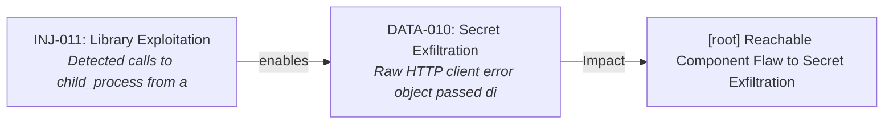
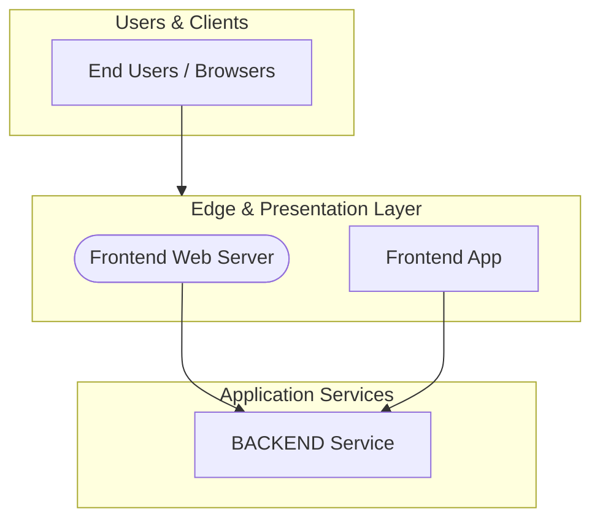

# Security Assessment: bcgov/nr-results-exam

Commit: `2b7c3fb9ee8ef913906386a576c3516c9b89097b`

Generated by `scripts/compile-findings.py` + `scripts/render-report.py` (scripted findings; not Copilot-authored).

## Executive summary

56 open finding(s) (Critical 0, High 2, Medium 40, Low 14); 0 confirmed-fixed. Top findings: DATA-007 (High), INJ-011 (High), CICD-001 (Medium), CICD-002 (Medium), CICD-003 (Medium). Coverage gaps: GitHub's own alert list was not read (dependabot: HTTP 403 or unavailable). Public scanner proxy used instead.; GitHub's own alert list was not read (code-scanning: HTTP 403 or unavailable). Public scanner proxy used instead.; GitHub's own alert list was not read (secret-scanning: HTTP 403 or unavailable). Public scanner proxy used instead.. VEX analysis: 5/6 dependency CVEs reachable in source. Correlated 1 exploit attack chain(s). Score is written separately by score.py.

## Scope table

| Chapter | Status | Findings |
|---|---|---|
| architecture | analyzed | 0 |
| cicd | analyzed | 15 |
| zero-trust | analyzed | 8 |
| authn | analyzed | 2 |
| authz | analyzed | 0 |
| injection | analyzed | 13 |
| configuration | analyzed | 1 |
| cryptography | analyzed | 0 |
| secrets | analyzed | 0 |
| logging-data | analyzed | 15 |
| code-scanning | analyzed | 20 |
| secret-scanning | analyzed | 0 |
| dependabot | analyzed | 6 |
| dependencies | analyzed | 6 |
| containers-iac | analyzed | 4 |
| testing | analyzed | 0 |
| stack | analyzed | 0 |

## Severity totals

| Severity | Count |
|---|---|
| Critical | 0 |
| High | 2 |
| Medium | 40 |
| Low | 14 |

| Domain | Findings |
|---|---|
| AUTH | 2 |
| CICD | 15 |
| CONFIG | 1 |
| DATA | 15 |
| DEPS | 6 |
| INFRA | 4 |
| INJ | 13 |

## OWASP Top 10 (2021)

| Category | Findings |
|---|---|
| A01 Broken Access Control | AUTH-001, AUTH-002, CONFIG-001, INJ-001, INJ-002, INJ-003, INJ-004, INJ-005, INJ-006, INJ-007, INJ-008 |
| A02 Cryptographic Failures | none |
| A03 Injection | INJ-011 |
| A04 Insecure Design | none |
| A05 Security Misconfiguration | none |
| A06 Vulnerable and Outdated Components | none |
| A07 Identification and Authentication Failures | none |
| A08 Software and Data Integrity Failures | DEPS-005 |
| A09 Security Logging and Monitoring Failures | DATA-007, DATA-001, DATA-002, DATA-003, DATA-004, DATA-005, DATA-006, DATA-008, DATA-009, DATA-010, DATA-011, DATA-012, DATA-013, DATA-014, DATA-015 |
| A10 Server-Side Request Forgery | none |

## Component risk ranking

1. `root` — Risk Score: 55 (26 finding(s): INJ-011, CICD-001, CICD-002, CICD-003, CICD-004)
2. Frontend App (`frontend`) — Risk Score: 26 (12 finding(s): DATA-007, DATA-001, DATA-002, DATA-003, DATA-004)
3. BACKEND Service (`backend`) — Risk Score: 23 (18 finding(s): DEPS-002, DEPS-003, DEPS-004, DEPS-005, INFRA-002)

## Attack chains (exploit correlation)

Multi-stage exploit paths synthesized across individual scanner and code findings. Remediating earlier stages breaks the attack chain.

### CHAIN-001: [root] Reachable Component Flaw to Secret Exfiltration

- **Severity:** High
- **Findings involved:** INJ-011, DATA-010
- **Narrative:** In component 'root', exploiting reachable dependency vulnerability INJ-011 grants code execution access within the container context, leading to extraction of credentials identified in DATA-010.
- **Coordinated Remediation:** Upgrade the reachable dependency and rotate the exposed credentials.

## Tools run

- **semgrep** 1.184.0 — ok; 35 result(s). scanned 168 path(s)
- **gitleaks** gitleaks — ok; 0 result(s). clean scan
- **osv-scanner** osv-scanner — ok; 6 result(s). 6 advisory hit(s)
- **trivy** 0.76.1 — ok; 3 result(s). 3 vuln(s), 0 misconfig(s)
- **dependabot** unknown — failed; 0 result(s). WARN: dependabot unavailable: gh: Resource not accessible by integration (HTTP 403)
- **code-scanning** unknown — failed; 0 result(s). WARN: code-scanning unavailable: gh: Resource not accessible by integration (HTTP 403)
- **secret-scanning** unknown — failed; 0 result(s). WARN: secret-scanning-raw unavailable: gh: Resource not accessible by integration (HTTP 403)

## architecture

Status: analyzed

Public clone layout reviewed via README.md, docker-compose.yml; monorepo/components inferred from manifests.

### Architecture overview

Discovered components:
- **Frontend Web Server** (`frontend-web-server`, type: `ingress`): paths ['frontend/Caddyfile']
- **Frontend App** (`frontend`, type: `frontend`): paths ['frontend']
- **BACKEND Service** (`backend`, type: `api`): paths ['backend']

Chapter write-up: scripted assessment records tool context, citation targets, and per-finding impact when findings exist; clean chapters still document what ran.

- README.md:1
- docker-compose.yml:1

## cicd

Status: analyzed

Reviewed 7 GitHub workflow file(s) under .github/workflows; 15 supply-chain/workflow finding(s) from scanners.

Chapter write-up: scripted assessment records tool context, citation targets, and per-finding impact when findings exist; clean chapters still document what ran.

- **CICD-001** (Medium): GitHub Actions step uses a mutable tag or branch reference. Tags and branch names can be silently repointed by the action owner, enabling supply-chain attacks — — impact: GitHub Actions step uses a mutable tag or branch reference. Tags and branch names can be silently repointed by the action owner, enabling supply-chain attacks —
- **CICD-002** (Medium): GitHub Actions step uses a mutable tag or branch reference. Tags and branch names can be silently repointed by the action owner, enabling supply-chain attacks — — impact: GitHub Actions step uses a mutable tag or branch reference. Tags and branch names can be silently repointed by the action owner, enabling supply-chain attacks —
- **CICD-003** (Medium): GitHub Actions step uses a mutable tag or branch reference. Tags and branch names can be silently repointed by the action owner, enabling supply-chain attacks — — impact: GitHub Actions step uses a mutable tag or branch reference. Tags and branch names can be silently repointed by the action owner, enabling supply-chain attacks —
- **CICD-004** (Medium): GitHub Actions step uses a mutable tag or branch reference. Tags and branch names can be silently repointed by the action owner, enabling supply-chain attacks — — impact: GitHub Actions step uses a mutable tag or branch reference. Tags and branch names can be silently repointed by the action owner, enabling supply-chain attacks —
- **CICD-005** (Medium): GitHub Actions step uses a mutable tag or branch reference. Tags and branch names can be silently repointed by the action owner, enabling supply-chain attacks — — impact: GitHub Actions step uses a mutable tag or branch reference. Tags and branch names can be silently repointed by the action owner, enabling supply-chain attacks —
- **CICD-006** (Medium): GitHub Actions step uses a mutable tag or branch reference. Tags and branch names can be silently repointed by the action owner, enabling supply-chain attacks — — impact: GitHub Actions step uses a mutable tag or branch reference. Tags and branch names can be silently repointed by the action owner, enabling supply-chain attacks —
- **CICD-007** (Medium): GitHub Actions step uses a mutable tag or branch reference. Tags and branch names can be silently repointed by the action owner, enabling supply-chain attacks — — impact: GitHub Actions step uses a mutable tag or branch reference. Tags and branch names can be silently repointed by the action owner, enabling supply-chain attacks —
- **CICD-008** (Medium): GitHub Actions step uses a mutable tag or branch reference. Tags and branch names can be silently repointed by the action owner, enabling supply-chain attacks — — impact: GitHub Actions step uses a mutable tag or branch reference. Tags and branch names can be silently repointed by the action owner, enabling supply-chain attacks —
- **CICD-009** (Medium): GitHub Actions step uses a mutable tag or branch reference. Tags and branch names can be silently repointed by the action owner, enabling supply-chain attacks — — impact: GitHub Actions step uses a mutable tag or branch reference. Tags and branch names can be silently repointed by the action owner, enabling supply-chain attacks —
- **CICD-010** (Medium): GitHub Actions step uses a mutable tag or branch reference. Tags and branch names can be silently repointed by the action owner, enabling supply-chain attacks — — impact: GitHub Actions step uses a mutable tag or branch reference. Tags and branch names can be silently repointed by the action owner, enabling supply-chain attacks —
- **CICD-011** (Medium): GitHub Actions step uses a mutable tag or branch reference. Tags and branch names can be silently repointed by the action owner, enabling supply-chain attacks — — impact: GitHub Actions step uses a mutable tag or branch reference. Tags and branch names can be silently repointed by the action owner, enabling supply-chain attacks —
- **CICD-012** (Medium): GitHub Actions step uses a mutable tag or branch reference. Tags and branch names can be silently repointed by the action owner, enabling supply-chain attacks — — impact: GitHub Actions step uses a mutable tag or branch reference. Tags and branch names can be silently repointed by the action owner, enabling supply-chain attacks —
- **CICD-013** (Medium): GitHub Actions step uses a mutable tag or branch reference. Tags and branch names can be silently repointed by the action owner, enabling supply-chain attacks — — impact: GitHub Actions step uses a mutable tag or branch reference. Tags and branch names can be silently repointed by the action owner, enabling supply-chain attacks —
- **CICD-014** (Medium): GitHub Actions step uses a mutable tag or branch reference. Tags and branch names can be silently repointed by the action owner, enabling supply-chain attacks — — impact: GitHub Actions step uses a mutable tag or branch reference. Tags and branch names can be silently repointed by the action owner, enabling supply-chain attacks —
- **CICD-015** (Medium): GitHub Actions step uses a mutable tag or branch reference. Tags and branch names can be silently repointed by the action owner, enabling supply-chain attacks — — impact: GitHub Actions step uses a mutable tag or branch reference. Tags and branch names can be silently repointed by the action owner, enabling supply-chain attacks —

## zero-trust

Status: analyzed

Mapped 8 Critical/High/Medium finding(s) to Verify Explicitly / Least Privilege / Assume Breach themes from scanner output.

Chapter write-up: scripted assessment records tool context, citation targets, and per-finding impact when findings exist; clean chapters still document what ran.

- **CICD-001** (Medium): GitHub Actions step uses a mutable tag or branch reference. Tags and branch names can be silently repointed by the action owner, enabling supply-chain attacks — — impact: GitHub Actions step uses a mutable tag or branch reference. Tags and branch names can be silently repointed by the action owner, enabling supply-chain attacks —
- **CICD-002** (Medium): GitHub Actions step uses a mutable tag or branch reference. Tags and branch names can be silently repointed by the action owner, enabling supply-chain attacks — — impact: GitHub Actions step uses a mutable tag or branch reference. Tags and branch names can be silently repointed by the action owner, enabling supply-chain attacks —
- **CICD-003** (Medium): GitHub Actions step uses a mutable tag or branch reference. Tags and branch names can be silently repointed by the action owner, enabling supply-chain attacks — — impact: GitHub Actions step uses a mutable tag or branch reference. Tags and branch names can be silently repointed by the action owner, enabling supply-chain attacks —
- **CICD-004** (Medium): GitHub Actions step uses a mutable tag or branch reference. Tags and branch names can be silently repointed by the action owner, enabling supply-chain attacks — — impact: GitHub Actions step uses a mutable tag or branch reference. Tags and branch names can be silently repointed by the action owner, enabling supply-chain attacks —
- **CICD-005** (Medium): GitHub Actions step uses a mutable tag or branch reference. Tags and branch names can be silently repointed by the action owner, enabling supply-chain attacks — — impact: GitHub Actions step uses a mutable tag or branch reference. Tags and branch names can be silently repointed by the action owner, enabling supply-chain attacks —
- **CICD-006** (Medium): GitHub Actions step uses a mutable tag or branch reference. Tags and branch names can be silently repointed by the action owner, enabling supply-chain attacks — — impact: GitHub Actions step uses a mutable tag or branch reference. Tags and branch names can be silently repointed by the action owner, enabling supply-chain attacks —
- **CICD-007** (Medium): GitHub Actions step uses a mutable tag or branch reference. Tags and branch names can be silently repointed by the action owner, enabling supply-chain attacks — — impact: GitHub Actions step uses a mutable tag or branch reference. Tags and branch names can be silently repointed by the action owner, enabling supply-chain attacks —
- **CICD-008** (Medium): GitHub Actions step uses a mutable tag or branch reference. Tags and branch names can be silently repointed by the action owner, enabling supply-chain attacks — — impact: GitHub Actions step uses a mutable tag or branch reference. Tags and branch names can be silently repointed by the action owner, enabling supply-chain attacks —

## authn

Status: analyzed

Authentication file checks and scanner hits: 2 open, 0 confirmed-fixed (AUTH seeds when target is nr-fom).

Chapter write-up: scripted assessment records tool context, citation targets, and per-finding impact when findings exist; clean chapters still document what ran.

- **AUTH-001** (Low): A CSRF middleware was not detected in your express application. Ensure you are either using one such as `csurf` or `csrf` (see rule references) and/or you are p — impact: A CSRF middleware was not detected in your express application. Ensure you are either using one such as `csurf` or `csrf` (see rule references) and/or you are p
- **AUTH-002** (Low): A CSRF middleware was not detected in your express application. Ensure you are either using one such as `csurf` or `csrf` (see rule references) and/or you are p — impact: A CSRF middleware was not detected in your express application. Ensure you are either using one such as `csurf` or `csrf` (see rule references) and/or you are p

## authz

Status: analyzed

Automated authz rules, not a full RBAC audit: found 3 NestJS/Express/Django authorization/guard hit(s) under the clone.

Chapter write-up: scripted assessment records tool context, citation targets, and per-finding impact when findings exist; clean chapters still document what ran.

- backend/__tests__/authMiddleware.test.js:403
- backend/__tests__/authMiddleware.test.js:420
- backend/middleware/authMiddleware.js:150

## injection

Status: analyzed

Semgrep 1.184.0 ran with 35 result(s). scanned 168 path(s). 13 injection-domain finding(s) promoted.

Chapter write-up: scripted assessment records tool context, citation targets, and per-finding impact when findings exist; clean chapters still document what ran.

- **INJ-011** (High): Detected calls to child_process from a function argument `cmd`. This could lead to a command injection if the input is user controllable. Try to avoid calls to  — impact: Detected calls to child_process from a function argument `cmd`. This could lead to a command injection if the input is user controllable. Try to avoid calls to 
- **INJ-009** (Medium): This tag is missing an 'integrity' subresource integrity attribute. The 'integrity' attribute allows for the browser to verify that externally hosted files (for — impact: This tag is missing an 'integrity' subresource integrity attribute. The 'integrity' attribute allows for the browser to verify that externally hosted files (for
- **INJ-010** (Medium): This tag is missing an 'integrity' subresource integrity attribute. The 'integrity' attribute allows for the browser to verify that externally hosted files (for — impact: This tag is missing an 'integrity' subresource integrity attribute. The 'integrity' attribute allows for the browser to verify that externally hosted files (for
- **INJ-012** (Medium): `backendCoverage.replace` method will only replace the first occurrence when used with a string argument ('%'). If this method is used for escaping of dangerous — impact: `backendCoverage.replace` method will only replace the first occurrence when used with a string argument ('%'). If this method is used for escaping of dangerous
- **INJ-013** (Medium): `frontendCoverage.replace` method will only replace the first occurrence when used with a string argument ('%'). If this method is used for escaping of dangerou — impact: `frontendCoverage.replace` method will only replace the first occurrence when used with a string argument ('%'). If this method is used for escaping of dangerou
- **INJ-001** (Low): A CSRF middleware was not detected in your express application. Ensure you are either using one such as `csurf` or `csrf` (see rule references) and/or you are p — impact: A CSRF middleware was not detected in your express application. Ensure you are either using one such as `csurf` or `csrf` (see rule references) and/or you are p
- **INJ-002** (Low): A CSRF middleware was not detected in your express application. Ensure you are either using one such as `csurf` or `csrf` (see rule references) and/or you are p — impact: A CSRF middleware was not detected in your express application. Ensure you are either using one such as `csurf` or `csrf` (see rule references) and/or you are p
- **INJ-003** (Low): A CSRF middleware was not detected in your express application. Ensure you are either using one such as `csurf` or `csrf` (see rule references) and/or you are p — impact: A CSRF middleware was not detected in your express application. Ensure you are either using one such as `csurf` or `csrf` (see rule references) and/or you are p
- **INJ-004** (Low): A CSRF middleware was not detected in your express application. Ensure you are either using one such as `csurf` or `csrf` (see rule references) and/or you are p — impact: A CSRF middleware was not detected in your express application. Ensure you are either using one such as `csurf` or `csrf` (see rule references) and/or you are p
- **INJ-005** (Low): A CSRF middleware was not detected in your express application. Ensure you are either using one such as `csurf` or `csrf` (see rule references) and/or you are p — impact: A CSRF middleware was not detected in your express application. Ensure you are either using one such as `csurf` or `csrf` (see rule references) and/or you are p
- **INJ-006** (Low): A CSRF middleware was not detected in your express application. Ensure you are either using one such as `csurf` or `csrf` (see rule references) and/or you are p — impact: A CSRF middleware was not detected in your express application. Ensure you are either using one such as `csurf` or `csrf` (see rule references) and/or you are p
- **INJ-007** (Low): A CSRF middleware was not detected in your express application. Ensure you are either using one such as `csurf` or `csrf` (see rule references) and/or you are p — impact: A CSRF middleware was not detected in your express application. Ensure you are either using one such as `csurf` or `csrf` (see rule references) and/or you are p
- **INJ-008** (Low): A CSRF middleware was not detected in your express application. Ensure you are either using one such as `csurf` or `csrf` (see rule references) and/or you are p — impact: A CSRF middleware was not detected in your express application. Ensure you are either using one such as `csurf` or `csrf` (see rule references) and/or you are p

## configuration

Status: analyzed

Configuration findings from scanners: 1. Public manifests reviewed for CORS/debug/TLS defaults where cited.

Chapter write-up: scripted assessment records tool context, citation targets, and per-finding impact when findings exist; clean chapters still document what ran.

- **CONFIG-001** (Low): A CSRF middleware was not detected in your express application. Ensure you are either using one such as `csurf` or `csrf` (see rule references) and/or you are p — impact: A CSRF middleware was not detected in your express application. Ensure you are either using one such as `csurf` or `csrf` (see rule references) and/or you are p

## cryptography

Status: analyzed

Cryptography file checks and scanner hits: 0 open, 0 confirmed-fixed.

Chapter write-up: scripted assessment records tool context, citation targets, and per-finding impact when findings exist; clean chapters still document what ran.

- README.md:1

## secrets

Status: analyzed

gitleaks gitleaks ran with 0 result(s). clean scan. 0 secret finding(s) promoted.

Chapter write-up: scripted assessment records tool context, citation targets, and per-finding impact when findings exist; clean chapters still document what ran.

- README.md:1

## logging-data

Status: analyzed

Logging/PII semantic and scanner hits: 15. Review checked client error logging and credential leaks.

Chapter write-up: scripted assessment records tool context, citation targets, and per-finding impact when findings exist; clean chapters still document what ran.

- **DATA-007** (High): Potential credential or authorization token disclosure in logger call (Token) — impact: Writing tokens, credentials, or raw authorization headers to logs leaks sensitive authentication secrets to log storage and monitoring pipelines.
- **DATA-001** (Medium): Raw HTTP client error object passed directly to logger — impact: Serializing raw HTTP client error objects directly to logs exposes full request configurations, which frequently contain Authorization headers and Bearer tokens
- **DATA-002** (Medium): Raw HTTP client error object passed directly to logger — impact: Serializing raw HTTP client error objects directly to logs exposes full request configurations, which frequently contain Authorization headers and Bearer tokens
- **DATA-003** (Medium): Raw HTTP client error object passed directly to logger — impact: Serializing raw HTTP client error objects directly to logs exposes full request configurations, which frequently contain Authorization headers and Bearer tokens
- **DATA-004** (Medium): Raw HTTP client error object passed directly to logger — impact: Serializing raw HTTP client error objects directly to logs exposes full request configurations, which frequently contain Authorization headers and Bearer tokens
- **DATA-005** (Medium): Raw HTTP client error object passed directly to logger — impact: Serializing raw HTTP client error objects directly to logs exposes full request configurations, which frequently contain Authorization headers and Bearer tokens
- **DATA-006** (Medium): Raw HTTP client error object passed directly to logger — impact: Serializing raw HTTP client error objects directly to logs exposes full request configurations, which frequently contain Authorization headers and Bearer tokens
- **DATA-008** (Medium): Raw HTTP client error object passed directly to logger — impact: Serializing raw HTTP client error objects directly to logs exposes full request configurations, which frequently contain Authorization headers and Bearer tokens
- **DATA-009** (Medium): Raw HTTP client error object passed directly to logger — impact: Serializing raw HTTP client error objects directly to logs exposes full request configurations, which frequently contain Authorization headers and Bearer tokens
- **DATA-010** (Medium): Raw HTTP client error object passed directly to logger — impact: Serializing raw HTTP client error objects directly to logs exposes full request configurations, which frequently contain Authorization headers and Bearer tokens
- **DATA-011** (Medium): Raw HTTP client error object passed directly to logger — impact: Serializing raw HTTP client error objects directly to logs exposes full request configurations, which frequently contain Authorization headers and Bearer tokens
- **DATA-012** (Medium): Raw HTTP client error object passed directly to logger — impact: Serializing raw HTTP client error objects directly to logs exposes full request configurations, which frequently contain Authorization headers and Bearer tokens
- **DATA-013** (Medium): Raw HTTP client error object passed directly to logger — impact: Serializing raw HTTP client error objects directly to logs exposes full request configurations, which frequently contain Authorization headers and Bearer tokens
- **DATA-014** (Medium): Raw HTTP client error object passed directly to logger — impact: Serializing raw HTTP client error objects directly to logs exposes full request configurations, which frequently contain Authorization headers and Bearer tokens
- **DATA-015** (Medium): Raw HTTP client error object passed directly to logger — impact: Serializing raw HTTP client error objects directly to logs exposes full request configurations, which frequently contain Authorization headers and Bearer tokens

## code-scanning

Status: analyzed

Semgrep 1.184.0 ran with 35 result(s). scanned 168 path(s). Public proxy for GitHub code-scanning until #96. GitHub's own alert list was not read (403/unavailable).

Chapter write-up: scripted assessment records tool context, citation targets, and per-finding impact when findings exist; clean chapters still document what ran.

- **INJ-011** (High): Detected calls to child_process from a function argument `cmd`. This could lead to a command injection if the input is user controllable. Try to avoid calls to  — impact: Detected calls to child_process from a function argument `cmd`. This could lead to a command injection if the input is user controllable. Try to avoid calls to 
- **CICD-001** (Medium): GitHub Actions step uses a mutable tag or branch reference. Tags and branch names can be silently repointed by the action owner, enabling supply-chain attacks — — impact: GitHub Actions step uses a mutable tag or branch reference. Tags and branch names can be silently repointed by the action owner, enabling supply-chain attacks —
- **CICD-002** (Medium): GitHub Actions step uses a mutable tag or branch reference. Tags and branch names can be silently repointed by the action owner, enabling supply-chain attacks — — impact: GitHub Actions step uses a mutable tag or branch reference. Tags and branch names can be silently repointed by the action owner, enabling supply-chain attacks —
- **CICD-003** (Medium): GitHub Actions step uses a mutable tag or branch reference. Tags and branch names can be silently repointed by the action owner, enabling supply-chain attacks — — impact: GitHub Actions step uses a mutable tag or branch reference. Tags and branch names can be silently repointed by the action owner, enabling supply-chain attacks —
- **CICD-004** (Medium): GitHub Actions step uses a mutable tag or branch reference. Tags and branch names can be silently repointed by the action owner, enabling supply-chain attacks — — impact: GitHub Actions step uses a mutable tag or branch reference. Tags and branch names can be silently repointed by the action owner, enabling supply-chain attacks —
- **CICD-005** (Medium): GitHub Actions step uses a mutable tag or branch reference. Tags and branch names can be silently repointed by the action owner, enabling supply-chain attacks — — impact: GitHub Actions step uses a mutable tag or branch reference. Tags and branch names can be silently repointed by the action owner, enabling supply-chain attacks —
- **CICD-006** (Medium): GitHub Actions step uses a mutable tag or branch reference. Tags and branch names can be silently repointed by the action owner, enabling supply-chain attacks — — impact: GitHub Actions step uses a mutable tag or branch reference. Tags and branch names can be silently repointed by the action owner, enabling supply-chain attacks —
- **CICD-007** (Medium): GitHub Actions step uses a mutable tag or branch reference. Tags and branch names can be silently repointed by the action owner, enabling supply-chain attacks — — impact: GitHub Actions step uses a mutable tag or branch reference. Tags and branch names can be silently repointed by the action owner, enabling supply-chain attacks —
- **CICD-008** (Medium): GitHub Actions step uses a mutable tag or branch reference. Tags and branch names can be silently repointed by the action owner, enabling supply-chain attacks — — impact: GitHub Actions step uses a mutable tag or branch reference. Tags and branch names can be silently repointed by the action owner, enabling supply-chain attacks —
- **CICD-009** (Medium): GitHub Actions step uses a mutable tag or branch reference. Tags and branch names can be silently repointed by the action owner, enabling supply-chain attacks — — impact: GitHub Actions step uses a mutable tag or branch reference. Tags and branch names can be silently repointed by the action owner, enabling supply-chain attacks —
- **CICD-010** (Medium): GitHub Actions step uses a mutable tag or branch reference. Tags and branch names can be silently repointed by the action owner, enabling supply-chain attacks — — impact: GitHub Actions step uses a mutable tag or branch reference. Tags and branch names can be silently repointed by the action owner, enabling supply-chain attacks —
- **CICD-011** (Medium): GitHub Actions step uses a mutable tag or branch reference. Tags and branch names can be silently repointed by the action owner, enabling supply-chain attacks — — impact: GitHub Actions step uses a mutable tag or branch reference. Tags and branch names can be silently repointed by the action owner, enabling supply-chain attacks —
- **CICD-012** (Medium): GitHub Actions step uses a mutable tag or branch reference. Tags and branch names can be silently repointed by the action owner, enabling supply-chain attacks — — impact: GitHub Actions step uses a mutable tag or branch reference. Tags and branch names can be silently repointed by the action owner, enabling supply-chain attacks —
- **CICD-013** (Medium): GitHub Actions step uses a mutable tag or branch reference. Tags and branch names can be silently repointed by the action owner, enabling supply-chain attacks — — impact: GitHub Actions step uses a mutable tag or branch reference. Tags and branch names can be silently repointed by the action owner, enabling supply-chain attacks —
- **CICD-014** (Medium): GitHub Actions step uses a mutable tag or branch reference. Tags and branch names can be silently repointed by the action owner, enabling supply-chain attacks — — impact: GitHub Actions step uses a mutable tag or branch reference. Tags and branch names can be silently repointed by the action owner, enabling supply-chain attacks —
- **CICD-015** (Medium): GitHub Actions step uses a mutable tag or branch reference. Tags and branch names can be silently repointed by the action owner, enabling supply-chain attacks — — impact: GitHub Actions step uses a mutable tag or branch reference. Tags and branch names can be silently repointed by the action owner, enabling supply-chain attacks —
- **INFRA-002** (Medium): In Kubernetes, each pod runs in its own isolated environment with its own set of security policies. However, certain container images may contain `setuid` or `s — impact: In Kubernetes, each pod runs in its own isolated environment with its own set of security policies. However, certain container images may contain `setuid` or `s
- **INFRA-004** (Medium): In Kubernetes, each pod runs in its own isolated environment with its own set of security policies. However, certain container images may contain `setuid` or `s — impact: In Kubernetes, each pod runs in its own isolated environment with its own set of security policies. However, certain container images may contain `setuid` or `s
- **INJ-009** (Medium): This tag is missing an 'integrity' subresource integrity attribute. The 'integrity' attribute allows for the browser to verify that externally hosted files (for — impact: This tag is missing an 'integrity' subresource integrity attribute. The 'integrity' attribute allows for the browser to verify that externally hosted files (for
- **INJ-010** (Medium): This tag is missing an 'integrity' subresource integrity attribute. The 'integrity' attribute allows for the browser to verify that externally hosted files (for — impact: This tag is missing an 'integrity' subresource integrity attribute. The 'integrity' attribute allows for the browser to verify that externally hosted files (for

## secret-scanning

Status: analyzed

gitleaks gitleaks ran with 0 result(s). clean scan. Public proxy for GitHub secret-scanning until #96. GitHub's own alert list was not read (403/unavailable).

Chapter write-up: scripted assessment records tool context, citation targets, and per-finding impact when findings exist; clean chapters still document what ran.

- README.md:1

## dependabot

Status: analyzed

osv-scanner osv-scanner ran with 6 result(s). 6 advisory hit(s). Trivy 0.76.1 ran with 3 result(s). 3 vuln(s), 0 misconfig(s). Public proxy for Dependabot until #96. GitHub's own alert list was not read (403/unavailable).

### VEX Reachability Analysis

- Reachable dependency vulnerabilities: 5 (packages: minimatch, stream-json)
- Unreachable transitive vulnerabilities: 1 (packages: glob)

Chapter write-up: scripted assessment records tool context, citation targets, and per-finding impact when findings exist; clean chapters still document what ran.

- **DEPS-002** (Medium): minimatch 10.2.6 affected by GHSA-g3hv-75wg-m249 — impact: minimatch has potential denial of service via globparts amplification CWE: CWE-405 Aliases: CVE-2026-118764.
- **DEPS-003** (Medium): stream-json 1.9.1 affected by GHSA-528h-pc64-c93x — impact: stream-json: pick/ignore/filter/replace filters are O(depth²) on nested input — small crafted JSON blocks the event loop for seconds→minutes (DoS) CWE: CWE-407 
- **DEPS-004** (Medium): stream-json 1.9.1 affected by GHSA-hqr4-qq8f-hg3x — impact: stream-json: JSONC parser and verifier re-scan the whole accumulated comment on every input chunk CWE: CWE-407 Aliases: CVE-2026-104182.
- **DEPS-005** (Medium): stream-json 1.9.1 affected by GHSA-mjw6-4jj6-33hc — impact: stream-json has a prototype pollution issue: Assembler writes this.current[this.key] on plain objects CWE: CWE-1321 Aliases: CVE-2026-104183.
- **DEPS-006** (Medium): minimatch 10.2.6 affected by GHSA-g3hv-75wg-m249 — impact: minimatch has potential denial of service via globparts amplification CWE: CWE-405 Aliases: CVE-2026-118764.
- **DEPS-001** (Low): glob 13.0.7 affected by GHSA-3g3m-2fjr-6pw4 — impact: Glob: AbortSignal cancellation bypass allows post-timeout filesystem traversal CWE: CWE-400 Aliases: CVE-2026-118773.

## dependencies

Status: analyzed

osv-scanner osv-scanner ran with 6 result(s). 6 advisory hit(s). Trivy 0.76.1 ran with 3 result(s). 3 vuln(s), 0 misconfig(s). 6 dependency finding(s) promoted after dedupe.

### VEX Reachability Analysis

- Reachable dependency vulnerabilities: 5 (packages: minimatch, stream-json)
- Unreachable transitive vulnerabilities: 1 (packages: glob)

Chapter write-up: scripted assessment records tool context, citation targets, and per-finding impact when findings exist; clean chapters still document what ran.

- **DEPS-002** (Medium): minimatch 10.2.6 affected by GHSA-g3hv-75wg-m249 — impact: minimatch has potential denial of service via globparts amplification CWE: CWE-405 Aliases: CVE-2026-118764.
- **DEPS-003** (Medium): stream-json 1.9.1 affected by GHSA-528h-pc64-c93x — impact: stream-json: pick/ignore/filter/replace filters are O(depth²) on nested input — small crafted JSON blocks the event loop for seconds→minutes (DoS) CWE: CWE-407 
- **DEPS-004** (Medium): stream-json 1.9.1 affected by GHSA-hqr4-qq8f-hg3x — impact: stream-json: JSONC parser and verifier re-scan the whole accumulated comment on every input chunk CWE: CWE-407 Aliases: CVE-2026-104182.
- **DEPS-005** (Medium): stream-json 1.9.1 affected by GHSA-mjw6-4jj6-33hc — impact: stream-json has a prototype pollution issue: Assembler writes this.current[this.key] on plain objects CWE: CWE-1321 Aliases: CVE-2026-104183.
- **DEPS-006** (Medium): minimatch 10.2.6 affected by GHSA-g3hv-75wg-m249 — impact: minimatch has potential denial of service via globparts amplification CWE: CWE-405 Aliases: CVE-2026-118764.
- **DEPS-001** (Low): glob 13.0.7 affected by GHSA-3g3m-2fjr-6pw4 — impact: Glob: AbortSignal cancellation bypass allows post-timeout filesystem traversal CWE: CWE-400 Aliases: CVE-2026-118773.

## containers-iac

Status: analyzed

Trivy 0.76.1 ran with 3 result(s). 3 vuln(s), 0 misconfig(s). 4 IaC/container finding(s).

Chapter write-up: scripted assessment records tool context, citation targets, and per-finding impact when findings exist; clean chapters still document what ran.

- **INFRA-002** (Medium): In Kubernetes, each pod runs in its own isolated environment with its own set of security policies. However, certain container images may contain `setuid` or `s — impact: In Kubernetes, each pod runs in its own isolated environment with its own set of security policies. However, certain container images may contain `setuid` or `s
- **INFRA-004** (Medium): In Kubernetes, each pod runs in its own isolated environment with its own set of security policies. However, certain container images may contain `setuid` or `s — impact: In Kubernetes, each pod runs in its own isolated environment with its own set of security policies. However, certain container images may contain `setuid` or `s
- **INFRA-001** (Low): When running containers in Kubernetes, it's important to ensure that they  are properly secured to prevent privilege escalation attacks.  One potential vulnerab — impact: When running containers in Kubernetes, it's important to ensure that they  are properly secured to prevent privilege escalation attacks.  One potential vulnerab
- **INFRA-003** (Low): When running containers in Kubernetes, it's important to ensure that they  are properly secured to prevent privilege escalation attacks.  One potential vulnerab — impact: When running containers in Kubernetes, it's important to ensure that they  are properly secured to prevent privilege escalation attacks.  One potential vulnerab

## testing

Status: analyzed

No unit/e2e test files matched common patterns in the public clone.

Chapter write-up: scripted assessment records tool context, citation targets, and per-finding impact when findings exist; clean chapters still document what ran.

- README.md:1

## stack

Status: analyzed

Stack from public manifests: engines=n/a; renovate=yes; 7 workflow file(s).

Chapter write-up: scripted assessment records tool context, citation targets, and per-finding impact when findings exist; clean chapters still document what ran.

- renovate.json:1

## Findings

### DATA-007: Potential credential or authorization token disclosure in logger call (Token)

- **Severity:** High
- **Domain:** DATA
- **Source:** semantic-analyzer
- **Evidence:** frontend/src/services/CognitoAuthService.ts:187 (`console.error(`Token refresh failed: ${response.status} - ${errorText}`);`)
- **Impact:** Writing tokens, credentials, or raw authorization headers to logs leaks sensitive authentication secrets to log storage and monitoring pipelines.
- **Recommendation:** Redact authorization tokens and sensitive credential headers prior to emitting log records.
- **CWE:** CWE-532
- **OWASP:** A09 Security Logging and Monitoring Failures

### INJ-011: Detected calls to child_process from a function argument `cmd`. This could lead to a command injection if the input is user controllable. Try to avoid calls to 

- **Severity:** High
- **Domain:** INJ
- **Source:** semgrep
- **Evidence:** scripts/generate-security-report.js:37 (`return execSync(cmd, { encoding: 'utf8', stdio: ['ignore', 'pipe', 'ignore'] }).`)
- **Impact:** Detected calls to child_process from a function argument `cmd`. This could lead to a command injection if the input is user controllable. Try to avoid calls to child_process, and if it is needed ensure user input is correctly sanitized or s CWE: CWE-78 OWASP: A03 Injection
- **Recommendation:** Follow Semgrep rule guidance for javascript.lang.security.detect-child-process.detect-child-process: https://cheatsheetseries.owasp.org/cheatsheets/Nodejs_Security_Cheat_Sheet.html#do-not-use-dangerous-functions
- **CWE:** CWE-78
- **OWASP:** A03 Injection

### CICD-001: GitHub Actions step uses a mutable tag or branch reference. Tags and branch names can be silently repointed by the action owner, enabling supply-chain attacks —

- **Severity:** Medium
- **Domain:** CICD
- **Source:** semgrep
- **Evidence:** .github/workflows/.deploy.yml:97 (`- uses: actions/checkout@v7`)
- **Impact:** GitHub Actions step uses a mutable tag or branch reference. Tags and branch names can be silently repointed by the action owner, enabling supply-chain attacks — as seen in the trivy-action and kics-github-action compromises. Pin the referen CWE: CWE-1357, CWE-353
- **Recommendation:** Follow Semgrep rule guidance for yaml.github-actions.security.github-actions-mutable-action-tag.github-actions-mutable-action-tag: https://docs.github.com/en/actions/security-guides/security-hardening-for-github-actions#using-third-party-actions
- **CWE:** CWE-1357, CWE-353

### CICD-002: GitHub Actions step uses a mutable tag or branch reference. Tags and branch names can be silently repointed by the action owner, enabling supply-chain attacks —

- **Severity:** Medium
- **Domain:** CICD
- **Source:** semgrep
- **Evidence:** .github/workflows/.deploy.yml:98 (`- uses: actions/setup-node@v7`)
- **Impact:** GitHub Actions step uses a mutable tag or branch reference. Tags and branch names can be silently repointed by the action owner, enabling supply-chain attacks — as seen in the trivy-action and kics-github-action compromises. Pin the referen CWE: CWE-1357, CWE-353
- **Recommendation:** Follow Semgrep rule guidance for yaml.github-actions.security.github-actions-mutable-action-tag.github-actions-mutable-action-tag: https://docs.github.com/en/actions/security-guides/security-hardening-for-github-actions#using-third-party-actions
- **CWE:** CWE-1357, CWE-353

### CICD-003: GitHub Actions step uses a mutable tag or branch reference. Tags and branch names can be silently repointed by the action owner, enabling supply-chain attacks —

- **Severity:** Medium
- **Domain:** CICD
- **Source:** semgrep
- **Evidence:** .github/workflows/analysis.yml:28 (`- uses: actions/checkout@v7`)
- **Impact:** GitHub Actions step uses a mutable tag or branch reference. Tags and branch names can be silently repointed by the action owner, enabling supply-chain attacks — as seen in the trivy-action and kics-github-action compromises. Pin the referen CWE: CWE-1357, CWE-353
- **Recommendation:** Follow Semgrep rule guidance for yaml.github-actions.security.github-actions-mutable-action-tag.github-actions-mutable-action-tag: https://docs.github.com/en/actions/security-guides/security-hardening-for-github-actions#using-third-party-actions
- **CWE:** CWE-1357, CWE-353

### CICD-004: GitHub Actions step uses a mutable tag or branch reference. Tags and branch names can be silently repointed by the action owner, enabling supply-chain attacks —

- **Severity:** Medium
- **Domain:** CICD
- **Source:** semgrep
- **Evidence:** .github/workflows/analysis.yml:29 (`- uses: github/codeql-action/init@v4`)
- **Impact:** GitHub Actions step uses a mutable tag or branch reference. Tags and branch names can be silently repointed by the action owner, enabling supply-chain attacks — as seen in the trivy-action and kics-github-action compromises. Pin the referen CWE: CWE-1357, CWE-353
- **Recommendation:** Follow Semgrep rule guidance for yaml.github-actions.security.github-actions-mutable-action-tag.github-actions-mutable-action-tag: https://docs.github.com/en/actions/security-guides/security-hardening-for-github-actions#using-third-party-actions
- **CWE:** CWE-1357, CWE-353

### CICD-005: GitHub Actions step uses a mutable tag or branch reference. Tags and branch names can be silently repointed by the action owner, enabling supply-chain attacks —

- **Severity:** Medium
- **Domain:** CICD
- **Source:** semgrep
- **Evidence:** .github/workflows/analysis.yml:34 (`uses: github/codeql-action/analyze@v4`)
- **Impact:** GitHub Actions step uses a mutable tag or branch reference. Tags and branch names can be silently repointed by the action owner, enabling supply-chain attacks — as seen in the trivy-action and kics-github-action compromises. Pin the referen CWE: CWE-1357, CWE-353
- **Recommendation:** Follow Semgrep rule guidance for yaml.github-actions.security.github-actions-mutable-action-tag.github-actions-mutable-action-tag: https://docs.github.com/en/actions/security-guides/security-hardening-for-github-actions#using-third-party-actions
- **CWE:** CWE-1357, CWE-353

### CICD-006: GitHub Actions step uses a mutable tag or branch reference. Tags and branch names can be silently repointed by the action owner, enabling supply-chain attacks —

- **Severity:** Medium
- **Domain:** CICD
- **Source:** semgrep
- **Evidence:** .github/workflows/analysis.yml:47 (`- uses: actions/checkout@v7`)
- **Impact:** GitHub Actions step uses a mutable tag or branch reference. Tags and branch names can be silently repointed by the action owner, enabling supply-chain attacks — as seen in the trivy-action and kics-github-action compromises. Pin the referen CWE: CWE-1357, CWE-353
- **Recommendation:** Follow Semgrep rule guidance for yaml.github-actions.security.github-actions-mutable-action-tag.github-actions-mutable-action-tag: https://docs.github.com/en/actions/security-guides/security-hardening-for-github-actions#using-third-party-actions
- **CWE:** CWE-1357, CWE-353

### CICD-007: GitHub Actions step uses a mutable tag or branch reference. Tags and branch names can be silently repointed by the action owner, enabling supply-chain attacks —

- **Severity:** Medium
- **Domain:** CICD
- **Source:** semgrep
- **Evidence:** .github/workflows/analysis.yml:62 (`uses: github/codeql-action/upload-sarif@v4`)
- **Impact:** GitHub Actions step uses a mutable tag or branch reference. Tags and branch names can be silently repointed by the action owner, enabling supply-chain attacks — as seen in the trivy-action and kics-github-action compromises. Pin the referen CWE: CWE-1357, CWE-353
- **Recommendation:** Follow Semgrep rule guidance for yaml.github-actions.security.github-actions-mutable-action-tag.github-actions-mutable-action-tag: https://docs.github.com/en/actions/security-guides/security-hardening-for-github-actions#using-third-party-actions
- **CWE:** CWE-1357, CWE-353

### CICD-008: GitHub Actions step uses a mutable tag or branch reference. Tags and branch names can be silently repointed by the action owner, enabling supply-chain attacks —

- **Severity:** Medium
- **Domain:** CICD
- **Source:** semgrep
- **Evidence:** .github/workflows/analysis.yml:70 (`uses: github/codeql-action/upload-sarif@v4`)
- **Impact:** GitHub Actions step uses a mutable tag or branch reference. Tags and branch names can be silently repointed by the action owner, enabling supply-chain attacks — as seen in the trivy-action and kics-github-action compromises. Pin the referen CWE: CWE-1357, CWE-353
- **Recommendation:** Follow Semgrep rule guidance for yaml.github-actions.security.github-actions-mutable-action-tag.github-actions-mutable-action-tag: https://docs.github.com/en/actions/security-guides/security-hardening-for-github-actions#using-third-party-actions
- **CWE:** CWE-1357, CWE-353

### CICD-009: GitHub Actions step uses a mutable tag or branch reference. Tags and branch names can be silently repointed by the action owner, enabling supply-chain attacks —

- **Severity:** Medium
- **Domain:** CICD
- **Source:** semgrep
- **Evidence:** .github/workflows/merge.yml:27 (`- uses: actions/checkout@v7`)
- **Impact:** GitHub Actions step uses a mutable tag or branch reference. Tags and branch names can be silently repointed by the action owner, enabling supply-chain attacks — as seen in the trivy-action and kics-github-action compromises. Pin the referen CWE: CWE-1357, CWE-353
- **Recommendation:** Follow Semgrep rule guidance for yaml.github-actions.security.github-actions-mutable-action-tag.github-actions-mutable-action-tag: https://docs.github.com/en/actions/security-guides/security-hardening-for-github-actions#using-third-party-actions
- **CWE:** CWE-1357, CWE-353

### CICD-010: GitHub Actions step uses a mutable tag or branch reference. Tags and branch names can be silently repointed by the action owner, enabling supply-chain attacks —

- **Severity:** Medium
- **Domain:** CICD
- **Source:** semgrep
- **Evidence:** .github/workflows/merge.yml:106 (`- uses: actions/checkout@v7`)
- **Impact:** GitHub Actions step uses a mutable tag or branch reference. Tags and branch names can be silently repointed by the action owner, enabling supply-chain attacks — as seen in the trivy-action and kics-github-action compromises. Pin the referen CWE: CWE-1357, CWE-353
- **Recommendation:** Follow Semgrep rule guidance for yaml.github-actions.security.github-actions-mutable-action-tag.github-actions-mutable-action-tag: https://docs.github.com/en/actions/security-guides/security-hardening-for-github-actions#using-third-party-actions
- **CWE:** CWE-1357, CWE-353

### CICD-011: GitHub Actions step uses a mutable tag or branch reference. Tags and branch names can be silently repointed by the action owner, enabling supply-chain attacks —

- **Severity:** Medium
- **Domain:** CICD
- **Source:** semgrep
- **Evidence:** .github/workflows/reporting.yml:26 (`uses: actions/checkout@v7`)
- **Impact:** GitHub Actions step uses a mutable tag or branch reference. Tags and branch names can be silently repointed by the action owner, enabling supply-chain attacks — as seen in the trivy-action and kics-github-action compromises. Pin the referen CWE: CWE-1357, CWE-353
- **Recommendation:** Follow Semgrep rule guidance for yaml.github-actions.security.github-actions-mutable-action-tag.github-actions-mutable-action-tag: https://docs.github.com/en/actions/security-guides/security-hardening-for-github-actions#using-third-party-actions
- **CWE:** CWE-1357, CWE-353

### CICD-012: GitHub Actions step uses a mutable tag or branch reference. Tags and branch names can be silently repointed by the action owner, enabling supply-chain attacks —

- **Severity:** Medium
- **Domain:** CICD
- **Source:** semgrep
- **Evidence:** .github/workflows/reporting.yml:94 (`uses: github/codeql-action/upload-sarif@v4`)
- **Impact:** GitHub Actions step uses a mutable tag or branch reference. Tags and branch names can be silently repointed by the action owner, enabling supply-chain attacks — as seen in the trivy-action and kics-github-action compromises. Pin the referen CWE: CWE-1357, CWE-353
- **Recommendation:** Follow Semgrep rule guidance for yaml.github-actions.security.github-actions-mutable-action-tag.github-actions-mutable-action-tag: https://docs.github.com/en/actions/security-guides/security-hardening-for-github-actions#using-third-party-actions
- **CWE:** CWE-1357, CWE-353

### CICD-013: GitHub Actions step uses a mutable tag or branch reference. Tags and branch names can be silently repointed by the action owner, enabling supply-chain attacks —

- **Severity:** Medium
- **Domain:** CICD
- **Source:** semgrep
- **Evidence:** .github/workflows/reporting.yml:124 (`uses: github/codeql-action/upload-sarif@v4`)
- **Impact:** GitHub Actions step uses a mutable tag or branch reference. Tags and branch names can be silently repointed by the action owner, enabling supply-chain attacks — as seen in the trivy-action and kics-github-action compromises. Pin the referen CWE: CWE-1357, CWE-353
- **Recommendation:** Follow Semgrep rule guidance for yaml.github-actions.security.github-actions-mutable-action-tag.github-actions-mutable-action-tag: https://docs.github.com/en/actions/security-guides/security-hardening-for-github-actions#using-third-party-actions
- **CWE:** CWE-1357, CWE-353

### CICD-014: GitHub Actions step uses a mutable tag or branch reference. Tags and branch names can be silently repointed by the action owner, enabling supply-chain attacks —

- **Severity:** Medium
- **Domain:** CICD
- **Source:** semgrep
- **Evidence:** .github/workflows/reporting.yml:172 (`uses: actions/upload-artifact@v7`)
- **Impact:** GitHub Actions step uses a mutable tag or branch reference. Tags and branch names can be silently repointed by the action owner, enabling supply-chain attacks — as seen in the trivy-action and kics-github-action compromises. Pin the referen CWE: CWE-1357, CWE-353
- **Recommendation:** Follow Semgrep rule guidance for yaml.github-actions.security.github-actions-mutable-action-tag.github-actions-mutable-action-tag: https://docs.github.com/en/actions/security-guides/security-hardening-for-github-actions#using-third-party-actions
- **CWE:** CWE-1357, CWE-353

### CICD-015: GitHub Actions step uses a mutable tag or branch reference. Tags and branch names can be silently repointed by the action owner, enabling supply-chain attacks —

- **Severity:** Medium
- **Domain:** CICD
- **Source:** semgrep
- **Evidence:** .github/workflows/reporting.yml:225 (`- uses: actions/checkout@v7`)
- **Impact:** GitHub Actions step uses a mutable tag or branch reference. Tags and branch names can be silently repointed by the action owner, enabling supply-chain attacks — as seen in the trivy-action and kics-github-action compromises. Pin the referen CWE: CWE-1357, CWE-353
- **Recommendation:** Follow Semgrep rule guidance for yaml.github-actions.security.github-actions-mutable-action-tag.github-actions-mutable-action-tag: https://docs.github.com/en/actions/security-guides/security-hardening-for-github-actions#using-third-party-actions
- **CWE:** CWE-1357, CWE-353

### DATA-001: Raw HTTP client error object passed directly to logger

- **Severity:** Medium
- **Domain:** DATA
- **Source:** semantic-analyzer
- **Evidence:** frontend/src/services/CognitoAuthService.ts:203 (`console.error('Error refreshing tokens:', error);`)
- **Impact:** Serializing raw HTTP client error objects directly to logs exposes full request configurations, which frequently contain Authorization headers and Bearer tokens.
- **Recommendation:** Log only `error.message` or `error.code` rather than serializing the entire HTTP error object.
- **CWE:** CWE-532
- **OWASP:** A09 Security Logging and Monitoring Failures

### DATA-002: Raw HTTP client error object passed directly to logger

- **Severity:** Medium
- **Domain:** DATA
- **Source:** semantic-analyzer
- **Evidence:** frontend/src/services/CognitoAuthService.ts:224 (`console.error('Error checking token expiration:', error);`)
- **Impact:** Serializing raw HTTP client error objects directly to logs exposes full request configurations, which frequently contain Authorization headers and Bearer tokens.
- **Recommendation:** Log only `error.message` or `error.code` rather than serializing the entire HTTP error object.
- **CWE:** CWE-532
- **OWASP:** A09 Security Logging and Monitoring Failures

### DATA-003: Raw HTTP client error object passed directly to logger

- **Severity:** Medium
- **Domain:** DATA
- **Source:** semantic-analyzer
- **Evidence:** frontend/src/services/CognitoAuthService.ts:293 (`console.error('Failed to decode id_token payload for storing tokens', error);`)
- **Impact:** Serializing raw HTTP client error objects directly to logs exposes full request configurations, which frequently contain Authorization headers and Bearer tokens.
- **Recommendation:** Log only `error.message` or `error.code` rather than serializing the entire HTTP error object.
- **CWE:** CWE-532
- **OWASP:** A09 Security Logging and Monitoring Failures

### DATA-004: Raw HTTP client error object passed directly to logger

- **Severity:** Medium
- **Domain:** DATA
- **Source:** semantic-analyzer
- **Evidence:** frontend/src/services/CognitoAuthService.ts:362 (`console.error('Error parsing ID token:', error);`)
- **Impact:** Serializing raw HTTP client error objects directly to logs exposes full request configurations, which frequently contain Authorization headers and Bearer tokens.
- **Recommendation:** Log only `error.message` or `error.code` rather than serializing the entire HTTP error object.
- **CWE:** CWE-532
- **OWASP:** A09 Security Logging and Monitoring Failures

### DATA-005: Raw HTTP client error object passed directly to logger

- **Severity:** Medium
- **Domain:** DATA
- **Source:** semantic-analyzer
- **Evidence:** frontend/src/services/CognitoAuthService.ts:400 (`console.error('OAuth error:', error, urlParams.get('error_description'));`)
- **Impact:** Serializing raw HTTP client error objects directly to logs exposes full request configurations, which frequently contain Authorization headers and Bearer tokens.
- **Recommendation:** Log only `error.message` or `error.code` rather than serializing the entire HTTP error object.
- **CWE:** CWE-532
- **OWASP:** A09 Security Logging and Monitoring Failures

### DATA-006: Raw HTTP client error object passed directly to logger

- **Severity:** Medium
- **Domain:** DATA
- **Source:** semantic-analyzer
- **Evidence:** frontend/src/services/CognitoAuthService.ts:432 (`console.error('Error exchanging code for tokens:', err);`)
- **Impact:** Serializing raw HTTP client error objects directly to logs exposes full request configurations, which frequently contain Authorization headers and Bearer tokens.
- **Recommendation:** Log only `error.message` or `error.code` rather than serializing the entire HTTP error object.
- **CWE:** CWE-532
- **OWASP:** A09 Security Logging and Monitoring Failures

### DATA-008: Raw HTTP client error object passed directly to logger

- **Severity:** Medium
- **Domain:** DATA
- **Source:** semantic-analyzer
- **Evidence:** frontend/src/services/EmailService.ts:80 (`console.error('Error sending user report email:', error);`)
- **Impact:** Serializing raw HTTP client error objects directly to logs exposes full request configurations, which frequently contain Authorization headers and Bearer tokens.
- **Recommendation:** Log only `error.message` or `error.code` rather than serializing the entire HTTP error object.
- **CWE:** CWE-532
- **OWASP:** A09 Security Logging and Monitoring Failures

### DATA-009: Raw HTTP client error object passed directly to logger

- **Severity:** Medium
- **Domain:** DATA
- **Source:** semantic-analyzer
- **Evidence:** frontend/src/services/EmailService.ts:170 (`console.error('Error sending admin report email:', error);`)
- **Impact:** Serializing raw HTTP client error objects directly to logs exposes full request configurations, which frequently contain Authorization headers and Bearer tokens.
- **Recommendation:** Log only `error.message` or `error.code` rather than serializing the entire HTTP error object.
- **CWE:** CWE-532
- **OWASP:** A09 Security Logging and Monitoring Failures

### DATA-010: Raw HTTP client error object passed directly to logger

- **Severity:** Medium
- **Domain:** DATA
- **Source:** semantic-analyzer
- **Evidence:** scripts/generate-security-report.js:17 (`console.error('Warning: Failed to parse reporting-config.json, using defaults.',`)
- **Impact:** Serializing raw HTTP client error objects directly to logs exposes full request configurations, which frequently contain Authorization headers and Bearer tokens.
- **Recommendation:** Log only `error.message` or `error.code` rather than serializing the entire HTTP error object.
- **CWE:** CWE-532
- **OWASP:** A09 Security Logging and Monitoring Failures

### DATA-011: Raw HTTP client error object passed directly to logger

- **Severity:** Medium
- **Domain:** DATA
- **Source:** semantic-analyzer
- **Evidence:** scripts/generate-security-report.js:62 (`console.error('Warning: Failed to load tests/.zap/rules.tsv', e);`)
- **Impact:** Serializing raw HTTP client error objects directly to logs exposes full request configurations, which frequently contain Authorization headers and Bearer tokens.
- **Recommendation:** Log only `error.message` or `error.code` rather than serializing the entire HTTP error object.
- **CWE:** CWE-532
- **OWASP:** A09 Security Logging and Monitoring Failures

### DATA-012: Raw HTTP client error object passed directly to logger

- **Severity:** Medium
- **Domain:** DATA
- **Source:** semantic-analyzer
- **Evidence:** scripts/generate-security-report.js:101 (`console.error('Failed to parse zap-report.json, assuming empty results.', e);`)
- **Impact:** Serializing raw HTTP client error objects directly to logs exposes full request configurations, which frequently contain Authorization headers and Bearer tokens.
- **Recommendation:** Log only `error.message` or `error.code` rather than serializing the entire HTTP error object.
- **CWE:** CWE-532
- **OWASP:** A09 Security Logging and Monitoring Failures

### DATA-013: Raw HTTP client error object passed directly to logger

- **Severity:** Medium
- **Domain:** DATA
- **Source:** semantic-analyzer
- **Evidence:** scripts/generate-security-report.js:121 (`console.error('Warning: Failed to read nuclei-results.jsonl', e);`)
- **Impact:** Serializing raw HTTP client error objects directly to logs exposes full request configurations, which frequently contain Authorization headers and Bearer tokens.
- **Recommendation:** Log only `error.message` or `error.code` rather than serializing the entire HTTP error object.
- **CWE:** CWE-532
- **OWASP:** A09 Security Logging and Monitoring Failures

### DATA-014: Raw HTTP client error object passed directly to logger

- **Severity:** Medium
- **Domain:** DATA
- **Source:** semantic-analyzer
- **Evidence:** scripts/generate-security-report.js:127 (`console.error('Warning: Failed to read nuclei-results.json', e);`)
- **Impact:** Serializing raw HTTP client error objects directly to logs exposes full request configurations, which frequently contain Authorization headers and Bearer tokens.
- **Recommendation:** Log only `error.message` or `error.code` rather than serializing the entire HTTP error object.
- **CWE:** CWE-532
- **OWASP:** A09 Security Logging and Monitoring Failures

### DATA-015: Raw HTTP client error object passed directly to logger

- **Severity:** Medium
- **Domain:** DATA
- **Source:** semantic-analyzer
- **Evidence:** scripts/generate-security-report.js:683 (`console.error('Failed to compile HTML detailed report.', e);`)
- **Impact:** Serializing raw HTTP client error objects directly to logs exposes full request configurations, which frequently contain Authorization headers and Bearer tokens.
- **Recommendation:** Log only `error.message` or `error.code` rather than serializing the entire HTTP error object.
- **CWE:** CWE-532
- **OWASP:** A09 Security Logging and Monitoring Failures

### DEPS-002: minimatch 10.2.6 affected by GHSA-g3hv-75wg-m249

- **Severity:** Medium
- **Domain:** DEPS
- **Source:** osv-scanner
- **Reachability:** reachable (VEX status: `affected`)
- **VEX Justification:** Transitively reachable via imported package 'typescript-eslint'.
- **Evidence:** backend/package-lock.json:2497 (`"node_modules/minimatch": {`)
- **Impact:** minimatch has potential denial of service via globparts amplification CWE: CWE-405 Aliases: CVE-2026-118764.
- **Recommendation:** Upgrade minimatch from 10.2.6 to a patched release per GHSA-g3hv-75wg-m249.
- **CWE:** CWE-405

### DEPS-003: stream-json 1.9.1 affected by GHSA-528h-pc64-c93x

- **Severity:** Medium
- **Domain:** DEPS
- **Source:** osv-scanner
- **Reachability:** reachable (VEX status: `affected`)
- **VEX Justification:** Transitively reachable via imported package 'minio'.
- **Evidence:** backend/package-lock.json:3316 (`"node_modules/stream-json": {`)
- **Impact:** stream-json: pick/ignore/filter/replace filters are O(depth²) on nested input — small crafted JSON blocks the event loop for seconds→minutes (DoS) CWE: CWE-407 Aliases: CVE-2026-71429.
- **Recommendation:** Upgrade stream-json from 1.9.1 to a patched release per GHSA-528h-pc64-c93x.
- **CWE:** CWE-407

### DEPS-004: stream-json 1.9.1 affected by GHSA-hqr4-qq8f-hg3x

- **Severity:** Medium
- **Domain:** DEPS
- **Source:** osv-scanner
- **Reachability:** reachable (VEX status: `affected`)
- **VEX Justification:** Transitively reachable via imported package 'minio'.
- **Evidence:** backend/package-lock.json:3316 (`"node_modules/stream-json": {`)
- **Impact:** stream-json: JSONC parser and verifier re-scan the whole accumulated comment on every input chunk CWE: CWE-407 Aliases: CVE-2026-104182.
- **Recommendation:** Upgrade stream-json from 1.9.1 to a patched release per GHSA-hqr4-qq8f-hg3x.
- **CWE:** CWE-407

### DEPS-005: stream-json 1.9.1 affected by GHSA-mjw6-4jj6-33hc

- **Severity:** Medium
- **Domain:** DEPS
- **Source:** osv-scanner
- **Reachability:** reachable (VEX status: `affected`)
- **VEX Justification:** Transitively reachable via imported package 'minio'.
- **Evidence:** backend/package-lock.json:3316 (`"node_modules/stream-json": {`)
- **Impact:** stream-json has a prototype pollution issue: Assembler writes this.current[this.key] on plain objects CWE: CWE-1321 Aliases: CVE-2026-104183.
- **Recommendation:** Upgrade stream-json from 1.9.1 to a patched release per GHSA-mjw6-4jj6-33hc.
- **CWE:** CWE-1321
- **OWASP:** A08 Software and Data Integrity Failures

### DEPS-006: minimatch 10.2.6 affected by GHSA-g3hv-75wg-m249

- **Severity:** Medium
- **Domain:** DEPS
- **Source:** osv-scanner
- **Reachability:** reachable (VEX status: `affected`)
- **VEX Justification:** Transitively reachable via imported package 'typescript-eslint'.
- **Evidence:** frontend/package-lock.json:4319 (`"node_modules/minimatch": {`)
- **Impact:** minimatch has potential denial of service via globparts amplification CWE: CWE-405 Aliases: CVE-2026-118764.
- **Recommendation:** Upgrade minimatch from 10.2.6 to a patched release per GHSA-g3hv-75wg-m249.
- **CWE:** CWE-405

### INFRA-002: In Kubernetes, each pod runs in its own isolated environment with its own set of security policies. However, certain container images may contain `setuid` or `s

- **Severity:** Medium
- **Domain:** INFRA
- **Source:** semgrep
- **Evidence:** backend/openshift.deploy.yml:92 (`name: "${NAME}"`)
- **Impact:** In Kubernetes, each pod runs in its own isolated environment with its own set of security policies. However, certain container images may contain `setuid` or `setgid` binaries that could allow an attacker to perform privilege escalation and CWE: CWE-732
- **Recommendation:** Follow Semgrep rule guidance for yaml.kubernetes.security.allow-privilege-escalation-no-securitycontext.allow-privilege-escalation-no-securitycontext: https://kubernetes.io/docs/concepts/policy/pod-security-policy/#privilege-escalation
- **CWE:** CWE-732

### INFRA-004: In Kubernetes, each pod runs in its own isolated environment with its own set of security policies. However, certain container images may contain `setuid` or `s

- **Severity:** Medium
- **Domain:** INFRA
- **Source:** semgrep
- **Evidence:** frontend/openshift.deploy.yml:79 (`securityContext:`)
- **Impact:** In Kubernetes, each pod runs in its own isolated environment with its own set of security policies. However, certain container images may contain `setuid` or `setgid` binaries that could allow an attacker to perform privilege escalation and CWE: CWE-732
- **Recommendation:** Follow Semgrep rule guidance for yaml.kubernetes.security.allow-privilege-escalation.allow-privilege-escalation: https://kubernetes.io/docs/concepts/policy/pod-security-policy/#privilege-escalation
- **CWE:** CWE-732

### INJ-009: This tag is missing an 'integrity' subresource integrity attribute. The 'integrity' attribute allows for the browser to verify that externally hosted files (for

- **Severity:** Medium
- **Domain:** INJ
- **Source:** semgrep
- **Evidence:** scripts/dashboard-template.html:12 (`<link rel="stylesheet" href="https://cdnjs.cloudflare.com/ajax/libs/font-awesome`)
- **Impact:** This tag is missing an 'integrity' subresource integrity attribute. The 'integrity' attribute allows for the browser to verify that externally hosted files (for example from a CDN) are delivered without unexpected manipulation. Without this CWE: CWE-353
- **Recommendation:** Follow Semgrep rule guidance for html.security.audit.missing-integrity.missing-integrity: https://owasp.org/Top10/A08_2021-Software_and_Data_Integrity_Failures
- **CWE:** CWE-353

### INJ-010: This tag is missing an 'integrity' subresource integrity attribute. The 'integrity' attribute allows for the browser to verify that externally hosted files (for

- **Severity:** Medium
- **Domain:** INJ
- **Source:** semgrep
- **Evidence:** scripts/dashboard-template.html:15 (``)
- **Impact:** This tag is missing an 'integrity' subresource integrity attribute. The 'integrity' attribute allows for the browser to verify that externally hosted files (for example from a CDN) are delivered without unexpected manipulation. Without this CWE: CWE-353
- **Recommendation:** Follow Semgrep rule guidance for html.security.audit.missing-integrity.missing-integrity: https://owasp.org/Top10/A08_2021-Software_and_Data_Integrity_Failures
- **CWE:** CWE-353

### INJ-012: `backendCoverage.replace` method will only replace the first occurrence when used with a string argument ('%'). If this method is used for escaping of dangerous

- **Severity:** Medium
- **Domain:** INJ
- **Source:** semgrep
- **Evidence:** scripts/generate-security-report.js:416 (`backendCoverage: backendCoverage.replace('%', ''),`)
- **Impact:** `backendCoverage.replace` method will only replace the first occurrence when used with a string argument ('%'). If this method is used for escaping of dangerous data then there is a possibility for a bypass. Try to use sanitization library  CWE: CWE-116
- **Recommendation:** Follow Semgrep rule guidance for javascript.lang.security.audit.incomplete-sanitization.incomplete-sanitization: https://owasp.org/Top10/A03_2021-Injection
- **CWE:** CWE-116

### INJ-013: `frontendCoverage.replace` method will only replace the first occurrence when used with a string argument ('%'). If this method is used for escaping of dangerou

- **Severity:** Medium
- **Domain:** INJ
- **Source:** semgrep
- **Evidence:** scripts/generate-security-report.js:417 (`frontendCoverage: frontendCoverage.replace('%', ''),`)
- **Impact:** `frontendCoverage.replace` method will only replace the first occurrence when used with a string argument ('%'). If this method is used for escaping of dangerous data then there is a possibility for a bypass. Try to use sanitization library CWE: CWE-116
- **Recommendation:** Follow Semgrep rule guidance for javascript.lang.security.audit.incomplete-sanitization.incomplete-sanitization: https://owasp.org/Top10/A03_2021-Injection
- **CWE:** CWE-116

### AUTH-001: A CSRF middleware was not detected in your express application. Ensure you are either using one such as `csurf` or `csrf` (see rule references) and/or you are p

- **Severity:** Low
- **Domain:** AUTH
- **Source:** semgrep
- **Evidence:** backend/__tests__/authMiddleware.test.js:44 (`const app = express();`)
- **Impact:** A CSRF middleware was not detected in your express application. Ensure you are either using one such as `csurf` or `csrf` (see rule references) and/or you are properly doing CSRF validation in your routes with a token or cookies. CWE: CWE-352 OWASP: A01 Broken Access Control
- **Recommendation:** Follow Semgrep rule guidance for javascript.express.security.audit.express-check-csurf-middleware-usage.express-check-csurf-middleware-usage: https://www.npmjs.com/package/csurf
- **CWE:** CWE-352
- **OWASP:** A01 Broken Access Control

### AUTH-002: A CSRF middleware was not detected in your express application. Ensure you are either using one such as `csurf` or `csrf` (see rule references) and/or you are p

- **Severity:** Low
- **Domain:** AUTH
- **Source:** semgrep
- **Evidence:** backend/__tests__/authMiddleware.test.js:116 (`const app = express();`)
- **Impact:** A CSRF middleware was not detected in your express application. Ensure you are either using one such as `csurf` or `csrf` (see rule references) and/or you are properly doing CSRF validation in your routes with a token or cookies. CWE: CWE-352 OWASP: A01 Broken Access Control
- **Recommendation:** Follow Semgrep rule guidance for javascript.express.security.audit.express-check-csurf-middleware-usage.express-check-csurf-middleware-usage: https://www.npmjs.com/package/csurf
- **CWE:** CWE-352
- **OWASP:** A01 Broken Access Control

### CONFIG-001: A CSRF middleware was not detected in your express application. Ensure you are either using one such as `csurf` or `csrf` (see rule references) and/or you are p

- **Severity:** Low
- **Domain:** CONFIG
- **Source:** semgrep
- **Evidence:** backend/__tests__/cors.test.js:9 (`const app = express();`)
- **Impact:** A CSRF middleware was not detected in your express application. Ensure you are either using one such as `csurf` or `csrf` (see rule references) and/or you are properly doing CSRF validation in your routes with a token or cookies. CWE: CWE-352 OWASP: A01 Broken Access Control
- **Recommendation:** Follow Semgrep rule guidance for javascript.express.security.audit.express-check-csurf-middleware-usage.express-check-csurf-middleware-usage: https://www.npmjs.com/package/csurf
- **CWE:** CWE-352
- **OWASP:** A01 Broken Access Control

### DEPS-001: glob 13.0.7 affected by GHSA-3g3m-2fjr-6pw4

- **Severity:** Low
- **Domain:** DEPS
- **Source:** osv-scanner
- **Reachability:** unreachable (VEX status: `not_affected`)
- **VEX Justification:** vulnerable_code_not_in_execute_path (unimported transitive dependency with no imported parent callers)
- **Evidence:** backend/package-lock.json:1856 (`"node_modules/glob": {`)
- **Impact:** Glob: AbortSignal cancellation bypass allows post-timeout filesystem traversal CWE: CWE-400 Aliases: CVE-2026-118773.
- **Recommendation:** Upgrade glob from 13.0.7 to a patched release per GHSA-3g3m-2fjr-6pw4.
- **CWE:** CWE-400

### INFRA-001: When running containers in Kubernetes, it's important to ensure that they  are properly secured to prevent privilege escalation attacks.  One potential vulnerab

- **Severity:** Low
- **Domain:** INFRA
- **Source:** semgrep
- **Evidence:** backend/openshift.deploy.yml:88 (`spec:`)
- **Impact:** When running containers in Kubernetes, it's important to ensure that they  are properly secured to prevent privilege escalation attacks.  One potential vulnerability is when a container is allowed to run  applications as the root user, whic CWE: CWE-250
- **Recommendation:** Follow Semgrep rule guidance for yaml.kubernetes.security.run-as-non-root.run-as-non-root: https://kubernetes.io/blog/2016/08/security-best-practices-kubernetes-deployment/
- **CWE:** CWE-250

### INFRA-003: When running containers in Kubernetes, it's important to ensure that they  are properly secured to prevent privilege escalation attacks.  One potential vulnerab

- **Severity:** Low
- **Domain:** INFRA
- **Source:** semgrep
- **Evidence:** frontend/openshift.deploy.yml:76 (`spec:`)
- **Impact:** When running containers in Kubernetes, it's important to ensure that they  are properly secured to prevent privilege escalation attacks.  One potential vulnerability is when a container is allowed to run  applications as the root user, whic CWE: CWE-250
- **Recommendation:** Follow Semgrep rule guidance for yaml.kubernetes.security.run-as-non-root.run-as-non-root: https://kubernetes.io/blog/2016/08/security-best-practices-kubernetes-deployment/
- **CWE:** CWE-250

### INJ-001: A CSRF middleware was not detected in your express application. Ensure you are either using one such as `csurf` or `csrf` (see rule references) and/or you are p

- **Severity:** Low
- **Domain:** INJ
- **Source:** semgrep
- **Evidence:** backend/__tests__/health.test.js:12 (`const app = express();`)
- **Impact:** A CSRF middleware was not detected in your express application. Ensure you are either using one such as `csurf` or `csrf` (see rule references) and/or you are properly doing CSRF validation in your routes with a token or cookies. CWE: CWE-352 OWASP: A01 Broken Access Control
- **Recommendation:** Follow Semgrep rule guidance for javascript.express.security.audit.express-check-csurf-middleware-usage.express-check-csurf-middleware-usage: https://www.npmjs.com/package/csurf
- **CWE:** CWE-352
- **OWASP:** A01 Broken Access Control

### INJ-002: A CSRF middleware was not detected in your express application. Ensure you are either using one such as `csurf` or `csrf` (see rule references) and/or you are p

- **Severity:** Low
- **Domain:** INJ
- **Source:** semgrep
- **Evidence:** backend/__tests__/health.test.js:41 (`const app = express();`)
- **Impact:** A CSRF middleware was not detected in your express application. Ensure you are either using one such as `csurf` or `csrf` (see rule references) and/or you are properly doing CSRF validation in your routes with a token or cookies. CWE: CWE-352 OWASP: A01 Broken Access Control
- **Recommendation:** Follow Semgrep rule guidance for javascript.express.security.audit.express-check-csurf-middleware-usage.express-check-csurf-middleware-usage: https://www.npmjs.com/package/csurf
- **CWE:** CWE-352
- **OWASP:** A01 Broken Access Control

### INJ-003: A CSRF middleware was not detected in your express application. Ensure you are either using one such as `csurf` or `csrf` (see rule references) and/or you are p

- **Severity:** Low
- **Domain:** INJ
- **Source:** semgrep
- **Evidence:** backend/__tests__/health.test.js:63 (`const app = express();`)
- **Impact:** A CSRF middleware was not detected in your express application. Ensure you are either using one such as `csurf` or `csrf` (see rule references) and/or you are properly doing CSRF validation in your routes with a token or cookies. CWE: CWE-352 OWASP: A01 Broken Access Control
- **Recommendation:** Follow Semgrep rule guidance for javascript.express.security.audit.express-check-csurf-middleware-usage.express-check-csurf-middleware-usage: https://www.npmjs.com/package/csurf
- **CWE:** CWE-352
- **OWASP:** A01 Broken Access Control

### INJ-004: A CSRF middleware was not detected in your express application. Ensure you are either using one such as `csurf` or `csrf` (see rule references) and/or you are p

- **Severity:** Low
- **Domain:** INJ
- **Source:** semgrep
- **Evidence:** backend/__tests__/index.test.js:11 (`const app = express();`)
- **Impact:** A CSRF middleware was not detected in your express application. Ensure you are either using one such as `csurf` or `csrf` (see rule references) and/or you are properly doing CSRF validation in your routes with a token or cookies. CWE: CWE-352 OWASP: A01 Broken Access Control
- **Recommendation:** Follow Semgrep rule guidance for javascript.express.security.audit.express-check-csurf-middleware-usage.express-check-csurf-middleware-usage: https://www.npmjs.com/package/csurf
- **CWE:** CWE-352
- **OWASP:** A01 Broken Access Control

### INJ-005: A CSRF middleware was not detected in your express application. Ensure you are either using one such as `csurf` or `csrf` (see rule references) and/or you are p

- **Severity:** Low
- **Domain:** INJ
- **Source:** semgrep
- **Evidence:** backend/__tests__/mailRoutes.test.js:19 (`const app = express();`)
- **Impact:** A CSRF middleware was not detected in your express application. Ensure you are either using one such as `csurf` or `csrf` (see rule references) and/or you are properly doing CSRF validation in your routes with a token or cookies. CWE: CWE-352 OWASP: A01 Broken Access Control
- **Recommendation:** Follow Semgrep rule guidance for javascript.express.security.audit.express-check-csurf-middleware-usage.express-check-csurf-middleware-usage: https://www.npmjs.com/package/csurf
- **CWE:** CWE-352
- **OWASP:** A01 Broken Access Control

### INJ-006: A CSRF middleware was not detected in your express application. Ensure you are either using one such as `csurf` or `csrf` (see rule references) and/or you are p

- **Severity:** Low
- **Domain:** INJ
- **Source:** semgrep
- **Evidence:** backend/__tests__/questionRoutes.test.js:34 (`const app = express();`)
- **Impact:** A CSRF middleware was not detected in your express application. Ensure you are either using one such as `csurf` or `csrf` (see rule references) and/or you are properly doing CSRF validation in your routes with a token or cookies. CWE: CWE-352 OWASP: A01 Broken Access Control
- **Recommendation:** Follow Semgrep rule guidance for javascript.express.security.audit.express-check-csurf-middleware-usage.express-check-csurf-middleware-usage: https://www.npmjs.com/package/csurf
- **CWE:** CWE-352
- **OWASP:** A01 Broken Access Control

### INJ-007: A CSRF middleware was not detected in your express application. Ensure you are either using one such as `csurf` or `csrf` (see rule references) and/or you are p

- **Severity:** Low
- **Domain:** INJ
- **Source:** semgrep
- **Evidence:** backend/__tests__/rateLimit.test.js:82 (`const app = express();`)
- **Impact:** A CSRF middleware was not detected in your express application. Ensure you are either using one such as `csurf` or `csrf` (see rule references) and/or you are properly doing CSRF validation in your routes with a token or cookies. CWE: CWE-352 OWASP: A01 Broken Access Control
- **Recommendation:** Follow Semgrep rule guidance for javascript.express.security.audit.express-check-csurf-middleware-usage.express-check-csurf-middleware-usage: https://www.npmjs.com/package/csurf
- **CWE:** CWE-352
- **OWASP:** A01 Broken Access Control

### INJ-008: A CSRF middleware was not detected in your express application. Ensure you are either using one such as `csurf` or `csrf` (see rule references) and/or you are p

- **Severity:** Low
- **Domain:** INJ
- **Source:** semgrep
- **Evidence:** backend/index.js:16 (`const app = express();`)
- **Impact:** A CSRF middleware was not detected in your express application. Ensure you are either using one such as `csurf` or `csrf` (see rule references) and/or you are properly doing CSRF validation in your routes with a token or cookies. CWE: CWE-352 OWASP: A01 Broken Access Control
- **Recommendation:** Follow Semgrep rule guidance for javascript.express.security.audit.express-check-csurf-middleware-usage.express-check-csurf-middleware-usage: https://www.npmjs.com/package/csurf
- **CWE:** CWE-352
- **OWASP:** A01 Broken Access Control

## Confirmed fixed

None.

## Coverage gaps

- GitHub's own alert list was not read (dependabot: HTTP 403 or unavailable). Public scanner proxy used instead.
- GitHub's own alert list was not read (code-scanning: HTTP 403 or unavailable). Public scanner proxy used instead.
- GitHub's own alert list was not read (secret-scanning: HTTP 403 or unavailable). Public scanner proxy used instead.

## Questions

None.
