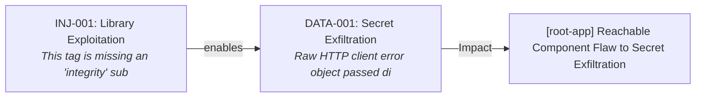
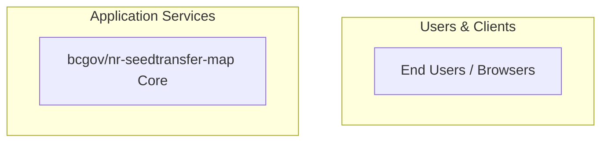

# Security Assessment: bcgov/nr-seedtransfer-map

Commit: `ae8766441241e9ba3dadc054352c2646fec8f0a0`

Generated by `scripts/compile-findings.py` + `scripts/render-report.py` (scripted findings; not Copilot-authored).

## Executive summary

27 open finding(s) (Critical 0, High 0, Medium 26, Low 1); 0 confirmed-fixed. Top findings: CICD-001 (Medium), CICD-002 (Medium), CICD-003 (Medium), CICD-004 (Medium), CICD-005 (Medium). Coverage gaps: GitHub's own alert list was not read (dependabot: HTTP 403 or unavailable). Public scanner proxy used instead.; GitHub's own alert list was not read (code-scanning: HTTP 403 or unavailable). Public scanner proxy used instead.; GitHub's own alert list was not read (secret-scanning: HTTP 403 or unavailable). Public scanner proxy used instead.. VEX analysis: 0/1 dependency CVEs reachable in source. Correlated 1 exploit attack chain(s). Score is written separately by score.py.

## Scope table

| Chapter | Status | Findings |
|---|---|---|
| architecture | analyzed | 0 |
| cicd | analyzed | 14 |
| zero-trust | analyzed | 8 |
| authn | analyzed | 0 |
| authz | not_assessed | 0 |
| injection | analyzed | 6 |
| configuration | analyzed | 0 |
| cryptography | analyzed | 3 |
| secrets | analyzed | 0 |
| logging-data | analyzed | 3 |
| code-scanning | analyzed | 20 |
| secret-scanning | analyzed | 0 |
| dependabot | analyzed | 1 |
| dependencies | analyzed | 1 |
| containers-iac | analyzed | 0 |
| testing | analyzed | 0 |
| stack | analyzed | 0 |

## Severity totals

| Severity | Count |
|---|---|
| Critical | 0 |
| High | 0 |
| Medium | 26 |
| Low | 1 |

| Domain | Findings |
|---|---|
| CICD | 14 |
| CRYPTO | 3 |
| DATA | 3 |
| DEPS | 1 |
| INJ | 6 |

## OWASP Top 10 (2021)

| Category | Findings |
|---|---|
| A01 Broken Access Control | CRYPTO-001, CRYPTO-002, CRYPTO-003, INJ-005 |
| A02 Cryptographic Failures | none |
| A03 Injection | none |
| A04 Insecure Design | none |
| A05 Security Misconfiguration | none |
| A06 Vulnerable and Outdated Components | none |
| A07 Identification and Authentication Failures | none |
| A08 Software and Data Integrity Failures | none |
| A09 Security Logging and Monitoring Failures | DATA-001, DATA-002, DATA-003 |
| A10 Server-Side Request Forgery | none |

## Component risk ranking

1. bcgov/nr-seedtransfer-map Core (`root-app`) — Risk Score: 53 (27 finding(s): CICD-001, CICD-002, CICD-003, CICD-004, CICD-005)

## Attack chains (exploit correlation)

Multi-stage exploit paths synthesized across individual scanner and code findings. Remediating earlier stages breaks the attack chain.

### CHAIN-001: [root-app] Reachable Component Flaw to Secret Exfiltration

- **Severity:** High
- **Findings involved:** INJ-001, DATA-001
- **Narrative:** In component 'root-app', exploiting reachable dependency vulnerability INJ-001 grants code execution access within the container context, leading to extraction of credentials identified in DATA-001.
- **Coordinated Remediation:** Upgrade the reachable dependency and rotate the exposed credentials.

## Tools run

- **semgrep** 1.184.0 — ok; 23 result(s). scanned 39 path(s)
- **gitleaks** gitleaks — ok; 0 result(s). clean scan
- **osv-scanner** osv-scanner — ok; 1 result(s). 1 advisory hit(s)
- **trivy** 0.76.1 — ok; 0 result(s). 0 vuln(s), 0 misconfig(s)
- **dependabot** unknown — failed; 0 result(s). WARN: dependabot unavailable: gh: Resource not accessible by integration (HTTP 403)
- **code-scanning** unknown — failed; 0 result(s). WARN: code-scanning unavailable: gh: Resource not accessible by integration (HTTP 403)
- **secret-scanning** unknown — failed; 0 result(s). WARN: secret-scanning-raw unavailable: gh: Resource not accessible by integration (HTTP 403)

## architecture

Status: analyzed

Public clone layout reviewed via README.md, package.json; monorepo/components inferred from manifests.

### Architecture overview

Discovered components:
- **bcgov/nr-seedtransfer-map Core** (`root-app`, type: `api`): paths ['.']

Chapter write-up: scripted assessment records tool context, citation targets, and per-finding impact when findings exist; clean chapters still document what ran.

- README.md:1
- package.json:1

## cicd

Status: analyzed

Reviewed 5 GitHub workflow file(s) under .github/workflows; 14 supply-chain/workflow finding(s) from scanners.

Chapter write-up: scripted assessment records tool context, citation targets, and per-finding impact when findings exist; clean chapters still document what ran.

- **CICD-001** (Medium): GitHub Actions step uses a mutable tag or branch reference. Tags and branch names can be silently repointed by the action owner, enabling supply-chain attacks — — impact: GitHub Actions step uses a mutable tag or branch reference. Tags and branch names can be silently repointed by the action owner, enabling supply-chain attacks —
- **CICD-002** (Medium): GitHub Actions step uses a mutable tag or branch reference. Tags and branch names can be silently repointed by the action owner, enabling supply-chain attacks — — impact: GitHub Actions step uses a mutable tag or branch reference. Tags and branch names can be silently repointed by the action owner, enabling supply-chain attacks —
- **CICD-003** (Medium): GitHub Actions step uses a mutable tag or branch reference. Tags and branch names can be silently repointed by the action owner, enabling supply-chain attacks — — impact: GitHub Actions step uses a mutable tag or branch reference. Tags and branch names can be silently repointed by the action owner, enabling supply-chain attacks —
- **CICD-004** (Medium): GitHub Actions step uses a mutable tag or branch reference. Tags and branch names can be silently repointed by the action owner, enabling supply-chain attacks — — impact: GitHub Actions step uses a mutable tag or branch reference. Tags and branch names can be silently repointed by the action owner, enabling supply-chain attacks —
- **CICD-005** (Medium): GitHub Actions step uses a mutable tag or branch reference. Tags and branch names can be silently repointed by the action owner, enabling supply-chain attacks — — impact: GitHub Actions step uses a mutable tag or branch reference. Tags and branch names can be silently repointed by the action owner, enabling supply-chain attacks —
- **CICD-006** (Medium): GitHub Actions step uses a mutable tag or branch reference. Tags and branch names can be silently repointed by the action owner, enabling supply-chain attacks — — impact: GitHub Actions step uses a mutable tag or branch reference. Tags and branch names can be silently repointed by the action owner, enabling supply-chain attacks —
- **CICD-007** (Medium): GitHub Actions step uses a mutable tag or branch reference. Tags and branch names can be silently repointed by the action owner, enabling supply-chain attacks — — impact: GitHub Actions step uses a mutable tag or branch reference. Tags and branch names can be silently repointed by the action owner, enabling supply-chain attacks —
- **CICD-008** (Medium): GitHub Actions step uses a mutable tag or branch reference. Tags and branch names can be silently repointed by the action owner, enabling supply-chain attacks — — impact: GitHub Actions step uses a mutable tag or branch reference. Tags and branch names can be silently repointed by the action owner, enabling supply-chain attacks —
- **CICD-009** (Medium): GitHub Actions step uses a mutable tag or branch reference. Tags and branch names can be silently repointed by the action owner, enabling supply-chain attacks — — impact: GitHub Actions step uses a mutable tag or branch reference. Tags and branch names can be silently repointed by the action owner, enabling supply-chain attacks —
- **CICD-010** (Medium): GitHub Actions step uses a mutable tag or branch reference. Tags and branch names can be silently repointed by the action owner, enabling supply-chain attacks — — impact: GitHub Actions step uses a mutable tag or branch reference. Tags and branch names can be silently repointed by the action owner, enabling supply-chain attacks —
- **CICD-011** (Medium): GitHub Actions step uses a mutable tag or branch reference. Tags and branch names can be silently repointed by the action owner, enabling supply-chain attacks — — impact: GitHub Actions step uses a mutable tag or branch reference. Tags and branch names can be silently repointed by the action owner, enabling supply-chain attacks —
- **CICD-012** (Medium): GitHub Actions step uses a mutable tag or branch reference. Tags and branch names can be silently repointed by the action owner, enabling supply-chain attacks — — impact: GitHub Actions step uses a mutable tag or branch reference. Tags and branch names can be silently repointed by the action owner, enabling supply-chain attacks —
- **CICD-013** (Medium): GitHub Actions step uses a mutable tag or branch reference. Tags and branch names can be silently repointed by the action owner, enabling supply-chain attacks — — impact: GitHub Actions step uses a mutable tag or branch reference. Tags and branch names can be silently repointed by the action owner, enabling supply-chain attacks —
- **CICD-014** (Medium): GitHub Actions step uses a mutable tag or branch reference. Tags and branch names can be silently repointed by the action owner, enabling supply-chain attacks — — impact: GitHub Actions step uses a mutable tag or branch reference. Tags and branch names can be silently repointed by the action owner, enabling supply-chain attacks —

## zero-trust

Status: analyzed

Mapped 8 Critical/High/Medium finding(s) to Verify Explicitly / Least Privilege / Assume Breach themes from scanner output.

Chapter write-up: scripted assessment records tool context, citation targets, and per-finding impact when findings exist; clean chapters still document what ran.

- **CICD-001** (Medium): GitHub Actions step uses a mutable tag or branch reference. Tags and branch names can be silently repointed by the action owner, enabling supply-chain attacks — — impact: GitHub Actions step uses a mutable tag or branch reference. Tags and branch names can be silently repointed by the action owner, enabling supply-chain attacks —
- **CICD-002** (Medium): GitHub Actions step uses a mutable tag or branch reference. Tags and branch names can be silently repointed by the action owner, enabling supply-chain attacks — — impact: GitHub Actions step uses a mutable tag or branch reference. Tags and branch names can be silently repointed by the action owner, enabling supply-chain attacks —
- **CICD-003** (Medium): GitHub Actions step uses a mutable tag or branch reference. Tags and branch names can be silently repointed by the action owner, enabling supply-chain attacks — — impact: GitHub Actions step uses a mutable tag or branch reference. Tags and branch names can be silently repointed by the action owner, enabling supply-chain attacks —
- **CICD-004** (Medium): GitHub Actions step uses a mutable tag or branch reference. Tags and branch names can be silently repointed by the action owner, enabling supply-chain attacks — — impact: GitHub Actions step uses a mutable tag or branch reference. Tags and branch names can be silently repointed by the action owner, enabling supply-chain attacks —
- **CICD-005** (Medium): GitHub Actions step uses a mutable tag or branch reference. Tags and branch names can be silently repointed by the action owner, enabling supply-chain attacks — — impact: GitHub Actions step uses a mutable tag or branch reference. Tags and branch names can be silently repointed by the action owner, enabling supply-chain attacks —
- **CICD-006** (Medium): GitHub Actions step uses a mutable tag or branch reference. Tags and branch names can be silently repointed by the action owner, enabling supply-chain attacks — — impact: GitHub Actions step uses a mutable tag or branch reference. Tags and branch names can be silently repointed by the action owner, enabling supply-chain attacks —
- **CICD-007** (Medium): GitHub Actions step uses a mutable tag or branch reference. Tags and branch names can be silently repointed by the action owner, enabling supply-chain attacks — — impact: GitHub Actions step uses a mutable tag or branch reference. Tags and branch names can be silently repointed by the action owner, enabling supply-chain attacks —
- **CICD-008** (Medium): GitHub Actions step uses a mutable tag or branch reference. Tags and branch names can be silently repointed by the action owner, enabling supply-chain attacks — — impact: GitHub Actions step uses a mutable tag or branch reference. Tags and branch names can be silently repointed by the action owner, enabling supply-chain attacks —

## authn

Status: analyzed

Authentication file checks and scanner hits: 0 open, 0 confirmed-fixed (AUTH seeds when target is nr-fom).

Chapter write-up: scripted assessment records tool context, citation targets, and per-finding impact when findings exist; clean chapters still document what ran.

- README.md:1

## authz

Status: not_assessed

No NestJS, Express, or Django authorization patterns or endpoints found to assess.

Chapter write-up: scripted assessment records tool context, citation targets, and per-finding impact when findings exist; clean chapters still document what ran.

## injection

Status: analyzed

Semgrep 1.184.0 ran with 23 result(s). scanned 39 path(s). 6 injection-domain finding(s) promoted.

Chapter write-up: scripted assessment records tool context, citation targets, and per-finding impact when findings exist; clean chapters still document what ran.

- **INJ-001** (Medium): This tag is missing an 'integrity' subresource integrity attribute. The 'integrity' attribute allows for the browser to verify that externally hosted files (for — impact: This tag is missing an 'integrity' subresource integrity attribute. The 'integrity' attribute allows for the browser to verify that externally hosted files (for
- **INJ-002** (Medium): This tag is missing an 'integrity' subresource integrity attribute. The 'integrity' attribute allows for the browser to verify that externally hosted files (for — impact: This tag is missing an 'integrity' subresource integrity attribute. The 'integrity' attribute allows for the browser to verify that externally hosted files (for
- **INJ-003** (Medium): This tag is missing an 'integrity' subresource integrity attribute. The 'integrity' attribute allows for the browser to verify that externally hosted files (for — impact: This tag is missing an 'integrity' subresource integrity attribute. The 'integrity' attribute allows for the browser to verify that externally hosted files (for
- **INJ-004** (Medium): This tag is missing an 'integrity' subresource integrity attribute. The 'integrity' attribute allows for the browser to verify that externally hosted files (for — impact: This tag is missing an 'integrity' subresource integrity attribute. The 'integrity' attribute allows for the browser to verify that externally hosted files (for
- **INJ-005** (Medium): Manually-created forms in django templates should specify a csrf_token to prevent CSRF attacks. — impact: Manually-created forms in django templates should specify a csrf_token to prevent CSRF attacks. CWE: CWE-352 OWASP: A01 Broken Access Control
- **INJ-006** (Medium): This Renovate configuration does not set a minimum release age. Newly published packages can be malicious or unstable. Add `"minimumReleaseAge": "7 days"` withi — impact: This Renovate configuration does not set a minimum release age. Newly published packages can be malicious or unstable. Add `"minimumReleaseAge": "7 days"` withi

## configuration

Status: analyzed

Configuration findings from scanners: 0. Public manifests reviewed for CORS/debug/TLS defaults where cited.

Chapter write-up: scripted assessment records tool context, citation targets, and per-finding impact when findings exist; clean chapters still document what ran.

- README.md:1

## cryptography

Status: analyzed

Cryptography file checks and scanner hits: 3 open, 0 confirmed-fixed.

Chapter write-up: scripted assessment records tool context, citation targets, and per-finding impact when findings exist; clean chapters still document what ran.

- **CRYPTO-001** (Medium): Detected possible user input going into a `path.join` or `path.resolve` function. This could possibly lead to a path traversal vulnerability,  where the attacke — impact: Detected possible user input going into a `path.join` or `path.resolve` function. This could possibly lead to a path traversal vulnerability,  where the attacke
- **CRYPTO-002** (Medium): Detected possible user input going into a `path.join` or `path.resolve` function. This could possibly lead to a path traversal vulnerability,  where the attacke — impact: Detected possible user input going into a `path.join` or `path.resolve` function. This could possibly lead to a path traversal vulnerability,  where the attacke
- **CRYPTO-003** (Medium): Detected possible user input going into a `path.join` or `path.resolve` function. This could possibly lead to a path traversal vulnerability,  where the attacke — impact: Detected possible user input going into a `path.join` or `path.resolve` function. This could possibly lead to a path traversal vulnerability,  where the attacke

## secrets

Status: analyzed

gitleaks gitleaks ran with 0 result(s). clean scan. 0 secret finding(s) promoted.

Chapter write-up: scripted assessment records tool context, citation targets, and per-finding impact when findings exist; clean chapters still document what ran.

- README.md:1

## logging-data

Status: analyzed

Logging/PII semantic and scanner hits: 3. Review checked client error logging and credential leaks.

Chapter write-up: scripted assessment records tool context, citation targets, and per-finding impact when findings exist; clean chapters still document what ran.

- **DATA-001** (Medium): Raw HTTP client error object passed directly to logger — impact: Serializing raw HTTP client error objects directly to logs exposes full request configurations, which frequently contain Authorization headers and Bearer tokens
- **DATA-002** (Medium): Raw HTTP client error object passed directly to logger — impact: Serializing raw HTTP client error objects directly to logs exposes full request configurations, which frequently contain Authorization headers and Bearer tokens
- **DATA-003** (Medium): Raw HTTP client error object passed directly to logger — impact: Serializing raw HTTP client error objects directly to logs exposes full request configurations, which frequently contain Authorization headers and Bearer tokens

## code-scanning

Status: analyzed

Semgrep 1.184.0 ran with 23 result(s). scanned 39 path(s). Public proxy for GitHub code-scanning until #96. GitHub's own alert list was not read (403/unavailable).

Chapter write-up: scripted assessment records tool context, citation targets, and per-finding impact when findings exist; clean chapters still document what ran.

- **CICD-001** (Medium): GitHub Actions step uses a mutable tag or branch reference. Tags and branch names can be silently repointed by the action owner, enabling supply-chain attacks — — impact: GitHub Actions step uses a mutable tag or branch reference. Tags and branch names can be silently repointed by the action owner, enabling supply-chain attacks —
- **CICD-002** (Medium): GitHub Actions step uses a mutable tag or branch reference. Tags and branch names can be silently repointed by the action owner, enabling supply-chain attacks — — impact: GitHub Actions step uses a mutable tag or branch reference. Tags and branch names can be silently repointed by the action owner, enabling supply-chain attacks —
- **CICD-003** (Medium): GitHub Actions step uses a mutable tag or branch reference. Tags and branch names can be silently repointed by the action owner, enabling supply-chain attacks — — impact: GitHub Actions step uses a mutable tag or branch reference. Tags and branch names can be silently repointed by the action owner, enabling supply-chain attacks —
- **CICD-004** (Medium): GitHub Actions step uses a mutable tag or branch reference. Tags and branch names can be silently repointed by the action owner, enabling supply-chain attacks — — impact: GitHub Actions step uses a mutable tag or branch reference. Tags and branch names can be silently repointed by the action owner, enabling supply-chain attacks —
- **CICD-005** (Medium): GitHub Actions step uses a mutable tag or branch reference. Tags and branch names can be silently repointed by the action owner, enabling supply-chain attacks — — impact: GitHub Actions step uses a mutable tag or branch reference. Tags and branch names can be silently repointed by the action owner, enabling supply-chain attacks —
- **CICD-006** (Medium): GitHub Actions step uses a mutable tag or branch reference. Tags and branch names can be silently repointed by the action owner, enabling supply-chain attacks — — impact: GitHub Actions step uses a mutable tag or branch reference. Tags and branch names can be silently repointed by the action owner, enabling supply-chain attacks —
- **CICD-007** (Medium): GitHub Actions step uses a mutable tag or branch reference. Tags and branch names can be silently repointed by the action owner, enabling supply-chain attacks — — impact: GitHub Actions step uses a mutable tag or branch reference. Tags and branch names can be silently repointed by the action owner, enabling supply-chain attacks —
- **CICD-008** (Medium): GitHub Actions step uses a mutable tag or branch reference. Tags and branch names can be silently repointed by the action owner, enabling supply-chain attacks — — impact: GitHub Actions step uses a mutable tag or branch reference. Tags and branch names can be silently repointed by the action owner, enabling supply-chain attacks —
- **CICD-009** (Medium): GitHub Actions step uses a mutable tag or branch reference. Tags and branch names can be silently repointed by the action owner, enabling supply-chain attacks — — impact: GitHub Actions step uses a mutable tag or branch reference. Tags and branch names can be silently repointed by the action owner, enabling supply-chain attacks —
- **CICD-010** (Medium): GitHub Actions step uses a mutable tag or branch reference. Tags and branch names can be silently repointed by the action owner, enabling supply-chain attacks — — impact: GitHub Actions step uses a mutable tag or branch reference. Tags and branch names can be silently repointed by the action owner, enabling supply-chain attacks —
- **CICD-011** (Medium): GitHub Actions step uses a mutable tag or branch reference. Tags and branch names can be silently repointed by the action owner, enabling supply-chain attacks — — impact: GitHub Actions step uses a mutable tag or branch reference. Tags and branch names can be silently repointed by the action owner, enabling supply-chain attacks —
- **CICD-012** (Medium): GitHub Actions step uses a mutable tag or branch reference. Tags and branch names can be silently repointed by the action owner, enabling supply-chain attacks — — impact: GitHub Actions step uses a mutable tag or branch reference. Tags and branch names can be silently repointed by the action owner, enabling supply-chain attacks —
- **CICD-013** (Medium): GitHub Actions step uses a mutable tag or branch reference. Tags and branch names can be silently repointed by the action owner, enabling supply-chain attacks — — impact: GitHub Actions step uses a mutable tag or branch reference. Tags and branch names can be silently repointed by the action owner, enabling supply-chain attacks —
- **CICD-014** (Medium): GitHub Actions step uses a mutable tag or branch reference. Tags and branch names can be silently repointed by the action owner, enabling supply-chain attacks — — impact: GitHub Actions step uses a mutable tag or branch reference. Tags and branch names can be silently repointed by the action owner, enabling supply-chain attacks —
- **CRYPTO-001** (Medium): Detected possible user input going into a `path.join` or `path.resolve` function. This could possibly lead to a path traversal vulnerability,  where the attacke — impact: Detected possible user input going into a `path.join` or `path.resolve` function. This could possibly lead to a path traversal vulnerability,  where the attacke
- **CRYPTO-002** (Medium): Detected possible user input going into a `path.join` or `path.resolve` function. This could possibly lead to a path traversal vulnerability,  where the attacke — impact: Detected possible user input going into a `path.join` or `path.resolve` function. This could possibly lead to a path traversal vulnerability,  where the attacke
- **CRYPTO-003** (Medium): Detected possible user input going into a `path.join` or `path.resolve` function. This could possibly lead to a path traversal vulnerability,  where the attacke — impact: Detected possible user input going into a `path.join` or `path.resolve` function. This could possibly lead to a path traversal vulnerability,  where the attacke
- **INJ-001** (Medium): This tag is missing an 'integrity' subresource integrity attribute. The 'integrity' attribute allows for the browser to verify that externally hosted files (for — impact: This tag is missing an 'integrity' subresource integrity attribute. The 'integrity' attribute allows for the browser to verify that externally hosted files (for
- **INJ-002** (Medium): This tag is missing an 'integrity' subresource integrity attribute. The 'integrity' attribute allows for the browser to verify that externally hosted files (for — impact: This tag is missing an 'integrity' subresource integrity attribute. The 'integrity' attribute allows for the browser to verify that externally hosted files (for
- **INJ-003** (Medium): This tag is missing an 'integrity' subresource integrity attribute. The 'integrity' attribute allows for the browser to verify that externally hosted files (for — impact: This tag is missing an 'integrity' subresource integrity attribute. The 'integrity' attribute allows for the browser to verify that externally hosted files (for

## secret-scanning

Status: analyzed

gitleaks gitleaks ran with 0 result(s). clean scan. Public proxy for GitHub secret-scanning until #96. GitHub's own alert list was not read (403/unavailable).

Chapter write-up: scripted assessment records tool context, citation targets, and per-finding impact when findings exist; clean chapters still document what ran.

- README.md:1

## dependabot

Status: analyzed

osv-scanner osv-scanner ran with 1 result(s). 1 advisory hit(s). Trivy 0.76.1 ran with 0 result(s). 0 vuln(s), 0 misconfig(s). Public proxy for Dependabot until #96. GitHub's own alert list was not read (403/unavailable).

### VEX Reachability Analysis

- Reachable dependency vulnerabilities: 0 (packages: none)
- Unreachable transitive vulnerabilities: 1 (packages: minimatch)

Chapter write-up: scripted assessment records tool context, citation targets, and per-finding impact when findings exist; clean chapters still document what ran.

- **DEPS-001** (Low): minimatch 10.2.6 affected by GHSA-g3hv-75wg-m249 — impact: minimatch has potential denial of service via globparts amplification CWE: CWE-405 Aliases: CVE-2026-118764.

## dependencies

Status: analyzed

osv-scanner osv-scanner ran with 1 result(s). 1 advisory hit(s). Trivy 0.76.1 ran with 0 result(s). 0 vuln(s), 0 misconfig(s). 1 dependency finding(s) promoted after dedupe.

### VEX Reachability Analysis

- Reachable dependency vulnerabilities: 0 (packages: none)
- Unreachable transitive vulnerabilities: 1 (packages: minimatch)

Chapter write-up: scripted assessment records tool context, citation targets, and per-finding impact when findings exist; clean chapters still document what ran.

- **DEPS-001** (Low): minimatch 10.2.6 affected by GHSA-g3hv-75wg-m249 — impact: minimatch has potential denial of service via globparts amplification CWE: CWE-405 Aliases: CVE-2026-118764.

## containers-iac

Status: analyzed

Trivy 0.76.1 ran with 0 result(s). 0 vuln(s), 0 misconfig(s). 0 IaC/container finding(s).

Chapter write-up: scripted assessment records tool context, citation targets, and per-finding impact when findings exist; clean chapters still document what ran.

- README.md:1

## testing

Status: analyzed

Found 1 test file(s) matching common unit/e2e patterns in the public clone.

Chapter write-up: scripted assessment records tool context, citation targets, and per-finding impact when findings exist; clean chapters still document what ran.

- tests/e2e.spec.js:1

## stack

Status: analyzed

Stack from public manifests: engines={"node": ">=20.19.0"}; renovate=yes; 5 workflow file(s).

Chapter write-up: scripted assessment records tool context, citation targets, and per-finding impact when findings exist; clean chapters still document what ran.

- package.json:27
- renovate.json:1

## Findings

### CICD-001: GitHub Actions step uses a mutable tag or branch reference. Tags and branch names can be silently repointed by the action owner, enabling supply-chain attacks —

- **Severity:** Medium
- **Domain:** CICD
- **Source:** semgrep
- **Evidence:** .github/workflows/demo-deploy.yml:31 (`- uses: actions/checkout@v7`)
- **Impact:** GitHub Actions step uses a mutable tag or branch reference. Tags and branch names can be silently repointed by the action owner, enabling supply-chain attacks — as seen in the trivy-action and kics-github-action compromises. Pin the referen CWE: CWE-1357, CWE-353
- **Recommendation:** Follow Semgrep rule guidance for yaml.github-actions.security.github-actions-mutable-action-tag.github-actions-mutable-action-tag: https://docs.github.com/en/actions/security-guides/security-hardening-for-github-actions#using-third-party-actions
- **CWE:** CWE-1357, CWE-353

### CICD-002: GitHub Actions step uses a mutable tag or branch reference. Tags and branch names can be silently repointed by the action owner, enabling supply-chain attacks —

- **Severity:** Medium
- **Domain:** CICD
- **Source:** semgrep
- **Evidence:** .github/workflows/merge.yml:20 (`- uses: actions/checkout@v7`)
- **Impact:** GitHub Actions step uses a mutable tag or branch reference. Tags and branch names can be silently repointed by the action owner, enabling supply-chain attacks — as seen in the trivy-action and kics-github-action compromises. Pin the referen CWE: CWE-1357, CWE-353
- **Recommendation:** Follow Semgrep rule guidance for yaml.github-actions.security.github-actions-mutable-action-tag.github-actions-mutable-action-tag: https://docs.github.com/en/actions/security-guides/security-hardening-for-github-actions#using-third-party-actions
- **CWE:** CWE-1357, CWE-353

### CICD-003: GitHub Actions step uses a mutable tag or branch reference. Tags and branch names can be silently repointed by the action owner, enabling supply-chain attacks —

- **Severity:** Medium
- **Domain:** CICD
- **Source:** semgrep
- **Evidence:** .github/workflows/merge.yml:22 (`uses: actions/setup-node@v7`)
- **Impact:** GitHub Actions step uses a mutable tag or branch reference. Tags and branch names can be silently repointed by the action owner, enabling supply-chain attacks — as seen in the trivy-action and kics-github-action compromises. Pin the referen CWE: CWE-1357, CWE-353
- **Recommendation:** Follow Semgrep rule guidance for yaml.github-actions.security.github-actions-mutable-action-tag.github-actions-mutable-action-tag: https://docs.github.com/en/actions/security-guides/security-hardening-for-github-actions#using-third-party-actions
- **CWE:** CWE-1357, CWE-353

### CICD-004: GitHub Actions step uses a mutable tag or branch reference. Tags and branch names can be silently repointed by the action owner, enabling supply-chain attacks —

- **Severity:** Medium
- **Domain:** CICD
- **Source:** semgrep
- **Evidence:** .github/workflows/merge.yml:37 (`- uses: actions/checkout@v7`)
- **Impact:** GitHub Actions step uses a mutable tag or branch reference. Tags and branch names can be silently repointed by the action owner, enabling supply-chain attacks — as seen in the trivy-action and kics-github-action compromises. Pin the referen CWE: CWE-1357, CWE-353
- **Recommendation:** Follow Semgrep rule guidance for yaml.github-actions.security.github-actions-mutable-action-tag.github-actions-mutable-action-tag: https://docs.github.com/en/actions/security-guides/security-hardening-for-github-actions#using-third-party-actions
- **CWE:** CWE-1357, CWE-353

### CICD-005: GitHub Actions step uses a mutable tag or branch reference. Tags and branch names can be silently repointed by the action owner, enabling supply-chain attacks —

- **Severity:** Medium
- **Domain:** CICD
- **Source:** semgrep
- **Evidence:** .github/workflows/merge.yml:39 (`uses: actions/setup-node@v7`)
- **Impact:** GitHub Actions step uses a mutable tag or branch reference. Tags and branch names can be silently repointed by the action owner, enabling supply-chain attacks — as seen in the trivy-action and kics-github-action compromises. Pin the referen CWE: CWE-1357, CWE-353
- **Recommendation:** Follow Semgrep rule guidance for yaml.github-actions.security.github-actions-mutable-action-tag.github-actions-mutable-action-tag: https://docs.github.com/en/actions/security-guides/security-hardening-for-github-actions#using-third-party-actions
- **CWE:** CWE-1357, CWE-353

### CICD-006: GitHub Actions step uses a mutable tag or branch reference. Tags and branch names can be silently repointed by the action owner, enabling supply-chain attacks —

- **Severity:** Medium
- **Domain:** CICD
- **Source:** semgrep
- **Evidence:** .github/workflows/pr-close.yml:36 (`- uses: actions/checkout@v7`)
- **Impact:** GitHub Actions step uses a mutable tag or branch reference. Tags and branch names can be silently repointed by the action owner, enabling supply-chain attacks — as seen in the trivy-action and kics-github-action compromises. Pin the referen CWE: CWE-1357, CWE-353
- **Recommendation:** Follow Semgrep rule guidance for yaml.github-actions.security.github-actions-mutable-action-tag.github-actions-mutable-action-tag: https://docs.github.com/en/actions/security-guides/security-hardening-for-github-actions#using-third-party-actions
- **CWE:** CWE-1357, CWE-353

### CICD-007: GitHub Actions step uses a mutable tag or branch reference. Tags and branch names can be silently repointed by the action owner, enabling supply-chain attacks —

- **Severity:** Medium
- **Domain:** CICD
- **Source:** semgrep
- **Evidence:** .github/workflows/pr-close.yml:60 (`- uses: actions/checkout@v7`)
- **Impact:** GitHub Actions step uses a mutable tag or branch reference. Tags and branch names can be silently repointed by the action owner, enabling supply-chain attacks — as seen in the trivy-action and kics-github-action compromises. Pin the referen CWE: CWE-1357, CWE-353
- **Recommendation:** Follow Semgrep rule guidance for yaml.github-actions.security.github-actions-mutable-action-tag.github-actions-mutable-action-tag: https://docs.github.com/en/actions/security-guides/security-hardening-for-github-actions#using-third-party-actions
- **CWE:** CWE-1357, CWE-353

### CICD-008: GitHub Actions step uses a mutable tag or branch reference. Tags and branch names can be silently repointed by the action owner, enabling supply-chain attacks —

- **Severity:** Medium
- **Domain:** CICD
- **Source:** semgrep
- **Evidence:** .github/workflows/pr-open.yml:24 (`- uses: actions/checkout@v7`)
- **Impact:** GitHub Actions step uses a mutable tag or branch reference. Tags and branch names can be silently repointed by the action owner, enabling supply-chain attacks — as seen in the trivy-action and kics-github-action compromises. Pin the referen CWE: CWE-1357, CWE-353
- **Recommendation:** Follow Semgrep rule guidance for yaml.github-actions.security.github-actions-mutable-action-tag.github-actions-mutable-action-tag: https://docs.github.com/en/actions/security-guides/security-hardening-for-github-actions#using-third-party-actions
- **CWE:** CWE-1357, CWE-353

### CICD-009: GitHub Actions step uses a mutable tag or branch reference. Tags and branch names can be silently repointed by the action owner, enabling supply-chain attacks —

- **Severity:** Medium
- **Domain:** CICD
- **Source:** semgrep
- **Evidence:** .github/workflows/pr-open.yml:37 (`uses: actions/setup-node@v7`)
- **Impact:** GitHub Actions step uses a mutable tag or branch reference. Tags and branch names can be silently repointed by the action owner, enabling supply-chain attacks — as seen in the trivy-action and kics-github-action compromises. Pin the referen CWE: CWE-1357, CWE-353
- **Recommendation:** Follow Semgrep rule guidance for yaml.github-actions.security.github-actions-mutable-action-tag.github-actions-mutable-action-tag: https://docs.github.com/en/actions/security-guides/security-hardening-for-github-actions#using-third-party-actions
- **CWE:** CWE-1357, CWE-353

### CICD-010: GitHub Actions step uses a mutable tag or branch reference. Tags and branch names can be silently repointed by the action owner, enabling supply-chain attacks —

- **Severity:** Medium
- **Domain:** CICD
- **Source:** semgrep
- **Evidence:** .github/workflows/pr-open.yml:52 (`- uses: actions/checkout@v7`)
- **Impact:** GitHub Actions step uses a mutable tag or branch reference. Tags and branch names can be silently repointed by the action owner, enabling supply-chain attacks — as seen in the trivy-action and kics-github-action compromises. Pin the referen CWE: CWE-1357, CWE-353
- **Recommendation:** Follow Semgrep rule guidance for yaml.github-actions.security.github-actions-mutable-action-tag.github-actions-mutable-action-tag: https://docs.github.com/en/actions/security-guides/security-hardening-for-github-actions#using-third-party-actions
- **CWE:** CWE-1357, CWE-353

### CICD-011: GitHub Actions step uses a mutable tag or branch reference. Tags and branch names can be silently repointed by the action owner, enabling supply-chain attacks —

- **Severity:** Medium
- **Domain:** CICD
- **Source:** semgrep
- **Evidence:** .github/workflows/pr-open.yml:54 (`uses: actions/setup-node@v7`)
- **Impact:** GitHub Actions step uses a mutable tag or branch reference. Tags and branch names can be silently repointed by the action owner, enabling supply-chain attacks — as seen in the trivy-action and kics-github-action compromises. Pin the referen CWE: CWE-1357, CWE-353
- **Recommendation:** Follow Semgrep rule guidance for yaml.github-actions.security.github-actions-mutable-action-tag.github-actions-mutable-action-tag: https://docs.github.com/en/actions/security-guides/security-hardening-for-github-actions#using-third-party-actions
- **CWE:** CWE-1357, CWE-353

### CICD-012: GitHub Actions step uses a mutable tag or branch reference. Tags and branch names can be silently repointed by the action owner, enabling supply-chain attacks —

- **Severity:** Medium
- **Domain:** CICD
- **Source:** semgrep
- **Evidence:** .github/workflows/pr-open.yml:65 (`uses: actions/cache@v6`)
- **Impact:** GitHub Actions step uses a mutable tag or branch reference. Tags and branch names can be silently repointed by the action owner, enabling supply-chain attacks — as seen in the trivy-action and kics-github-action compromises. Pin the referen CWE: CWE-1357, CWE-353
- **Recommendation:** Follow Semgrep rule guidance for yaml.github-actions.security.github-actions-mutable-action-tag.github-actions-mutable-action-tag: https://docs.github.com/en/actions/security-guides/security-hardening-for-github-actions#using-third-party-actions
- **CWE:** CWE-1357, CWE-353

### CICD-013: GitHub Actions step uses a mutable tag or branch reference. Tags and branch names can be silently repointed by the action owner, enabling supply-chain attacks —

- **Severity:** Medium
- **Domain:** CICD
- **Source:** semgrep
- **Evidence:** .github/workflows/pr-open.yml:96 (`- uses: actions/checkout@v7`)
- **Impact:** GitHub Actions step uses a mutable tag or branch reference. Tags and branch names can be silently repointed by the action owner, enabling supply-chain attacks — as seen in the trivy-action and kics-github-action compromises. Pin the referen CWE: CWE-1357, CWE-353
- **Recommendation:** Follow Semgrep rule guidance for yaml.github-actions.security.github-actions-mutable-action-tag.github-actions-mutable-action-tag: https://docs.github.com/en/actions/security-guides/security-hardening-for-github-actions#using-third-party-actions
- **CWE:** CWE-1357, CWE-353

### CICD-014: GitHub Actions step uses a mutable tag or branch reference. Tags and branch names can be silently repointed by the action owner, enabling supply-chain attacks —

- **Severity:** Medium
- **Domain:** CICD
- **Source:** semgrep
- **Evidence:** .github/workflows/pr-open.yml:98 (`uses: actions/setup-node@v7`)
- **Impact:** GitHub Actions step uses a mutable tag or branch reference. Tags and branch names can be silently repointed by the action owner, enabling supply-chain attacks — as seen in the trivy-action and kics-github-action compromises. Pin the referen CWE: CWE-1357, CWE-353
- **Recommendation:** Follow Semgrep rule guidance for yaml.github-actions.security.github-actions-mutable-action-tag.github-actions-mutable-action-tag: https://docs.github.com/en/actions/security-guides/security-hardening-for-github-actions#using-third-party-actions
- **CWE:** CWE-1357, CWE-353

### CRYPTO-001: Detected possible user input going into a `path.join` or `path.resolve` function. This could possibly lead to a path traversal vulnerability,  where the attacke

- **Severity:** Medium
- **Domain:** CRYPTO
- **Source:** semgrep
- **Evidence:** scripts/convert-to-fgb.js:204 (`[redacted: possible credential]`)
- **Impact:** Detected possible user input going into a `path.join` or `path.resolve` function. This could possibly lead to a path traversal vulnerability,  where the attacker can access arbitrary files stored in the file system. Instead, be sure to sani CWE: CWE-22 OWASP: A01 Broken Access Control
- **Recommendation:** Follow Semgrep rule guidance for javascript.lang.security.audit.path-traversal.path-join-resolve-traversal.path-join-resolve-traversal: https://owasp.org/www-community/attacks/Path_Traversal
- **CWE:** CWE-22
- **OWASP:** A01 Broken Access Control

### CRYPTO-002: Detected possible user input going into a `path.join` or `path.resolve` function. This could possibly lead to a path traversal vulnerability,  where the attacke

- **Severity:** Medium
- **Domain:** CRYPTO
- **Source:** semgrep
- **Evidence:** scripts/convert-to-fgb.js:240 (`[redacted: possible credential]`)
- **Impact:** Detected possible user input going into a `path.join` or `path.resolve` function. This could possibly lead to a path traversal vulnerability,  where the attacker can access arbitrary files stored in the file system. Instead, be sure to sani CWE: CWE-22 OWASP: A01 Broken Access Control
- **Recommendation:** Follow Semgrep rule guidance for javascript.lang.security.audit.path-traversal.path-join-resolve-traversal.path-join-resolve-traversal: https://owasp.org/www-community/attacks/Path_Traversal
- **CWE:** CWE-22
- **OWASP:** A01 Broken Access Control

### CRYPTO-003: Detected possible user input going into a `path.join` or `path.resolve` function. This could possibly lead to a path traversal vulnerability,  where the attacke

- **Severity:** Medium
- **Domain:** CRYPTO
- **Source:** semgrep
- **Evidence:** scripts/export-layers-to-fgb.js:57 (`[redacted: possible credential]`)
- **Impact:** Detected possible user input going into a `path.join` or `path.resolve` function. This could possibly lead to a path traversal vulnerability,  where the attacker can access arbitrary files stored in the file system. Instead, be sure to sani CWE: CWE-22 OWASP: A01 Broken Access Control
- **Recommendation:** Follow Semgrep rule guidance for javascript.lang.security.audit.path-traversal.path-join-resolve-traversal.path-join-resolve-traversal: https://owasp.org/www-community/attacks/Path_Traversal
- **CWE:** CWE-22
- **OWASP:** A01 Broken Access Control

### DATA-001: Raw HTTP client error object passed directly to logger

- **Severity:** Medium
- **Domain:** DATA
- **Source:** semantic-analyzer
- **Evidence:** docs/scripts/defineMap.js:147 (`console.error('Failed to load Management Unit layer from local FlatGeobuf.', err`)
- **Impact:** Serializing raw HTTP client error objects directly to logs exposes full request configurations, which frequently contain Authorization headers and Bearer tokens.
- **Recommendation:** Log only `error.message` or `error.code` rather than serializing the entire HTTP error object.
- **CWE:** CWE-532
- **OWASP:** A09 Security Logging and Monitoring Failures

### DATA-002: Raw HTTP client error object passed directly to logger

- **Severity:** Medium
- **Domain:** DATA
- **Source:** semantic-analyzer
- **Evidence:** docs/scripts/defineMap.js:479 (`console.error(error)`)
- **Impact:** Serializing raw HTTP client error objects directly to logs exposes full request configurations, which frequently contain Authorization headers and Bearer tokens.
- **Recommendation:** Log only `error.message` or `error.code` rather than serializing the entire HTTP error object.
- **CWE:** CWE-532
- **OWASP:** A09 Security Logging and Monitoring Failures

### DATA-003: Raw HTTP client error object passed directly to logger

- **Severity:** Medium
- **Domain:** DATA
- **Source:** semantic-analyzer
- **Evidence:** scripts/export-layers-to-fgb.js:348 (`console.error('Error exporting layers:', err);`)
- **Impact:** Serializing raw HTTP client error objects directly to logs exposes full request configurations, which frequently contain Authorization headers and Bearer tokens.
- **Recommendation:** Log only `error.message` or `error.code` rather than serializing the entire HTTP error object.
- **CWE:** CWE-532
- **OWASP:** A09 Security Logging and Monitoring Failures

### INJ-001: This tag is missing an 'integrity' subresource integrity attribute. The 'integrity' attribute allows for the browser to verify that externally hosted files (for

- **Severity:** Medium
- **Domain:** INJ
- **Source:** semgrep
- **Evidence:** docs/index.html:22 (`<link rel="stylesheet" href="https://js.arcgis.com/4.34/esri/themes/light/main.c`)
- **Impact:** This tag is missing an 'integrity' subresource integrity attribute. The 'integrity' attribute allows for the browser to verify that externally hosted files (for example from a CDN) are delivered without unexpected manipulation. Without this CWE: CWE-353
- **Recommendation:** Follow Semgrep rule guidance for html.security.audit.missing-integrity.missing-integrity: https://owasp.org/Top10/A08_2021-Software_and_Data_Integrity_Failures
- **CWE:** CWE-353

### INJ-002: This tag is missing an 'integrity' subresource integrity attribute. The 'integrity' attribute allows for the browser to verify that externally hosted files (for

- **Severity:** Medium
- **Domain:** INJ
- **Source:** semgrep
- **Evidence:** docs/index.html:35 (``)
- **Impact:** This tag is missing an 'integrity' subresource integrity attribute. The 'integrity' attribute allows for the browser to verify that externally hosted files (for example from a CDN) are delivered without unexpected manipulation. Without this CWE: CWE-353
- **Recommendation:** Follow Semgrep rule guidance for html.security.audit.missing-integrity.missing-integrity: https://owasp.org/Top10/A08_2021-Software_and_Data_Integrity_Failures
- **CWE:** CWE-353

### INJ-003: This tag is missing an 'integrity' subresource integrity attribute. The 'integrity' attribute allows for the browser to verify that externally hosted files (for

- **Severity:** Medium
- **Domain:** INJ
- **Source:** semgrep
- **Evidence:** docs/index.html:36 (``)
- **Impact:** This tag is missing an 'integrity' subresource integrity attribute. The 'integrity' attribute allows for the browser to verify that externally hosted files (for example from a CDN) are delivered without unexpected manipulation. Without this CWE: CWE-353
- **Recommendation:** Follow Semgrep rule guidance for html.security.audit.missing-integrity.missing-integrity: https://owasp.org/Top10/A08_2021-Software_and_Data_Integrity_Failures
- **CWE:** CWE-353

### INJ-004: This tag is missing an 'integrity' subresource integrity attribute. The 'integrity' attribute allows for the browser to verify that externally hosted files (for

- **Severity:** Medium
- **Domain:** INJ
- **Source:** semgrep
- **Evidence:** docs/index.html:37 (`<script`)
- **Impact:** This tag is missing an 'integrity' subresource integrity attribute. The 'integrity' attribute allows for the browser to verify that externally hosted files (for example from a CDN) are delivered without unexpected manipulation. Without this CWE: CWE-353
- **Recommendation:** Follow Semgrep rule guidance for html.security.audit.missing-integrity.missing-integrity: https://owasp.org/Top10/A08_2021-Software_and_Data_Integrity_Failures
- **CWE:** CWE-353

### INJ-005: Manually-created forms in django templates should specify a csrf_token to prevent CSRF attacks.

- **Severity:** Medium
- **Domain:** INJ
- **Source:** semgrep
- **Evidence:** docs/index.html:423 (`[redacted: possible credential]`)
- **Impact:** Manually-created forms in django templates should specify a csrf_token to prevent CSRF attacks. CWE: CWE-352 OWASP: A01 Broken Access Control
- **Recommendation:** Follow Semgrep rule guidance for python.django.security.django-no-csrf-token.django-no-csrf-token: https://docs.djangoproject.com/en/4.2/howto/csrf/
- **CWE:** CWE-352
- **OWASP:** A01 Broken Access Control

### INJ-006: This Renovate configuration does not set a minimum release age. Newly published packages can be malicious or unstable. Add `"minimumReleaseAge": "7 days"` withi

- **Severity:** Medium
- **Domain:** INJ
- **Source:** semgrep
- **Evidence:** renovate.json:20 (`{`)
- **Impact:** This Renovate configuration does not set a minimum release age. Newly published packages can be malicious or unstable. Add `"minimumReleaseAge": "7 days"` within a `packageRules` entry to wait 7 days before proposing updates to newly publis CWE: CWE-829
- **Recommendation:** Follow Semgrep rule guidance for package_managers.renovate.renovate-missing-minimum-release-age.renovate-missing-minimum-release-age: https://docs.renovatebot.com/configuration-options/#minimumreleaseage
- **CWE:** CWE-829

### DEPS-001: minimatch 10.2.6 affected by GHSA-g3hv-75wg-m249

- **Severity:** Low
- **Domain:** DEPS
- **Source:** osv-scanner
- **Reachability:** unreachable (VEX status: `not_affected`)
- **VEX Justification:** vulnerable_code_not_in_execute_path (unimported transitive dependency with no imported parent callers)
- **Evidence:** package-lock.json:1312 (`"node_modules/minimatch": {`)
- **Impact:** minimatch has potential denial of service via globparts amplification CWE: CWE-405 Aliases: CVE-2026-118764.
- **Recommendation:** Upgrade minimatch from 10.2.6 to a patched release per GHSA-g3hv-75wg-m249.
- **CWE:** CWE-405

## Confirmed fixed

None.

## Coverage gaps

- GitHub's own alert list was not read (dependabot: HTTP 403 or unavailable). Public scanner proxy used instead.
- GitHub's own alert list was not read (code-scanning: HTTP 403 or unavailable). Public scanner proxy used instead.
- GitHub's own alert list was not read (secret-scanning: HTTP 403 or unavailable). Public scanner proxy used instead.

## Questions

None.
