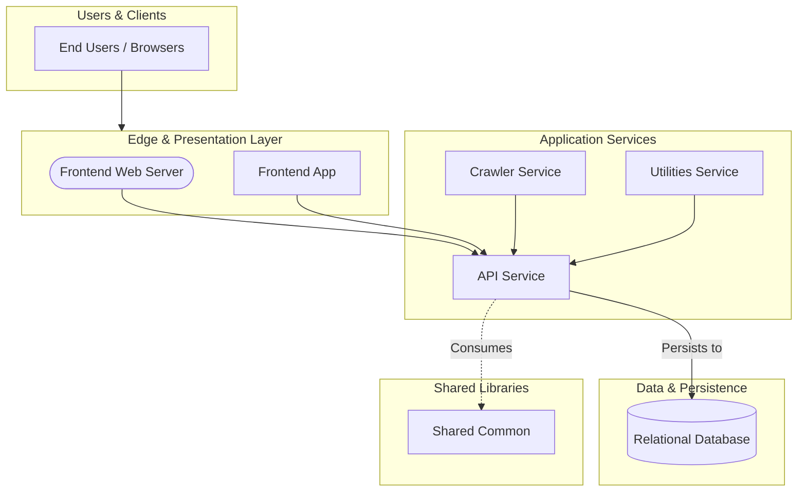

# Security Assessment: bcgov/pubcode

Commit: `6fffc5f65f6fb5be234d890d47677bc76570c745`

Generated by `scripts/compile-findings.py` + `scripts/render-report.py` (scripted findings; not Copilot-authored).

## Executive summary

35 open finding(s) (Critical 0, High 2, Medium 20, Low 13); 0 confirmed-fixed. Top findings: AUTHZ-001 (High), AUTHZ-002 (High), DEPS-001 (Medium), DEPS-002 (Medium), DEPS-003 (Medium). Coverage gaps: GitHub's own alert list was not read (dependabot: HTTP 403 or unavailable). Public scanner proxy used instead.; GitHub's own alert list was not read (code-scanning: HTTP 403 or unavailable). Public scanner proxy used instead.; GitHub's own alert list was not read (secret-scanning: HTTP 403 or unavailable). Public scanner proxy used instead.. VEX analysis: 4/4 dependency CVEs reachable in source. Score is written separately by score.py.

## Scope table

| Chapter | Status | Findings |
|---|---|---|
| architecture | analyzed | 0 |
| cicd | analyzed | 0 |
| zero-trust | analyzed | 8 |
| authn | analyzed | 0 |
| authz | analyzed | 2 |
| injection | analyzed | 2 |
| configuration | analyzed | 0 |
| cryptography | analyzed | 0 |
| secrets | analyzed | 0 |
| logging-data | analyzed | 0 |
| code-scanning | analyzed | 13 |
| secret-scanning | analyzed | 0 |
| dependabot | analyzed | 4 |
| dependencies | analyzed | 4 |
| containers-iac | analyzed | 27 |
| testing | analyzed | 0 |
| stack | analyzed | 0 |

## Severity totals

| Severity | Count |
|---|---|
| Critical | 0 |
| High | 2 |
| Medium | 20 |
| Low | 13 |

| Domain | Findings |
|---|---|
| AUTHZ | 2 |
| DEPS | 4 |
| INFRA | 27 |
| INJ | 2 |

## OWASP Top 10 (2021)

| Category | Findings |
|---|---|
| A01 Broken Access Control | AUTHZ-001, AUTHZ-002, INJ-001 |
| A02 Cryptographic Failures | none |
| A03 Injection | none |
| A04 Insecure Design | none |
| A05 Security Misconfiguration | INFRA-015, INFRA-022, INFRA-023, INFRA-027, INFRA-012, INFRA-013, INFRA-014, INFRA-016, INFRA-017, INFRA-018, INFRA-019, INFRA-020, INFRA-021, INFRA-024, INFRA-025, INFRA-026 |
| A06 Vulnerable and Outdated Components | none |
| A07 Identification and Authentication Failures | none |
| A08 Software and Data Integrity Failures | none |
| A09 Security Logging and Monitoring Failures | none |
| A10 Server-Side Request Forgery | none |

## Component risk ranking

1. `root` — Risk Score: 26 (19 finding(s): INFRA-001, INFRA-002, INFRA-003, INFRA-015, INFRA-022)
2. Relational Database (`database`) — Risk Score: 16 (8 finding(s): INFRA-004, INFRA-005, INFRA-006, INFRA-007, INFRA-008)
3. API Service (`api`) — Risk Score: 15 (5 finding(s): AUTHZ-001, AUTHZ-002, DEPS-001, INJ-002, INJ-001)
4. Crawler Service (`crawler`) — Risk Score: 2 (1 finding(s): DEPS-002)
5. Frontend App (`frontend`) — Risk Score: 2 (1 finding(s): DEPS-003)
6. Utilities Service (`utilities`) — Risk Score: 2 (1 finding(s): DEPS-004)

## Tools run

- **semgrep** 1.184.0 — ok; 43 result(s). scanned 127 path(s)
- **gitleaks** gitleaks — ok; 0 result(s). clean scan
- **osv-scanner** osv-scanner — ok; 4 result(s). 4 advisory hit(s)
- **trivy** 0.76.1 — ok; 16 result(s). 0 vuln(s), 16 misconfig(s)
- **dependabot** unknown — failed; 0 result(s). WARN: dependabot unavailable: gh: Resource not accessible by integration (HTTP 403)
- **code-scanning** unknown — failed; 0 result(s). WARN: code-scanning unavailable: gh: Resource not accessible by integration (HTTP 403)
- **secret-scanning** unknown — failed; 0 result(s). WARN: secret-scanning-raw unavailable: gh: Resource not accessible by integration (HTTP 403)

## architecture

Status: analyzed

Public clone layout reviewed via README.md, bcgovpubcode.yml, docker-compose.yml; monorepo/components inferred from manifests.

### Architecture overview

Discovered components:
- **Frontend Web Server** (`frontend-web-server`, type: `ingress`): paths ['frontend/Caddyfile']
- **Frontend App** (`frontend`, type: `frontend`): paths ['frontend']
- **API Service** (`api`, type: `api`): paths ['api']
- **Crawler Service** (`crawler`, type: `batch`): paths ['crawler']
- **Utilities Service** (`utilities`, type: `batch`): paths ['utilities']
- **Relational Database** (`database`, type: `database`): paths ['database', 'docker-compose.yml']
- **Shared Common** (`common`, type: `library`): paths ['common']

Chapter write-up: scripted assessment records tool context, citation targets, and per-finding impact when findings exist; clean chapters still document what ran.

- README.md:1
- bcgovpubcode.yml:1
- docker-compose.yml:1

## cicd

Status: analyzed

Reviewed 8 GitHub workflow file(s) under .github/workflows; 0 supply-chain/workflow finding(s) from scanners.

Chapter write-up: scripted assessment records tool context, citation targets, and per-finding impact when findings exist; clean chapters still document what ran.

- .github/workflows/.deploy.yml:1

## zero-trust

Status: analyzed

Mapped 8 Critical/High/Medium finding(s) to Verify Explicitly / Least Privilege / Assume Breach themes from scanner output.

Chapter write-up: scripted assessment records tool context, citation targets, and per-finding impact when findings exist; clean chapters still document what ran.

- **AUTHZ-001** (High): Unauthenticated mutating route in Express (POST /bulk-load) — impact: Route handler processes mutating requests without prior authentication middleware, permitting unauthorized data modification.
- **AUTHZ-002** (High): Unauthenticated mutating route in Express (DELETE /:repo_name) — impact: Route handler processes mutating requests without prior authentication middleware, permitting unauthorized data modification.
- **DEPS-001** (Medium): minimatch 10.2.6 affected by GHSA-g3hv-75wg-m249 — impact: minimatch has potential denial of service via globparts amplification CWE: CWE-405 Aliases: CVE-2026-118764.
- **DEPS-002** (Medium): minimatch 10.2.6 affected by GHSA-g3hv-75wg-m249 — impact: minimatch has potential denial of service via globparts amplification CWE: CWE-405 Aliases: CVE-2026-118764.
- **DEPS-003** (Medium): minimatch 10.2.6 affected by GHSA-g3hv-75wg-m249 — impact: minimatch has potential denial of service via globparts amplification CWE: CWE-405 Aliases: CVE-2026-118764.
- **DEPS-004** (Medium): minimatch 10.2.6 affected by GHSA-g3hv-75wg-m249 — impact: minimatch has potential denial of service via globparts amplification CWE: CWE-405 Aliases: CVE-2026-118764.
- **INFRA-001** (Medium): In Kubernetes, each pod runs in its own isolated environment with its own set of security policies. However, certain container images may contain `setuid` or `s — impact: In Kubernetes, each pod runs in its own isolated environment with its own set of security policies. However, certain container images may contain `setuid` or `s
- **INFRA-002** (Medium): In Kubernetes, each pod runs in its own isolated environment with its own set of security policies. However, certain container images may contain `setuid` or `s — impact: In Kubernetes, each pod runs in its own isolated environment with its own set of security policies. However, certain container images may contain `setuid` or `s

## authn

Status: analyzed

Authentication file checks and scanner hits: 0 open, 0 confirmed-fixed (AUTH seeds when target is nr-fom).

Chapter write-up: scripted assessment records tool context, citation targets, and per-finding impact when findings exist; clean chapters still document what ran.

- README.md:1

## authz

Status: analyzed

Semantic authorization analysis reviewed controllers and endpoints; found 2 authorization/access control finding(s).

Chapter write-up: scripted assessment records tool context, citation targets, and per-finding impact when findings exist; clean chapters still document what ran.

- **AUTHZ-001** (High): Unauthenticated mutating route in Express (POST /bulk-load) — impact: Route handler processes mutating requests without prior authentication middleware, permitting unauthorized data modification.
- **AUTHZ-002** (High): Unauthenticated mutating route in Express (DELETE /:repo_name) — impact: Route handler processes mutating requests without prior authentication middleware, permitting unauthorized data modification.

## injection

Status: analyzed

Semgrep 1.184.0 ran with 43 result(s). scanned 127 path(s). 2 injection-domain finding(s) promoted.

Chapter write-up: scripted assessment records tool context, citation targets, and per-finding impact when findings exist; clean chapters still document what ran.

- **INJ-002** (Medium): Checks for any usage of http servers instead of https servers. Encourages the usage of https protocol instead of http, which does not have TLS and is therefore  — impact: Checks for any usage of http servers instead of https servers. Encourages the usage of https protocol instead of http, which does not have TLS and is therefore 
- **INJ-001** (Low): A CSRF middleware was not detected in your express application. Ensure you are either using one such as `csurf` or `csrf` (see rule references) and/or you are p — impact: A CSRF middleware was not detected in your express application. Ensure you are either using one such as `csurf` or `csrf` (see rule references) and/or you are p

## configuration

Status: analyzed

Configuration findings from scanners: 0. Public manifests reviewed for CORS/debug/TLS defaults where cited.

Chapter write-up: scripted assessment records tool context, citation targets, and per-finding impact when findings exist; clean chapters still document what ran.

- README.md:1

## cryptography

Status: analyzed

Cryptography file checks and scanner hits: 0 open, 0 confirmed-fixed.

Chapter write-up: scripted assessment records tool context, citation targets, and per-finding impact when findings exist; clean chapters still document what ran.

- README.md:1

## secrets

Status: analyzed

gitleaks gitleaks ran with 0 result(s). clean scan. 0 secret finding(s) promoted.

Chapter write-up: scripted assessment records tool context, citation targets, and per-finding impact when findings exist; clean chapters still document what ran.

- README.md:1

## logging-data

Status: analyzed

Logging/PII semantic and scanner hits: 0. Review checked client error logging and credential leaks.

Chapter write-up: scripted assessment records tool context, citation targets, and per-finding impact when findings exist; clean chapters still document what ran.

- README.md:1

## code-scanning

Status: analyzed

Semgrep 1.184.0 ran with 43 result(s). scanned 127 path(s). Public proxy for GitHub code-scanning until #96. GitHub's own alert list was not read (403/unavailable).

Chapter write-up: scripted assessment records tool context, citation targets, and per-finding impact when findings exist; clean chapters still document what ran.

- **INFRA-001** (Medium): In Kubernetes, each pod runs in its own isolated environment with its own set of security policies. However, certain container images may contain `setuid` or `s — impact: In Kubernetes, each pod runs in its own isolated environment with its own set of security policies. However, certain container images may contain `setuid` or `s
- **INFRA-002** (Medium): In Kubernetes, each pod runs in its own isolated environment with its own set of security policies. However, certain container images may contain `setuid` or `s — impact: In Kubernetes, each pod runs in its own isolated environment with its own set of security policies. However, certain container images may contain `setuid` or `s
- **INFRA-003** (Medium): In Kubernetes, each pod runs in its own isolated environment with its own set of security policies. However, certain container images may contain `setuid` or `s — impact: In Kubernetes, each pod runs in its own isolated environment with its own set of security policies. However, certain container images may contain `setuid` or `s
- **INFRA-004** (Medium): Service 'database' allows for privilege escalation via setuid or setgid binaries. Add 'no-new-privileges:true' in 'security_opt' to prevent this. — impact: Service 'database' allows for privilege escalation via setuid or setgid binaries. Add 'no-new-privileges:true' in 'security_opt' to prevent this. CWE: CWE-732
- **INFRA-005** (Medium): Service 'database' is running with a writable root filesystem. This may allow malicious applications to download and run additional payloads, or modify containe — impact: Service 'database' is running with a writable root filesystem. This may allow malicious applications to download and run additional payloads, or modify containe
- **INFRA-006** (Medium): Service 'mongo-express' allows for privilege escalation via setuid or setgid binaries. Add 'no-new-privileges:true' in 'security_opt' to prevent this. — impact: Service 'mongo-express' allows for privilege escalation via setuid or setgid binaries. Add 'no-new-privileges:true' in 'security_opt' to prevent this. CWE: CWE-
- **INFRA-007** (Medium): Service 'mongo-express' is running with a writable root filesystem. This may allow malicious applications to download and run additional payloads, or modify con — impact: Service 'mongo-express' is running with a writable root filesystem. This may allow malicious applications to download and run additional payloads, or modify con
- **INFRA-008** (Medium): Service 'api' allows for privilege escalation via setuid or setgid binaries. Add 'no-new-privileges:true' in 'security_opt' to prevent this. — impact: Service 'api' allows for privilege escalation via setuid or setgid binaries. Add 'no-new-privileges:true' in 'security_opt' to prevent this. CWE: CWE-732
- **INFRA-009** (Medium): Service 'api' is running with a writable root filesystem. This may allow malicious applications to download and run additional payloads, or modify container fil — impact: Service 'api' is running with a writable root filesystem. This may allow malicious applications to download and run additional payloads, or modify container fil
- **INFRA-010** (Medium): Service 'frontend' allows for privilege escalation via setuid or setgid binaries. Add 'no-new-privileges:true' in 'security_opt' to prevent this. — impact: Service 'frontend' allows for privilege escalation via setuid or setgid binaries. Add 'no-new-privileges:true' in 'security_opt' to prevent this. CWE: CWE-732
- **INFRA-011** (Medium): Service 'frontend' is running with a writable root filesystem. This may allow malicious applications to download and run additional payloads, or modify containe — impact: Service 'frontend' is running with a writable root filesystem. This may allow malicious applications to download and run additional payloads, or modify containe
- **INJ-002** (Medium): Checks for any usage of http servers instead of https servers. Encourages the usage of https protocol instead of http, which does not have TLS and is therefore  — impact: Checks for any usage of http servers instead of https servers. Encourages the usage of https protocol instead of http, which does not have TLS and is therefore 
- **INJ-001** (Low): A CSRF middleware was not detected in your express application. Ensure you are either using one such as `csurf` or `csrf` (see rule references) and/or you are p — impact: A CSRF middleware was not detected in your express application. Ensure you are either using one such as `csurf` or `csrf` (see rule references) and/or you are p

## secret-scanning

Status: analyzed

gitleaks gitleaks ran with 0 result(s). clean scan. Public proxy for GitHub secret-scanning until #96. GitHub's own alert list was not read (403/unavailable).

Chapter write-up: scripted assessment records tool context, citation targets, and per-finding impact when findings exist; clean chapters still document what ran.

- README.md:1

## dependabot

Status: analyzed

osv-scanner osv-scanner ran with 4 result(s). 4 advisory hit(s). Trivy 0.76.1 ran with 16 result(s). 0 vuln(s), 16 misconfig(s). Public proxy for Dependabot until #96. GitHub's own alert list was not read (403/unavailable).

### VEX Reachability Analysis

- Reachable dependency vulnerabilities: 4 (packages: minimatch)
- Unreachable transitive vulnerabilities: 0 (packages: none)

Chapter write-up: scripted assessment records tool context, citation targets, and per-finding impact when findings exist; clean chapters still document what ran.

- **DEPS-001** (Medium): minimatch 10.2.6 affected by GHSA-g3hv-75wg-m249 — impact: minimatch has potential denial of service via globparts amplification CWE: CWE-405 Aliases: CVE-2026-118764.
- **DEPS-002** (Medium): minimatch 10.2.6 affected by GHSA-g3hv-75wg-m249 — impact: minimatch has potential denial of service via globparts amplification CWE: CWE-405 Aliases: CVE-2026-118764.
- **DEPS-003** (Medium): minimatch 10.2.6 affected by GHSA-g3hv-75wg-m249 — impact: minimatch has potential denial of service via globparts amplification CWE: CWE-405 Aliases: CVE-2026-118764.
- **DEPS-004** (Medium): minimatch 10.2.6 affected by GHSA-g3hv-75wg-m249 — impact: minimatch has potential denial of service via globparts amplification CWE: CWE-405 Aliases: CVE-2026-118764.

## dependencies

Status: analyzed

osv-scanner osv-scanner ran with 4 result(s). 4 advisory hit(s). Trivy 0.76.1 ran with 16 result(s). 0 vuln(s), 16 misconfig(s). 4 dependency finding(s) promoted after dedupe.

### VEX Reachability Analysis

- Reachable dependency vulnerabilities: 4 (packages: minimatch)
- Unreachable transitive vulnerabilities: 0 (packages: none)

Chapter write-up: scripted assessment records tool context, citation targets, and per-finding impact when findings exist; clean chapters still document what ran.

- **DEPS-001** (Medium): minimatch 10.2.6 affected by GHSA-g3hv-75wg-m249 — impact: minimatch has potential denial of service via globparts amplification CWE: CWE-405 Aliases: CVE-2026-118764.
- **DEPS-002** (Medium): minimatch 10.2.6 affected by GHSA-g3hv-75wg-m249 — impact: minimatch has potential denial of service via globparts amplification CWE: CWE-405 Aliases: CVE-2026-118764.
- **DEPS-003** (Medium): minimatch 10.2.6 affected by GHSA-g3hv-75wg-m249 — impact: minimatch has potential denial of service via globparts amplification CWE: CWE-405 Aliases: CVE-2026-118764.
- **DEPS-004** (Medium): minimatch 10.2.6 affected by GHSA-g3hv-75wg-m249 — impact: minimatch has potential denial of service via globparts amplification CWE: CWE-405 Aliases: CVE-2026-118764.

## containers-iac

Status: analyzed

Trivy 0.76.1 ran with 16 result(s). 0 vuln(s), 16 misconfig(s). 27 IaC/container finding(s).

Chapter write-up: scripted assessment records tool context, citation targets, and per-finding impact when findings exist; clean chapters still document what ran.

- **INFRA-001** (Medium): In Kubernetes, each pod runs in its own isolated environment with its own set of security policies. However, certain container images may contain `setuid` or `s — impact: In Kubernetes, each pod runs in its own isolated environment with its own set of security policies. However, certain container images may contain `setuid` or `s
- **INFRA-002** (Medium): In Kubernetes, each pod runs in its own isolated environment with its own set of security policies. However, certain container images may contain `setuid` or `s — impact: In Kubernetes, each pod runs in its own isolated environment with its own set of security policies. However, certain container images may contain `setuid` or `s
- **INFRA-003** (Medium): In Kubernetes, each pod runs in its own isolated environment with its own set of security policies. However, certain container images may contain `setuid` or `s — impact: In Kubernetes, each pod runs in its own isolated environment with its own set of security policies. However, certain container images may contain `setuid` or `s
- **INFRA-004** (Medium): Service 'database' allows for privilege escalation via setuid or setgid binaries. Add 'no-new-privileges:true' in 'security_opt' to prevent this. — impact: Service 'database' allows for privilege escalation via setuid or setgid binaries. Add 'no-new-privileges:true' in 'security_opt' to prevent this. CWE: CWE-732
- **INFRA-005** (Medium): Service 'database' is running with a writable root filesystem. This may allow malicious applications to download and run additional payloads, or modify containe — impact: Service 'database' is running with a writable root filesystem. This may allow malicious applications to download and run additional payloads, or modify containe
- **INFRA-006** (Medium): Service 'mongo-express' allows for privilege escalation via setuid or setgid binaries. Add 'no-new-privileges:true' in 'security_opt' to prevent this. — impact: Service 'mongo-express' allows for privilege escalation via setuid or setgid binaries. Add 'no-new-privileges:true' in 'security_opt' to prevent this. CWE: CWE-
- **INFRA-007** (Medium): Service 'mongo-express' is running with a writable root filesystem. This may allow malicious applications to download and run additional payloads, or modify con — impact: Service 'mongo-express' is running with a writable root filesystem. This may allow malicious applications to download and run additional payloads, or modify con
- **INFRA-008** (Medium): Service 'api' allows for privilege escalation via setuid or setgid binaries. Add 'no-new-privileges:true' in 'security_opt' to prevent this. — impact: Service 'api' allows for privilege escalation via setuid or setgid binaries. Add 'no-new-privileges:true' in 'security_opt' to prevent this. CWE: CWE-732
- **INFRA-009** (Medium): Service 'api' is running with a writable root filesystem. This may allow malicious applications to download and run additional payloads, or modify container fil — impact: Service 'api' is running with a writable root filesystem. This may allow malicious applications to download and run additional payloads, or modify container fil
- **INFRA-010** (Medium): Service 'frontend' allows for privilege escalation via setuid or setgid binaries. Add 'no-new-privileges:true' in 'security_opt' to prevent this. — impact: Service 'frontend' allows for privilege escalation via setuid or setgid binaries. Add 'no-new-privileges:true' in 'security_opt' to prevent this. CWE: CWE-732
- **INFRA-011** (Medium): Service 'frontend' is running with a writable root filesystem. This may allow malicious applications to download and run additional payloads, or modify containe — impact: Service 'frontend' is running with a writable root filesystem. This may allow malicious applications to download and run additional payloads, or modify containe
- **INFRA-015** (Medium): Restrict container images to trusted registries — impact: Container api in deployment pubcode-api (namespace: null) uses an image from an untrusted registry.
- **INFRA-022** (Medium): Restrict container images to trusted registries — impact: Container database in statefulset pubcode-database (namespace: null) uses an image from an untrusted registry.
- **INFRA-023** (Medium): Restrict container images to trusted registries — impact: Container database-init in statefulset pubcode-database (namespace: null) uses an image from an untrusted registry.
- **INFRA-027** (Medium): Restrict container images to trusted registries — impact: Container frontend in deployment pubcode-frontend (namespace: null) uses an image from an untrusted registry.
- **INFRA-012** (Low): CPU not limited — impact: Container 'api' of Deployment 'pubcode-api' should set 'resources.limits.cpu'
- **INFRA-013** (Low): Runs with UID <= 10000 — impact: Container 'api' of Deployment 'pubcode-api' should set 'securityContext.runAsUser' > 10000
- **INFRA-014** (Low): Runs with GID <= 10000 — impact: Container 'api' of Deployment 'pubcode-api' should set 'securityContext.runAsGroup' > 10000
- **INFRA-016** (Low): CPU not limited — impact: Container 'database' of StatefulSet 'pubcode-database' should set 'resources.limits.cpu'
- **INFRA-017** (Low): CPU not limited — impact: Container 'database-init' of StatefulSet 'pubcode-database' should set 'resources.limits.cpu'
- **INFRA-018** (Low): Runs with UID <= 10000 — impact: Container 'database' of StatefulSet 'pubcode-database' should set 'securityContext.runAsUser' > 10000
- **INFRA-019** (Low): Runs with UID <= 10000 — impact: Container 'database-init' of StatefulSet 'pubcode-database' should set 'securityContext.runAsUser' > 10000
- **INFRA-020** (Low): Runs with GID <= 10000 — impact: Container 'database' of StatefulSet 'pubcode-database' should set 'securityContext.runAsGroup' > 10000
- **INFRA-021** (Low): Runs with GID <= 10000 — impact: Container 'database-init' of StatefulSet 'pubcode-database' should set 'securityContext.runAsGroup' > 10000
- **INFRA-024** (Low): CPU not limited — impact: Container 'frontend' of Deployment 'pubcode-frontend' should set 'resources.limits.cpu'
- **INFRA-025** (Low): Runs with UID <= 10000 — impact: Container 'frontend' of Deployment 'pubcode-frontend' should set 'securityContext.runAsUser' > 10000
- **INFRA-026** (Low): Runs with GID <= 10000 — impact: Container 'frontend' of Deployment 'pubcode-frontend' should set 'securityContext.runAsGroup' > 10000

## testing

Status: analyzed

No unit/e2e test files matched common patterns in the public clone.

Chapter write-up: scripted assessment records tool context, citation targets, and per-finding impact when findings exist; clean chapters still document what ran.

- README.md:1

## stack

Status: analyzed

Stack from public manifests: engines=n/a; renovate=yes; 8 workflow file(s).

Chapter write-up: scripted assessment records tool context, citation targets, and per-finding impact when findings exist; clean chapters still document what ran.

- renovate.json:1

## Findings

### AUTHZ-001: Unauthenticated mutating route in Express (POST /bulk-load)

- **Severity:** High
- **Domain:** AUTHZ
- **Source:** semantic-analyzer
- **Evidence:** api/src/routes/pubcode-router.js:25 (`router.post("/bulk-load", (req, res, next) => {`)
- **Impact:** Route handler processes mutating requests without prior authentication middleware, permitting unauthorized data modification.
- **Recommendation:** Insert authentication and authorization middleware (e.g. `passport.authenticate` or `verifyToken`) before the route handler.
- **CWE:** CWE-284, CWE-862
- **OWASP:** A01 Broken Access Control

### AUTHZ-002: Unauthenticated mutating route in Express (DELETE /:repo_name)

- **Severity:** High
- **Domain:** AUTHZ
- **Source:** semantic-analyzer
- **Evidence:** api/src/routes/pubcode-router.js:35 (`router.delete("/:repo_name", (req, res, next) => {`)
- **Impact:** Route handler processes mutating requests without prior authentication middleware, permitting unauthorized data modification.
- **Recommendation:** Insert authentication and authorization middleware (e.g. `passport.authenticate` or `verifyToken`) before the route handler.
- **CWE:** CWE-284, CWE-862
- **OWASP:** A01 Broken Access Control

### DEPS-001: minimatch 10.2.6 affected by GHSA-g3hv-75wg-m249

- **Severity:** Medium
- **Domain:** DEPS
- **Source:** osv-scanner
- **Reachability:** reachable (VEX status: `affected`)
- **VEX Justification:** Transitively reachable via imported package 'eslint-plugin-react'.
- **Evidence:** api/package-lock.json:1257 (`"node_modules/minimatch": {`)
- **Impact:** minimatch has potential denial of service via globparts amplification CWE: CWE-405 Aliases: CVE-2026-118764.
- **Recommendation:** Upgrade minimatch from 10.2.6 to a patched release per GHSA-g3hv-75wg-m249.
- **CWE:** CWE-405

### DEPS-002: minimatch 10.2.6 affected by GHSA-g3hv-75wg-m249

- **Severity:** Medium
- **Domain:** DEPS
- **Source:** osv-scanner
- **Reachability:** reachable (VEX status: `affected`)
- **VEX Justification:** Transitively reachable via imported package 'eslint-plugin-react'.
- **Evidence:** crawler/package-lock.json:590 (`"node_modules/minimatch": {`)
- **Impact:** minimatch has potential denial of service via globparts amplification CWE: CWE-405 Aliases: CVE-2026-118764.
- **Recommendation:** Upgrade minimatch from 10.2.6 to a patched release per GHSA-g3hv-75wg-m249.
- **CWE:** CWE-405

### DEPS-003: minimatch 10.2.6 affected by GHSA-g3hv-75wg-m249

- **Severity:** Medium
- **Domain:** DEPS
- **Source:** osv-scanner
- **Reachability:** reachable (VEX status: `affected`)
- **VEX Justification:** Transitively reachable via imported package 'eslint-plugin-react'.
- **Evidence:** frontend/package-lock.json:3376 (`"node_modules/eslint-plugin-react/node_modules/minimatch": {`)
- **Impact:** minimatch has potential denial of service via globparts amplification CWE: CWE-405 Aliases: CVE-2026-118764.
- **Recommendation:** Upgrade minimatch from 10.2.6 to a patched release per GHSA-g3hv-75wg-m249.
- **CWE:** CWE-405

### DEPS-004: minimatch 10.2.6 affected by GHSA-g3hv-75wg-m249

- **Severity:** Medium
- **Domain:** DEPS
- **Source:** osv-scanner
- **Reachability:** reachable (VEX status: `affected`)
- **VEX Justification:** Transitively reachable via imported package 'eslint-plugin-react'.
- **Evidence:** utilities/remove-deleted-pubcode/package-lock.json:552 (`"node_modules/minimatch": {`)
- **Impact:** minimatch has potential denial of service via globparts amplification CWE: CWE-405 Aliases: CVE-2026-118764.
- **Recommendation:** Upgrade minimatch from 10.2.6 to a patched release per GHSA-g3hv-75wg-m249.
- **CWE:** CWE-405

### INFRA-001: In Kubernetes, each pod runs in its own isolated environment with its own set of security policies. However, certain container images may contain `setuid` or `s

- **Severity:** Medium
- **Domain:** INFRA
- **Source:** semgrep
- **Evidence:** charts/pubcode/values.yaml:33 (`- name: api`)
- **Impact:** In Kubernetes, each pod runs in its own isolated environment with its own set of security policies. However, certain container images may contain `setuid` or `setgid` binaries that could allow an attacker to perform privilege escalation and CWE: CWE-732
- **Recommendation:** Follow Semgrep rule guidance for yaml.kubernetes.security.allow-privilege-escalation-no-securitycontext.allow-privilege-escalation-no-securitycontext: https://kubernetes.io/docs/concepts/policy/pod-security-policy/#privilege-escalation
- **CWE:** CWE-732

### INFRA-002: In Kubernetes, each pod runs in its own isolated environment with its own set of security policies. However, certain container images may contain `setuid` or `s

- **Severity:** Medium
- **Domain:** INFRA
- **Source:** semgrep
- **Evidence:** charts/pubcode/values.yaml:133 (`securityContext:`)
- **Impact:** In Kubernetes, each pod runs in its own isolated environment with its own set of security policies. However, certain container images may contain `setuid` or `setgid` binaries that could allow an attacker to perform privilege escalation and CWE: CWE-732
- **Recommendation:** Follow Semgrep rule guidance for yaml.kubernetes.security.allow-privilege-escalation.allow-privilege-escalation: https://kubernetes.io/docs/concepts/policy/pod-security-policy/#privilege-escalation
- **CWE:** CWE-732

### INFRA-003: In Kubernetes, each pod runs in its own isolated environment with its own set of security policies. However, certain container images may contain `setuid` or `s

- **Severity:** Medium
- **Domain:** INFRA
- **Source:** semgrep
- **Evidence:** charts/pubcode/values.yaml:266 (`- name: database`)
- **Impact:** In Kubernetes, each pod runs in its own isolated environment with its own set of security policies. However, certain container images may contain `setuid` or `setgid` binaries that could allow an attacker to perform privilege escalation and CWE: CWE-732
- **Recommendation:** Follow Semgrep rule guidance for yaml.kubernetes.security.allow-privilege-escalation-no-securitycontext.allow-privilege-escalation-no-securitycontext: https://kubernetes.io/docs/concepts/policy/pod-security-policy/#privilege-escalation
- **CWE:** CWE-732

### INFRA-004: Service 'database' allows for privilege escalation via setuid or setgid binaries. Add 'no-new-privileges:true' in 'security_opt' to prevent this.

- **Severity:** Medium
- **Domain:** INFRA
- **Source:** semgrep
- **Evidence:** docker-compose.yml:5 (`database:`)
- **Impact:** Service 'database' allows for privilege escalation via setuid or setgid binaries. Add 'no-new-privileges:true' in 'security_opt' to prevent this. CWE: CWE-732
- **Recommendation:** Follow Semgrep rule guidance for yaml.docker-compose.security.no-new-privileges.no-new-privileges: https://raesene.github.io/blog/2019/06/01/docker-capabilities-and-no-new-privs/
- **CWE:** CWE-732

### INFRA-005: Service 'database' is running with a writable root filesystem. This may allow malicious applications to download and run additional payloads, or modify containe

- **Severity:** Medium
- **Domain:** INFRA
- **Source:** semgrep
- **Evidence:** docker-compose.yml:5 (`database:`)
- **Impact:** Service 'database' is running with a writable root filesystem. This may allow malicious applications to download and run additional payloads, or modify container files. If an application inside a container has to save something temporarily  CWE: CWE-732
- **Recommendation:** Follow Semgrep rule guidance for yaml.docker-compose.security.writable-filesystem-service.writable-filesystem-service: https://docs.docker.com/compose/compose-file/compose-file-v3/#domainname-hostname-ipc-mac_address-privileged-read_only-shm_size-stdin_open-tty-user-working_dir
- **CWE:** CWE-732

### INFRA-006: Service 'mongo-express' allows for privilege escalation via setuid or setgid binaries. Add 'no-new-privileges:true' in 'security_opt' to prevent this.

- **Severity:** Medium
- **Domain:** INFRA
- **Source:** semgrep
- **Evidence:** docker-compose.yml:20 (`mongo-express: # The admin UI container for mongoDB`)
- **Impact:** Service 'mongo-express' allows for privilege escalation via setuid or setgid binaries. Add 'no-new-privileges:true' in 'security_opt' to prevent this. CWE: CWE-732
- **Recommendation:** Follow Semgrep rule guidance for yaml.docker-compose.security.no-new-privileges.no-new-privileges: https://raesene.github.io/blog/2019/06/01/docker-capabilities-and-no-new-privs/
- **CWE:** CWE-732

### INFRA-007: Service 'mongo-express' is running with a writable root filesystem. This may allow malicious applications to download and run additional payloads, or modify con

- **Severity:** Medium
- **Domain:** INFRA
- **Source:** semgrep
- **Evidence:** docker-compose.yml:20 (`mongo-express: # The admin UI container for mongoDB`)
- **Impact:** Service 'mongo-express' is running with a writable root filesystem. This may allow malicious applications to download and run additional payloads, or modify container files. If an application inside a container has to save something tempora CWE: CWE-732
- **Recommendation:** Follow Semgrep rule guidance for yaml.docker-compose.security.writable-filesystem-service.writable-filesystem-service: https://docs.docker.com/compose/compose-file/compose-file-v3/#domainname-hostname-ipc-mac_address-privileged-read_only-shm_size-stdin_open-tty-user-working_dir
- **CWE:** CWE-732

### INFRA-008: Service 'api' allows for privilege escalation via setuid or setgid binaries. Add 'no-new-privileges:true' in 'security_opt' to prevent this.

- **Severity:** Medium
- **Domain:** INFRA
- **Source:** semgrep
- **Evidence:** docker-compose.yml:38 (`api:`)
- **Impact:** Service 'api' allows for privilege escalation via setuid or setgid binaries. Add 'no-new-privileges:true' in 'security_opt' to prevent this. CWE: CWE-732
- **Recommendation:** Follow Semgrep rule guidance for yaml.docker-compose.security.no-new-privileges.no-new-privileges: https://raesene.github.io/blog/2019/06/01/docker-capabilities-and-no-new-privs/
- **CWE:** CWE-732

### INFRA-009: Service 'api' is running with a writable root filesystem. This may allow malicious applications to download and run additional payloads, or modify container fil

- **Severity:** Medium
- **Domain:** INFRA
- **Source:** semgrep
- **Evidence:** docker-compose.yml:38 (`api:`)
- **Impact:** Service 'api' is running with a writable root filesystem. This may allow malicious applications to download and run additional payloads, or modify container files. If an application inside a container has to save something temporarily consi CWE: CWE-732
- **Recommendation:** Follow Semgrep rule guidance for yaml.docker-compose.security.writable-filesystem-service.writable-filesystem-service: https://docs.docker.com/compose/compose-file/compose-file-v3/#domainname-hostname-ipc-mac_address-privileged-read_only-shm_size-stdin_open-tty-user-working_dir
- **CWE:** CWE-732

### INFRA-010: Service 'frontend' allows for privilege escalation via setuid or setgid binaries. Add 'no-new-privileges:true' in 'security_opt' to prevent this.

- **Severity:** Medium
- **Domain:** INFRA
- **Source:** semgrep
- **Evidence:** docker-compose.yml:67 (`frontend:`)
- **Impact:** Service 'frontend' allows for privilege escalation via setuid or setgid binaries. Add 'no-new-privileges:true' in 'security_opt' to prevent this. CWE: CWE-732
- **Recommendation:** Follow Semgrep rule guidance for yaml.docker-compose.security.no-new-privileges.no-new-privileges: https://raesene.github.io/blog/2019/06/01/docker-capabilities-and-no-new-privs/
- **CWE:** CWE-732

### INFRA-011: Service 'frontend' is running with a writable root filesystem. This may allow malicious applications to download and run additional payloads, or modify containe

- **Severity:** Medium
- **Domain:** INFRA
- **Source:** semgrep
- **Evidence:** docker-compose.yml:67 (`frontend:`)
- **Impact:** Service 'frontend' is running with a writable root filesystem. This may allow malicious applications to download and run additional payloads, or modify container files. If an application inside a container has to save something temporarily  CWE: CWE-732
- **Recommendation:** Follow Semgrep rule guidance for yaml.docker-compose.security.writable-filesystem-service.writable-filesystem-service: https://docs.docker.com/compose/compose-file/compose-file-v3/#domainname-hostname-ipc-mac_address-privileged-read_only-shm_size-stdin_open-tty-user-working_dir
- **CWE:** CWE-732

### INFRA-015: Restrict container images to trusted registries

- **Severity:** Medium
- **Domain:** INFRA
- **Source:** trivy
- **Evidence:** charts/pubcode/templates/api/templates/deployment.yml:36 (`allowPrivilegeEscalation: false`)
- **Impact:** Container api in deployment pubcode-api (namespace: null) uses an image from an untrusted registry.
- **Recommendation:** Use images from trusted registries.
- **CWE:** CWE-16
- **OWASP:** A05 Security Misconfiguration

### INFRA-022: Restrict container images to trusted registries

- **Severity:** Medium
- **Domain:** INFRA
- **Source:** trivy
- **Evidence:** charts/pubcode/templates/database/templates/sfs.yml:61 (`image: "{{- if and $c.registry $c.repository -}}{{ tpl $c.registry $ }}/{{ tpl $`)
- **Impact:** Container database in statefulset pubcode-database (namespace: null) uses an image from an untrusted registry.
- **Recommendation:** Use images from trusted registries.
- **CWE:** CWE-16
- **OWASP:** A05 Security Misconfiguration

### INFRA-023: Restrict container images to trusted registries

- **Severity:** Medium
- **Domain:** INFRA
- **Source:** trivy
- **Evidence:** charts/pubcode/templates/database/templates/sfs.yml:35 (`readOnlyRootFilesystem: true`)
- **Impact:** Container database-init in statefulset pubcode-database (namespace: null) uses an image from an untrusted registry.
- **Recommendation:** Use images from trusted registries.
- **CWE:** CWE-16
- **OWASP:** A05 Security Misconfiguration

### INFRA-027: Restrict container images to trusted registries

- **Severity:** Medium
- **Domain:** INFRA
- **Source:** trivy
- **Evidence:** charts/pubcode/templates/frontend/templates/deployment.yaml:36 (`runAsNonRoot: {{ default true $c.securityContext.runAsNonRoot }}`)
- **Impact:** Container frontend in deployment pubcode-frontend (namespace: null) uses an image from an untrusted registry.
- **Recommendation:** Use images from trusted registries.
- **CWE:** CWE-16
- **OWASP:** A05 Security Misconfiguration

### INJ-002: Checks for any usage of http servers instead of https servers. Encourages the usage of https protocol instead of http, which does not have TLS and is therefore 

- **Severity:** Medium
- **Domain:** INJ
- **Source:** semgrep
- **Evidence:** api/src/server.js:11 (`const server = http.createServer(app);`)
- **Impact:** Checks for any usage of http servers instead of https servers. Encourages the usage of https protocol instead of http, which does not have TLS and is therefore unencrypted. Using http can lead to man-in-the-middle attacks in which the attac CWE: CWE-319
- **Recommendation:** Follow Semgrep rule guidance for problem-based-packs.insecure-transport.js-node.using-http-server.using-http-server: https://nodejs.org/api/http.html#http_class_http_agent
- **CWE:** CWE-319

### INFRA-012: CPU not limited

- **Severity:** Low
- **Domain:** INFRA
- **Source:** trivy
- **Evidence:** charts/pubcode/templates/api/templates/deployment.yml:36 (`allowPrivilegeEscalation: false`)
- **Impact:** Container 'api' of Deployment 'pubcode-api' should set 'resources.limits.cpu'
- **Recommendation:** Set a limit value under 'containers[].resources.limits.cpu'.
- **CWE:** CWE-16
- **OWASP:** A05 Security Misconfiguration

### INFRA-013: Runs with UID <= 10000

- **Severity:** Low
- **Domain:** INFRA
- **Source:** trivy
- **Evidence:** charts/pubcode/templates/api/templates/deployment.yml:36 (`allowPrivilegeEscalation: false`)
- **Impact:** Container 'api' of Deployment 'pubcode-api' should set 'securityContext.runAsUser' > 10000
- **Recommendation:** Set 'containers[].securityContext.runAsUser' to an integer > 10000.
- **CWE:** CWE-16
- **OWASP:** A05 Security Misconfiguration

### INFRA-014: Runs with GID <= 10000

- **Severity:** Low
- **Domain:** INFRA
- **Source:** trivy
- **Evidence:** charts/pubcode/templates/api/templates/deployment.yml:36 (`allowPrivilegeEscalation: false`)
- **Impact:** Container 'api' of Deployment 'pubcode-api' should set 'securityContext.runAsGroup' > 10000
- **Recommendation:** Set 'containers[].securityContext.runAsGroup' to an integer > 10000.
- **CWE:** CWE-16
- **OWASP:** A05 Security Misconfiguration

### INFRA-016: CPU not limited

- **Severity:** Low
- **Domain:** INFRA
- **Source:** trivy
- **Evidence:** charts/pubcode/templates/database/templates/sfs.yml:61 (`image: "{{- if and $c.registry $c.repository -}}{{ tpl $c.registry $ }}/{{ tpl $`)
- **Impact:** Container 'database' of StatefulSet 'pubcode-database' should set 'resources.limits.cpu'
- **Recommendation:** Set a limit value under 'containers[].resources.limits.cpu'.
- **CWE:** CWE-16
- **OWASP:** A05 Security Misconfiguration

### INFRA-017: CPU not limited

- **Severity:** Low
- **Domain:** INFRA
- **Source:** trivy
- **Evidence:** charts/pubcode/templates/database/templates/sfs.yml:35 (`readOnlyRootFilesystem: true`)
- **Impact:** Container 'database-init' of StatefulSet 'pubcode-database' should set 'resources.limits.cpu'
- **Recommendation:** Set a limit value under 'containers[].resources.limits.cpu'.
- **CWE:** CWE-16
- **OWASP:** A05 Security Misconfiguration

### INFRA-018: Runs with UID <= 10000

- **Severity:** Low
- **Domain:** INFRA
- **Source:** trivy
- **Evidence:** charts/pubcode/templates/database/templates/sfs.yml:61 (`image: "{{- if and $c.registry $c.repository -}}{{ tpl $c.registry $ }}/{{ tpl $`)
- **Impact:** Container 'database' of StatefulSet 'pubcode-database' should set 'securityContext.runAsUser' > 10000
- **Recommendation:** Set 'containers[].securityContext.runAsUser' to an integer > 10000.
- **CWE:** CWE-16
- **OWASP:** A05 Security Misconfiguration

### INFRA-019: Runs with UID <= 10000

- **Severity:** Low
- **Domain:** INFRA
- **Source:** trivy
- **Evidence:** charts/pubcode/templates/database/templates/sfs.yml:35 (`readOnlyRootFilesystem: true`)
- **Impact:** Container 'database-init' of StatefulSet 'pubcode-database' should set 'securityContext.runAsUser' > 10000
- **Recommendation:** Set 'containers[].securityContext.runAsUser' to an integer > 10000.
- **CWE:** CWE-16
- **OWASP:** A05 Security Misconfiguration

### INFRA-020: Runs with GID <= 10000

- **Severity:** Low
- **Domain:** INFRA
- **Source:** trivy
- **Evidence:** charts/pubcode/templates/database/templates/sfs.yml:61 (`image: "{{- if and $c.registry $c.repository -}}{{ tpl $c.registry $ }}/{{ tpl $`)
- **Impact:** Container 'database' of StatefulSet 'pubcode-database' should set 'securityContext.runAsGroup' > 10000
- **Recommendation:** Set 'containers[].securityContext.runAsGroup' to an integer > 10000.
- **CWE:** CWE-16
- **OWASP:** A05 Security Misconfiguration

### INFRA-021: Runs with GID <= 10000

- **Severity:** Low
- **Domain:** INFRA
- **Source:** trivy
- **Evidence:** charts/pubcode/templates/database/templates/sfs.yml:35 (`readOnlyRootFilesystem: true`)
- **Impact:** Container 'database-init' of StatefulSet 'pubcode-database' should set 'securityContext.runAsGroup' > 10000
- **Recommendation:** Set 'containers[].securityContext.runAsGroup' to an integer > 10000.
- **CWE:** CWE-16
- **OWASP:** A05 Security Misconfiguration

### INFRA-024: CPU not limited

- **Severity:** Low
- **Domain:** INFRA
- **Source:** trivy
- **Evidence:** charts/pubcode/templates/frontend/templates/deployment.yaml:36 (`runAsNonRoot: {{ default true $c.securityContext.runAsNonRoot }}`)
- **Impact:** Container 'frontend' of Deployment 'pubcode-frontend' should set 'resources.limits.cpu'
- **Recommendation:** Set a limit value under 'containers[].resources.limits.cpu'.
- **CWE:** CWE-16
- **OWASP:** A05 Security Misconfiguration

### INFRA-025: Runs with UID <= 10000

- **Severity:** Low
- **Domain:** INFRA
- **Source:** trivy
- **Evidence:** charts/pubcode/templates/frontend/templates/deployment.yaml:36 (`runAsNonRoot: {{ default true $c.securityContext.runAsNonRoot }}`)
- **Impact:** Container 'frontend' of Deployment 'pubcode-frontend' should set 'securityContext.runAsUser' > 10000
- **Recommendation:** Set 'containers[].securityContext.runAsUser' to an integer > 10000.
- **CWE:** CWE-16
- **OWASP:** A05 Security Misconfiguration

### INFRA-026: Runs with GID <= 10000

- **Severity:** Low
- **Domain:** INFRA
- **Source:** trivy
- **Evidence:** charts/pubcode/templates/frontend/templates/deployment.yaml:36 (`runAsNonRoot: {{ default true $c.securityContext.runAsNonRoot }}`)
- **Impact:** Container 'frontend' of Deployment 'pubcode-frontend' should set 'securityContext.runAsGroup' > 10000
- **Recommendation:** Set 'containers[].securityContext.runAsGroup' to an integer > 10000.
- **CWE:** CWE-16
- **OWASP:** A05 Security Misconfiguration

### INJ-001: A CSRF middleware was not detected in your express application. Ensure you are either using one such as `csurf` or `csrf` (see rule references) and/or you are p

- **Severity:** Low
- **Domain:** INJ
- **Source:** semgrep
- **Evidence:** api/src/app.js:6 (`const app = express();`)
- **Impact:** A CSRF middleware was not detected in your express application. Ensure you are either using one such as `csurf` or `csrf` (see rule references) and/or you are properly doing CSRF validation in your routes with a token or cookies. CWE: CWE-352 OWASP: A01 Broken Access Control
- **Recommendation:** Follow Semgrep rule guidance for javascript.express.security.audit.express-check-csurf-middleware-usage.express-check-csurf-middleware-usage: https://www.npmjs.com/package/csurf
- **CWE:** CWE-352
- **OWASP:** A01 Broken Access Control

## Confirmed fixed

None.

## Coverage gaps

- GitHub's own alert list was not read (dependabot: HTTP 403 or unavailable). Public scanner proxy used instead.
- GitHub's own alert list was not read (code-scanning: HTTP 403 or unavailable). Public scanner proxy used instead.
- GitHub's own alert list was not read (secret-scanning: HTTP 403 or unavailable). Public scanner proxy used instead.

## Questions

None.
